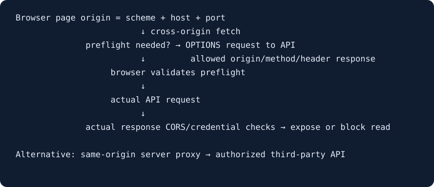

# W379. Understanding Cross-Origin Issues and Their Solutions

**Priority group:** Fourth 100 — role-dependent depth

**Category:** Configuration, identity and authorization

**Study position:** 379 of 547

[Group list](../FOURTH_100.md) · [All categories](../ALL_CATEGORIES.md) · [Chapter guide](../README.md)

## Question

Understanding Cross-Origin Issues and Their Solutions

palo-alto-networks

Please explain what is cross-origin and describe several solutions to cross-origin issues. What are the main aspects involved in cross-origin?

## Worked solution

<!-- architecture:W379:start -->
### Architecture and request flow

[Open the diagram](../diagrams/W379_final_architecture.svg). CORS is enforced by the browser. A passing preflight does not remove the need for the actual response's correct headers, and credentialed requests cannot use an arbitrary wildcard origin. Server authorization and CSRF protection remain separate; DNS changes and disabling browser security do not solve the application contract.
<!-- architecture:W379:end -->

### Origin, site and the browser boundary

An origin is scheme+host+effective port: `https://app.example:443` and `https://app.example` match, while HTTP versus HTTPS, another port or `api.example` are cross-origin. “Same site” for cookie policy is a different notion. The browser's same-origin policy restricts script access to cross-origin resources; CORS is a server-controlled permission for selected browser reads, not authentication and not a firewall for curl or another backend.

A cross-origin JSON POST usually preflights with OPTIONS carrying Origin, Access-Control-Request-Method and requested headers. Server checks an allowlist and responds with exact permitted origin, methods/headers and, if needed, Access-Control-Allow-Credentials: true; the actual response also needs its CORS headers. Credentialed reads cannot use wildcard allow-origin. `Vary: Origin` avoids a cache incorrectly reusing one origin's response. These mechanics are defined in the [Fetch CORS protocol](https://fetch.spec.whatwg.org/#http-cors-protocol).

### Solutions depend on who owns the API

If both frontend/backend are controlled, prefer same-origin routing such as `/api` behind a reverse proxy, or configure explicit production/dev origin allowlists at the API/gateway. Preserve real resource authorization and prevent an open proxy. If cross-origin API access is intentional, allow only needed methods/headers and expose response headers the client requires; handle preflight without demanding a missing application cookie while still restricting which cross-origin request is permitted. Avoid reflecting arbitrary Origin values as trusted.

Cookies require compatible credentials mode plus Secure/SameSite policy; third-party-cookie blocking may still prevent an intended embedded session. OAuth redirects/token-based API auth or a same-origin backend-for-frontend may fit better. CORS does not prevent every cross-site write: simple form requests can reach a server even when scripts cannot read the response, so protect state changes with CSRF defenses and authorization. A JSONP workaround executes remote script and has obsolete/security-limited semantics; disabling browser security or `mode:no-cors` is not a production fix for reading a protected API.

### Diagnose the actual failure

Inspect browser network errors, Origin, preflight request/response, redirect chain, allowed methods/headers, credentials and cache variation. A DNS/TLS failure or HTTP401 is not repaired by adding allow-origin. Test exact allowed/denied origins, preflight and actual responses, error responses, credential mode and CDN cache keys. Example: a React app on `localhost:3000` calling `localhost:8000` is cross-origin because the ports differ; a dev proxy can unify it without changing backend access control. Keep server-side identity/resource policy independent of browser response-sharing policy.

### Further study

- [F079: Defend an LLM application against prompt injection.](../08_rag_and_agents.md#f079)
- [F170: Design a cache without serving incorrect data.](../17_distributed_systems_depth.md#f170)
