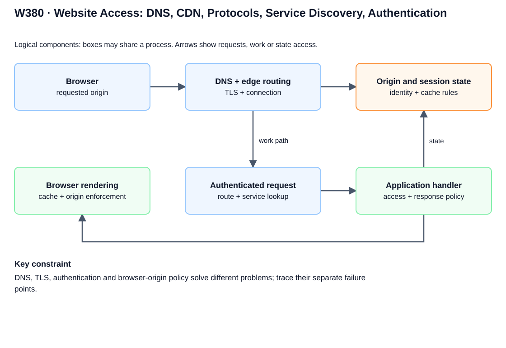

# W380. Website Access: DNS, CDN, Protocols, Service Discovery, Authentication

**Priority group:** Fourth 100 — role-dependent depth

**Category:** Configuration, identity and authorization

**Study position:** 380 of 547

[Group list](../FOURTH_100.md) · [All categories](../ALL_CATEGORIES.md) · [Chapter guide](../README.md)

<span class="practice-page"></span>

## Question

Website Access: DNS, CDN, Protocols, Service Discovery, Authentication

Explain, end to end, what happens in the background when a user opens a website (for example www.example.com) in a browser, and go deep on the infrastructure that makes it work.

Questions to answer
1. End-to-end flow: list the steps from typing the URL to the rendered page (caches, name resolution, connection setup, request, response, rendering).
2. DNS: what is the role of the Domain Name System, and how does a name get resolved to an IP address (resolvers, hierarchy, caching and TTL, record types)?
3. CDN: what does a Content Delivery Network do, how are users routed to a nearby edge, and what happens on a cache hit versus a miss?
4. Protocols: how do the components communicate (HTTP, HTTPS/TLS, HTTP/2 and HTTP/3), and what is typically used between backend services?
5. Service discovery: what problem does it solve, what are the client-side and server-side models, and what are concrete examples?
6. Authentication and authorization: how do common mechanisms (sessions, tokens, OAuth/OpenID Connect, mTLS) protect access rights?
Deliverable

A structured verbal walkthrough, with a diagram of the request path (client -&gt; DNS -&gt; CDN edge -&gt; load balancer -&gt; services -&gt; data store). Cover every area briefly, then pick one area and explain it in depth, including at least one trade-off (for example sessions vs. JWTs, GeoDNS vs. anycast, client- vs. server-side discovery).

## Worked solution

<!-- architecture:W380:start -->
### Architecture and request flow



[Open the diagram at full size](../diagrams/W380_architecture.svg). This is a baseline component diagram for this question. The boxes describe responsibilities; they do not require a separate microservice for every box.

- **Request and state:** Browser — requested origin → DNS + edge routing — TLS + connection. That component consults or updates **Origin and session state — identity + cache rules** under the required access and consistency rules.
- **Work and result:** the work path passes through **Authenticated request — route + service lookup** and **Application handler — access + response policy**, producing **Browser rendering — cache + origin enforcement**. Bound waiting and retries where a slow dependency can stall this path.
- **Correctness point:** DNS, TLS, authentication and browser-origin policy solve different problems; trace their separate failure points.

When explaining the drawing, trace one normal request first, then a duplicate request, an unavailable dependency and recovery from saved state. If the question requires stricter guarantees or a different scope, state the change explicitly rather than treating this baseline as the only possible design.
<!-- architecture:W380:end -->

### Request path, with DNS outside the HTTP data path

```text
Browser --DNS question--> Recursive resolver -> Root/TLD/authoritative DNS
Browser --HTTPS--------> CDN edge -> Load balancer -> Service -> Data store
                                                   |-> discovered downstream service
Browser <--------------- status/headers/body <-------------------------
                    DOM/CSS/script/layout/paint
```

Parse URL and check HSTS, service worker and HTTP cache; fragments are not sent to the server. Resolve hostname if no valid cached answer/connection exists. Connect or reuse a connection, negotiate TLS/protocol, send method/path/query/headers/cookies/body, follow valid redirects and process response. HTML parsing discovers CSS/scripts/images, which may reuse connections or fetch other origins; build DOM/CSSOM, execute scripts, layout, paint/composite and update accessibility/interactivity. A page can remain slow after a fast first byte because of JavaScript/layout.

### DNS and CDN

The stub resolver asks a recursive resolver, which caches and follows root/TLD/authoritative delegations for A/AAAA addresses, CNAME aliases and other relevant records. TTL and negative caching bound ordinary reuse; changing a record does not instantly invalidate all caches. DNSSEC authenticates signed DNS data when validated, not application user identity; encrypted resolver transport is a separate privacy boundary.

CDN routing can useGeoDNS or anycast. DNS location/caching may not represent the exact user; anycast follows network routing and is not a guarantee of best application latency. Edge cache keys include permitted URL/query/header variations and respect freshness/Cache-Control/Vary. A hit can avoid the origin; a miss may coalesce concurrent fetches, request origin through the balancer, then store only cacheable responses. Never share a personalized authorized response under a public URL-only cache key.

### Protocols, discovery and access

HTTP/1.1 and HTTP/2 commonly use TLS overTCP; HTTP/2 multiplexes streams on a connection but TCP loss can delay them together. HTTP/3 usesQUIC overUDP with integrated TLS1.3 and stream-level transport behavior, with deployment/firewall trade-offs. Backend calls may be HTTP/JSON, gRPC, SQL/wire protocols or durable messages; choose by latency/schema/streaming/async semantics and propagate deadlines/traces with bounded safe retries.

Service discovery maps a logical service to dynamic healthy endpoints: client-side registry/SDK selects one; server-side proxy/load balancer selects for the client. Kubernetes serviceDNS plus service routing and a registry-backed proxy are concrete patterns. Endpoint registration/health/TTL/draining determine stale-target behavior; publicDNS and internal discovery are related mechanisms at different layers.

Sessions map a secure cookie to server-side identity, state and revocation. JWT access tokens carry signed claims but still need issuer/audience/expiry/key/authorization checks; revocation is less immediate without lookup. OAuth grants delegated API access; OIDC adds user identity to a relying party. mTLS authenticates service/device certificates, not automatically the end user's right to a record. Apply resource authorization in services/database, not only an edge login check.

### Deep dive: sessions versus self-contained tokens

A server session is easy to revoke and keep small in the browser, but needs a highly available shared store/cache or bounded local caching. A self-contained token reduces that lookup and can work across replicas, but stale privilege/revocation can last until expiry unless introspection/denylist/epoch checks are added; large tokens also add every-request bytes. Choose short-lived audience-scoped access tokens plus explicit refresh/session control when needed. In both cases protect against theft/XSS/CSRF under the chosen storage/transport and rotate keys/session ids safely. Trace an expired session, a stale DNS record and an origin timeout separately; they fail at different parts of the same path.

### Further study

- [F165: Design idempotency for an order or booking API.](../17_distributed_systems_depth.md#f165)
- [F170: Design a cache without serving incorrect data.](../17_distributed_systems_depth.md#f170)
