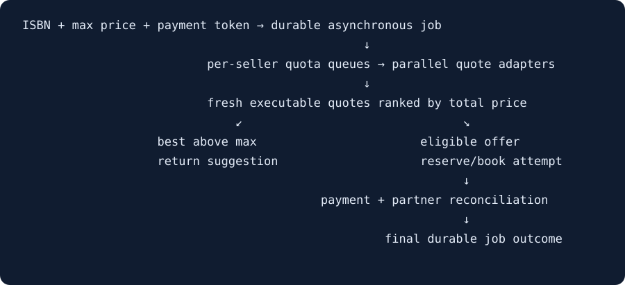

# W381. Book Seller External Fan-Out Broker Service

**Priority group:** Fourth 100 — role-dependent depth

**Category:** Crawling and fan-out pipelines

**Study position:** 381 of 547

[Group list](../FOURTH_100.md) · [All categories](../ALL_CATEGORIES.md) · [Chapter guide](../README.md)

## Question

Design a broker service that helps customers buy books at the cheapest price. The service does not sell books directly; it fans out to many partner bookstores to find the best deal.

Flow
1. A customer sends a request with: Book ID (ISBN), the maximum price they'll pay (Max Price), and payment details (credit card).
2. The service asks 50-200 partner seller APIs for their prices, finds the lowest, and:
If Low Price ≤ Max Price: it orders the book and charges the customer.
If the lowest price exceeds Max Price: it returns the lowest quote it found as a suggestion.

Scale & constraints

1-2 million unique books; 50-200 seller APIs.
End-to-end latency SLA: 10-20 seconds. Requests are asynchronous (return a job id, notify when done).
Must avoid overwhelming partner APIs.

Discuss: parallel quoting without exceeding per-seller rate limits, circuit breakers / backoff, handling sold-out inventory (try cheapest-to-most-expensive), when to charge the customer, quote expiry, and scaling to 10,000 sellers.

## Worked solution

<!-- architecture:W381:start -->
### Architecture and request flow

[Open the diagram](../diagrams/W381_final_architecture.svg). Quote fan-out obeys per-seller budgets, circuit breakers and the job deadline. Purchase is a separate idempotent state machine: revalidate/reserve the offer, keep the accepted total within Max Price, and reconcile uncertain seller/payment effects. A lost response never starts an unrelated second purchase.
<!-- architecture:W381:end -->

### Separate quote discovery from one durable purchase

`POST /book-purchase-jobs` accepts ISBN, edition/condition, shipping destination, max all-in price/currency and a payment **token**, not raw card storage, plus idempotency key. Return 202/job id; status and signed callback/poll expose quoting, selecting, authorizing, booking, capturing, completed, suggestion, failed or unknown. Store Request, PartnerQuota/Health, Offer(seller, ISBN, condition, total, currency, expires_at, inventory_token), PurchaseAttempt and payment/order operation ids. Quoted base price alone is not the comparable delivered cost; include shipping/tax/FX rules agreed with the customer.

### Fan out within partner and end-to-end budgets

For 50–200 sellers, use async adapters with per-seller distributed token buckets/concurrency caps, deadline and circuit breaker, not 200 unbounded retries per customer. For a chosen 15 s job budget, allow e.g. 5 s quoting, 2 s selection/authorization and 8 s booking/payment/reconciliation setup; actual partner latencies must validate it. Cache short-lived ISBN/destination/condition offer lookups, coalesce identical in-flight requests and respect expiry. Circuit-break unhealthy sellers with half-open probes; retries use jitter and remaining deadline/quota.

Sort valid offers by all-in price then stable seller id. If the best observed quote exceeds max, return it as a suggestion without charging. If an unresponsive seller might be cheaper, the system can only claim “lowest among responding sellers” with coverage/time; a guaranteed cheapest-of-all contract conflicts with a hard deadline during seller failure. State whether partial coverage is acceptable or fail the job instead of claiming a global minimum.

### Sold-out and payment race

Revalidate/hold the cheapest still-valid offer and price≤max. Authorize a payment hold under one stable payment id, then place the seller order with an idempotent purchase id and reservation/quote token; capture only after seller confirms the accepted order/price. If sold out, try the next-cheapest eligible offer within remaining budget, max and authorization constraints. Never order from two sellers because the first timed out: query/reconcile its operation status before switching. If seller cannot offer idempotency/status, stop an uncertain attempt for resolution rather than promise no duplicate purchase.

If all sellers fail, void the hold. If order succeeds but capture fails, retry/reconcile the same capture and cancel the order under agreed compensation policy if necessary; track manual/unknown states because no local transaction spans both external systems. Creation retry returns the same job and operation ids. Notify completion only after the chosen fulfillment/payment boundary; provider acceptance is not delivery of a book.

At 10k sellers, full fanout per user becomes too expensive even if technically concurrent. Maintain a freshness-scored offer/catalog index from feeds/periodic quotas, select likely available competitive candidates and live-requote a bounded set; expand under an explicit best-known-price contract. Per-seller queues, bulk quote APIs and regional caches protect partners. Measure quote coverage/age, job p95, partner 429/timeouts, order/capture unknowns, duplicate purchases and cost; fault-test expiry, sold-out after quote and crash after seller order before local commit. The diagram must include durable booking/payment reconciliation, not stop after merging prices.

### Further study

- [F090: Design a rate-limited LLM classification pipeline.](../09_ml_system_design.md#f090)
- [F169: Explain backpressure in a multi-stage data pipeline.](../17_distributed_systems_depth.md#f169)
