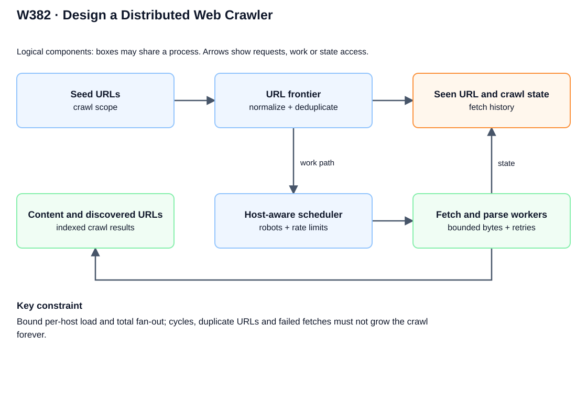

# W382. Design a Distributed Web Crawler

**Priority group:** Fourth 100 — role-dependent depth

**Category:** Crawling and fan-out pipelines

**Study position:** 382 of 547

[Group list](../FOURTH_100.md) · [All categories](../ALL_CATEGORIES.md) · [Chapter guide](../README.md)

## Question

Design a distributed web crawler at scale (sometimes framed as a Google Flight price aggregator, where 'URLs' become route queries and dedup is on price snapshots).

Functional: crawl billions of URLs, extract content and links, deduplicate, and store for indexing. Scale ~1B URLs/day, ~10 KB avg page (~10 TB/day new content), per-domain rate limits. Cover the URL frontier, scheduling, dedup, storage, politeness, and failure handling. Expect a follow-up: 'now crawl JavaScript-rendered pages.'

## Worked solution

<!-- architecture:W382:start -->
### Architecture and request flow

[Open the diagram at full size](../diagrams/W382_architecture.svg). This is a baseline component diagram for this question. The boxes describe responsibilities; they do not require a separate microservice for every box.

- **Request and state:** Seed URLs — crawl scope → URL frontier — normalize + deduplicate. That component consults or updates **Seen URL and crawl state — fetch history** under the required access and consistency rules.
- **Work and result:** the work path passes through **Host-aware scheduler — robots + rate limits** and **Fetch and parse workers — bounded bytes + retries**, producing **Content and discovered URLs — indexed crawl results**. Bound waiting and retries where a slow dependency can stall this path.
- **Correctness point:** Bound per-host load and total fan-out; cycles, duplicate URLs and failed fetches must not grow the crawl forever.

When explaining the drawing, trace one normal request first, then a duplicate request, an unavailable dependency and recovery from saved state. If the question requires stricter guarantees or a different scope, state the change explicitly rather than treating this baseline as the only possible design.
<!-- architecture:W382:end -->

### Budget the crawl and own the frontier

1B URLs/day ≈ 11,574 fetches/s; 10 KB/page gives 10 TB/day decimal raw content (~116 MB/s average), excluding headers, replicas, links and indexes. At an assumed 1 s fetch latency need ≈ 11.6k concurrent requests before headroom; per-domain politeness and host diversity can dominate that capacity. `POST /crawls` freezes seeds/scope/agent/policy; status/cancel APIs expose counts and errors. Store URL(normalized key, host, state, next_fetch, lease, attempt), Fetch(version, status, ETag, modified, hash, blob_ref), HostPolicy(robots, next_allowed, backoff) and discovered edges.

Normalize scheme/host/default ports, resolve relative links and drop fragments under explicit rules; do not blindly reorder/remove query parameters that may change content. Atomically insert/claim a unique URL key so concurrent discovery yields one logical frontier task. Content hashing can dedup identical bodies after fetch; near duplicates need reviewed similarity policy and do not erase distinct URLs/provenance.

### Host-aware scheduling and durable workers

Use host queues plus a global next-eligible-time priority index; one authoritative host scheduler/rate token owner coordinates all workers. Cache robots rules and honor allowed scopes/user-agent policy; robots is not authentication. Partition host ownership with leases/fencing, backoff on 429/5xx/DNS errors and obey retry hints. Fetch with connect/read/total deadlines, response/decompression/body-size caps, redirect hop limit and per-hop scope/host checks. Reject private/internal destinations under the public-crawl scope and recheck DNS/redirect targets against rebinding/SSRF.

Workers claim leased tasks, resolve/fetch, write immutable body+metadata, parse under bounded resources, then atomically mark completion and outbox discovered URLs. A crash after blob upload can orphan an object for cleanup; it must not lose the frontier task or double-publish indexing effects. Distinguish terminal 404/disallowed/invalid URLs from transient retries; dead-letter persistent parse errors. Bounded frontier depth/parameter-trap policies and budgets make a practical crawl finite while reporting omitted coverage.

### JavaScript pages are an expensive separate tier

Try ordinary HTTP/HTML parsing first; route identified JS-dependent pages to isolated headless-browser workers with no privileged network/cookies, limited tabs/scripts/memory/time and a precise DOM-ready/network-idle/budget stopping rule. Capture rendered DOM/outgoing links and versioned render configuration. Rendering cannot wait for “no activity forever” on live pages; HTTP-only and rendered versions may differ and need provenance. Browser work can cost orders more CPU/RAM than fetching, so cap/cost-schedule it and measure additional useful coverage.

Archive content in object storage with compact metadata/index queues and source timestamps. Checkpoint frontier/host policies, monitor fetch/parse/index lag, bandwidth, politeness violations, DNS failures, dup/trap rate and bytes per useful page. During downstream backlog, slow fetching before storage fills; resume after restart from durable tasks, not a local visited set. A flights variant replaces URL identity with normalized route/date/passenger query and snapshot validity; use provider quotas and quote freshness rather than pretending a price is immutable HTML.

### Further study

- [F166: Design a token-bucket rate limiter.](../17_distributed_systems_depth.md#f166)
- [F169: Explain backpressure in a multi-stage data pipeline.](../17_distributed_systems_depth.md#f169)
