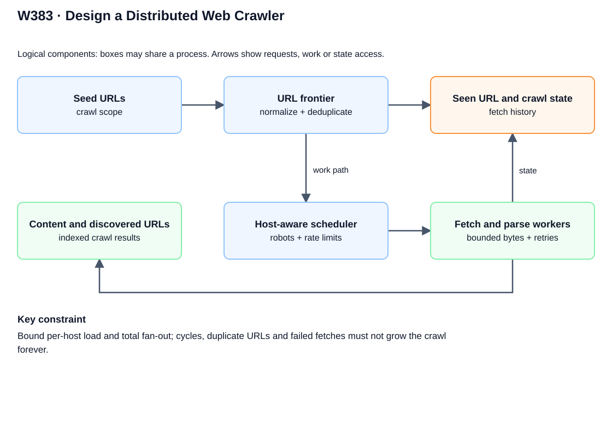

# W383. Design a Distributed Web Crawler

**Priority group:** Fourth 100 — role-dependent depth

**Category:** Crawling and fan-out pipelines

**Study position:** 383 of 547

[Group list](../FOURTH_100.md) · [All categories](../ALL_CATEGORIES.md) · [Chapter guide](../README.md)

## Question

Design a distributed web crawler.

Functional

Seed the crawler with a starter URL set.
Fetch each URL, persist HTML, extract embedded links, enqueue new URLs.
Honor robots.txt per-domain and respect crawl-delay directives.
Deduplicate at the URL level and (optionally) the content level.

Non-functional

Crawl ~10B pages over ~5 days.
Per-domain politeness of ~1 req/sec.
Survive worker / DNS failures without restarting from scratch.

Describe the pipeline stages, dedup strategy, politeness enforcement, scaling, and failure handling.

## Worked solution

<!-- architecture:W383:start -->
### Architecture and request flow

[Open the diagram at full size](../diagrams/W383_architecture.svg). This is a baseline component diagram for this question. The boxes describe responsibilities; they do not require a separate microservice for every box.

- **Request and state:** Seed URLs — crawl scope → URL frontier — normalize + deduplicate. That component consults or updates **Seen URL and crawl state — fetch history** under the required access and consistency rules.
- **Work and result:** the work path passes through **Host-aware scheduler — robots + rate limits** and **Fetch and parse workers — bounded bytes + retries**, producing **Content and discovered URLs — indexed crawl results**. Bound waiting and retries where a slow dependency can stall this path.
- **Correctness point:** Bound per-host load and total fan-out; cycles, duplicate URLs and failed fetches must not grow the crawl forever.

When explaining the drawing, trace one normal request first, then a duplicate request, an unavailable dependency and recovery from saved state. If the question requires stricter guarantees or a different scope, state the change explicitly rather than treating this baseline as the only possible design.
<!-- architecture:W383:end -->

### The target implies a host-diversity constraint

10B pages/(5·86400)≈**23,148 pages/s**. With at most 1 request/s/domain, you need at least ~23,148 concurrently productive independent domain budgets to sustain that rate; 1000 machines do not bypass a single domain's allowance. Page size was not given: at a chosen 50 KB/page, content is 500 TB total (~1.16 GB/s average) before replication/metadata. Measure fetch latency L to size concurrency ≈ 23,148L; network/parser/storage and source availability must also fit.

Seed a durable frontier with unique normalized URLs. Store URL identity, domain, next eligible fetch, state, attempt/lease and last response metadata; archive immutable HTML bodies by hash/version and discovered link edges separately. Normalize only safe equivalences, resolve relative links, strip fragments and preserve meaningful query differences. Unique URL insert/lease protects against concurrent repeats; optional body hash dedup preserves all URL → body mappings.

### Enforce politeness before dispatch

Maintain per-domain URL queues and one authoritative next_allowed/robots policy per domain, distributed by consistent host partitioning. Global workers ask for ready domains rather than sleep independently and accidentally exceed a shared limit. Next start≥last start+max(1 s, recognized crawl-delay policy); also limit concurrent requests if a prior slow request is still in flight. Robots rules, cache/error behavior follow a versioned policy; `crawl-delay` is a requested extension here, not a directive standardized by [RFC9309](https://www.rfc-editor.org/rfc/rfc9309.html). Recheck redirects against each target domain's scope/budget.

Fetch with DNS/connect/read/size/decompression/redirect bounds, parse HTML/links under resource limits, write content/metadata and commit newly discovered links through an outbox. Leased task state is queued → claimed → fetched/parsed → completed or retry_wait/permanent_failure. Idempotent blob/index keys and completed-version checks prevent replay duplicating derived content. DNS timeouts/SERVFAIL and transient 5xx get bounded backoff; 404/disallowed and persistent errors have explicit terminal states. A DNS negative cache means retry later per policy, not restart all work.

### Survive failures without losing accounting

Persist frontier, seen identities, host rate/robots state and offsets; on worker loss reclaim expired lease with fencing. If a fetch completed but ack was lost, refetch may occur (physical at-least-once), but content/index effects remain idempotent. Host owners failover conservatively using persisted next_allowed plus clock margin; two owners must not independently spend the same 1/s budget. Large hosts are a scheduling skew issue; more fetchers cannot break politeness. Sparse/blocked hosts may make 5-day coverage infeasible, which must be reported rather than hiding violations.

Use replicated log/metadata and object storage, partition crawl/index loads, cap frontier expansion and detect calendar/session/query traps. Expose progress by distinct discovered, eligible, successful, permanent failed, retry/inflight and uncovered; “all done” requires no leased/retry/discovery work at the chosen closed crawl boundary. Test duplicate discovery, worker crash, DNS failure, robots change, redirect loop and host owner failover; monitor 23k/s target against politeness, tail latency, queue age, storage bandwidth and coverage.

### Further study

- [F166: Design a token-bucket rate limiter.](../17_distributed_systems_depth.md#f166)
- [F169: Explain backpressure in a multi-stage data pipeline.](../17_distributed_systems_depth.md#f169)
