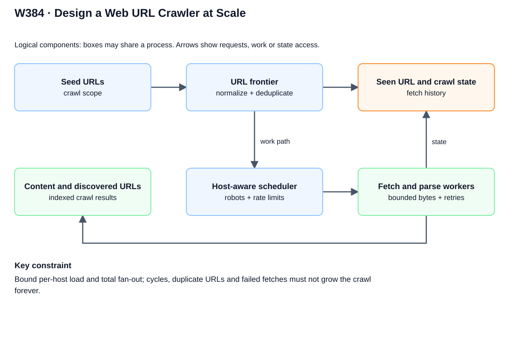

# W384. Design a Web URL Crawler at Scale

**Priority group:** Fourth 100 — role-dependent depth

**Category:** Crawling and fan-out pipelines

**Study position:** 384 of 547

[Group list](../FOURTH_100.md) · [All categories](../ALL_CATEGORIES.md) · [Chapter guide](../README.md)

<span class="practice-page"></span>

## Question

You are given two helper functions:

fetch_page(url) -&gt; str: returns the text content of a web page.
parse_urls(content) -&gt; list[str]: returns the outgoing URLs found on that page.

Design a system to crawl links, in three parts:
1. Basic crawling — Start at a given start_url. Find all reachable URLs that belong to the same domain (hostname equals the start URL's hostname). Do not process the same URL twice. BFS or DFS is fine.
2. Scaling up — What if the site has millions of URLs? Make it fast and safe under concurrency.
3. Failure handling — fetch_page or parsing may fail (timeouts, 5xx, temporary blocks). Keep the crawler from crashing.

## Worked solution

<!-- architecture:W384:start -->
### Architecture and request flow



[Open the diagram at full size](../diagrams/W384_architecture.svg). This is a baseline component diagram for this question. The boxes describe responsibilities; they do not require a separate microservice for every box.

- **Request and state:** Seed URLs — crawl scope → URL frontier — normalize + deduplicate. That component consults or updates **Seen URL and crawl state — fetch history** under the required access and consistency rules.
- **Work and result:** the work path passes through **Host-aware scheduler — robots + rate limits** and **Fetch and parse workers — bounded bytes + retries**, producing **Content and discovered URLs — indexed crawl results**. Bound waiting and retries where a slow dependency can stall this path.
- **Correctness point:** Bound per-host load and total fan-out; cycles, duplicate URLs and failed fetches must not grow the crawl forever.

When explaining the drawing, trace one normal request first, then a duplicate request, an unavailable dependency and recovery from saved state. If the question requires stricter guarantees or a different scope, state the change explicitly rather than treating this baseline as the only possible design.
<!-- architecture:W384:end -->

### A concrete same-host crawler using the supplied helpers

Breadth-first exploration records each normalized URL when enqueueing, not after fetching, so cycles/duplicate discoveries create one logical task. Hostname must equal the start hostname; `evilsite.test` is not a match for`site.test`. Keep meaningful paths/queries, resolve relative links and remove fragments as chosen safe page identity. Retry fetch andparse independently with a bounded attempt budget, andreturn both discovered URLs and explicit failures ratherthan crash the whole crawl.

```python
from collections import deque
from urllib.parse import urlsplit, urlunsplit, urljoin, urldefrag


def crawl(start_url, fetch_page, parse_urls, max_attempts=3):
    if max_attempts < 1:
        raise ValueError("positive attempts required")

    def canonical(url):
        parts = urlsplit(urldefrag(url)[0])
        if (
            parts.scheme.lower() not in ("http", "https")
            or not parts.hostname
            or parts.username is not None
        ):
            return None
        host = parts.hostname.lower()
        netloc = ("[" + host + "]") if ":" in host else host
        if parts.port is not None:
            netloc += ":" + str(parts.port)
        return urlunsplit(
            (parts.scheme.lower(), netloc, parts.path or "/", parts.query, "")
        )

    start = canonical(start_url)
    if start is None:
        raise ValueError("valid HTTP(S) start required")
    hostname = urlsplit(start).hostname
    seen = {start}
    queue = deque([start])
    errors = {}
    while queue:
        url = queue.popleft()
        content = None
        last_error = None
        for _ in range(max_attempts):
            try:
                content = fetch_page(url)
                break
            except Exception as exc:
                last_error = exc
        if content is None:
            errors[url] = f"fetch_failed: {type(last_error).__name__}"
            continue
        links = None
        for _ in range(max_attempts):
            try:
                links = list(parse_urls(content))
                break
            except Exception as exc:
                last_error = exc
        if links is None:
            errors[url] = f"parse_failed: {type(last_error).__name__}"
            continue
        for link in links:
            if not isinstance(link, str):
                continue
            try:
                target = canonical(urljoin(url, link))
            except (ValueError, TypeError):
                continue
            if (
                target is not None
                and urlsplit(target).hostname == hostname
                and target not in seen
            ):
                seen.add(target)
                queue.append(target)
    return {"urls": sorted(seen), "errors": errors}


if __name__ == "__main__":
    graph = {
        "https://site.test/": [
            "/a",
            "https://evilsite.test/a",
            "/a#x",
            "/bad",
            "/parse",
        ],
        "https://site.test/a": ["/", "https://site.test/b"],
        "https://site.test/b": [],
    }
    calls = {}

    def fetch(url):
        calls[url] = calls.get(url, 0) + 1
        if url.endswith("/bad"):
            raise TimeoutError()
        if url.endswith("/parse"):
            return "unparseable"
        if url.endswith("/a") and calls[url] == 1:
            raise TimeoutError()
        return url

    def parse(content):
        if content == "unparseable":
            raise ValueError("bad document")
        return graph[content]

    result = crawl("https://SITE.test", fetch, parse)
    assert result["urls"] == [
        "https://site.test/",
        "https://site.test/a",
        "https://site.test/b",
        "https://site.test/bad",
        "https://site.test/parse",
    ]
    assert (
        len(result["errors"]) == 2
        and calls["https://site.test/a"] == 2
        and calls["https://site.test/"] == 1
    )
    assert not any("evil" in url for url in calls)
    print(
        "W384: same-host BFS, cycles/fragments, exact logical dedup and fetch/parse failures passed"
    )
```

### Read the output and scale the right boundary

The fixture discovers five same-host URLs, fetches no evil host, visits the root once, recovers one transient fetch and reports one persistent fetch/one parse failure. Discovered-but-failed URLs remain in the result's explicit errors; no algorithm can discover their unknown outgoing links without a successful parse. The supplied fetch helper exposes no timeout/redirect controls, so its production adapter must enforce deadlines, body limits, redirect target scope and safe DNS destinations; catching an exception cannot stop a helper that hangs forever.

With V unique discovered URLs, E links and bounded retry R, time is O(R·fetch/parse work+V+E) apart from URL-string operations, and memory O(V+frontier+error output). The sequential reference has no threads; to scale use bounded async/thread pool fetches, atomic check-and-enqueue under one cooperating lock or unique DB claim, and per-host start/concurrency quotas. Never hold the central visited lock during network IO. Across processes use a durable frontier/unique URL key, leases, fencing and idempotent completion/outbox; a local set only deduplicates one process. Stream/archive parsed results and frontier partitions for millions of URLs, monitor backlog/errors and use backpressure. Logical no-duplicate processing is compatible with bounded physical retry after failure; strict never-refetch would sacrifice recovery.

### Further study

- [F166: Design a token-bucket rate limiter.](../17_distributed_systems_depth.md#f166)
- [F169: Explain backpressure in a multi-stage data pipeline.](../17_distributed_systems_depth.md#f169)
