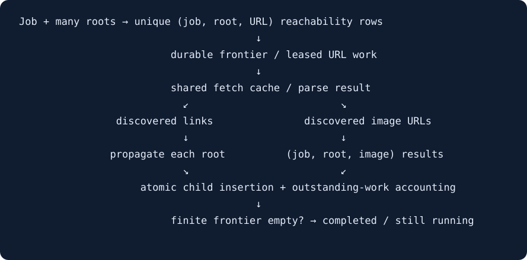

# W385. Image Link Crawler Service

**Priority group:** Fourth 100 — role-dependent depth

**Category:** Crawling and fan-out pipelines

**Study position:** 385 of 547

[Group list](../FOURTH_100.md) · [All categories](../ALL_CATEGORIES.md) · [Chapter guide](../README.md)

## Question

Design a service that accepts one or many root URLs, crawls pages and sublinks, extracts image links, and lets clients query job status and discovered images. The design is framed around API shape, persistence, failure handling, and knowing when crawling is complete.

### Requirements

Clients submit one or more root URLs to start an image-crawling job.
The service crawls pages and sublinks, extracts image URLs, and associates each discovered image with the top-level root URL.
Clients can query job status (e.g. in_progress or completed).
Clients can fetch the image links found for a submitted URL.
Design for unlimited root URLs and unlimited crawl depth.
Discuss how to know when sublinks are exhausted (one approach compares discovered sublink counts against completed counts).
Notes
Some variants explicitly do not store HTML text, only image URLs.
The strongest answers spend time on database schema, task scheduling, retry/failure handling, duplicate URLs, and API design rather than only crawler workers.

## Worked solution

<!-- architecture:W385:start -->
### Architecture and request flow

[Open the diagram](../diagrams/W385_final_architecture.svg). One fetched page may serve many roots, but each root's reachability and image provenance must still propagate. Insert newly discovered child work before decrementing the parent's outstanding work in the same atomic boundary. An unbounded or continuously growing graph cannot honestly be reported complete merely because a queue was momentarily empty.
<!-- architecture:W385:end -->

### Model roots and traversal provenance explicitly

`POST /image-crawl-jobs` accepts root batches and returns 202/jobid; for logically unbounded input add paginated`POST /jobs/{id}/roots` and`POST /jobs/{id}/close-input`. `GET /jobs/{id}` returns queued/running/completed/completed_with_errors/canceled counts and coverage; `GET /jobs/{id}/roots/{root_id}/images?cursor=` returns discovered image URLs with source pages. URLs/depth have no fixed product cap, but finite CPU/storage and an infinite/generated web graph mean completion is not guaranteed; support quotas/backpressure/pause/cancel without silently declaring a truncated crawl complete.

Store Job(input_closed, state), Root(job, root_url), Fetch(url, version, state, lease, attempt), PageEdge(parent, child),
`RootPage(root_id,page_url UNIQUE,state)` and`RootImage(root_id,image_url UNIQUE,source_page)`. URL normalization/relative image and sublink resolution preserve meaningful queries; page cycles and duplicate images do not multiply results. The HTML can be transient if only links are stored; persist edges/image associations and fetch metadata, but not claim an archive of the HTML.

### One fetch can serve many roots, but root traversal cannot be forgotten

Dedup network fetches globally per job/version via Fetch and cache parsed links. Dedup reachability per (root, page). If root A and root B both reach page X, fetch X once but propagate X's images and sublinks for **both roots**. A global visited set that stops B at traversed X loses B's descendant image associations. Root membership propagation through stored edges can be queued/idempotent; alternative per-root fetching is simpler but duplicates network work.

### Completion requires atomic outstanding-work accounting

For each root keep outstanding unique tasks=queued+leased+retry_wait+pending provenance expansion. In one DB transaction, a page completion inserts new RootPage children with unique constraints, increments outstanding only for new children, persists images/edge/outbox, then marks parent terminal and decrements its one unit. Completion is allowed only when input is closed and outstanding=0 with no discovery/expansion in flight. Comparing “links discovered” with “pages completed” without these atomic boundaries races with a worker about to enqueue children. Terminal permanent failure can reduce the counter but produces completed_with_errors, not complete coverage. A job with open roots input or infinite unique URLs remains active.

Workers have leases, bounded timeouts/retries, robots/per-host quotas, redirect/body bounds and safe egress; retries reuse (root, page)/attempt identity. On crash after writing images before ack, unique associations and transactional completion prevent double decrement or increment. Reclaim leases with fencing and persist frontier/checkpoints so job status survives restart. Page content changes during crawl are versioned and the claim is reachability in the observed fetch graph, not a simultaneous full internet snapshot.

Scale assumption 1M roots/day, 100 pages/root at 20 KB transient HTML is 100M fetches/day ≈ 1157/s and 2 TB/day network, with actual overlap/graph sizes dominating. Partition fetch by host for politeness and root provenance by root id, store images in indexed relational/KV set tables with pagination, and cache completed result pages. Monitor outstanding age, root coverage, fetch dedup hit, provenance fanout, retry/errors and completion stalls. Test two roots sharing a child, a cycle, worker crash during new child commit, a permafail and never-closed input.

### Further study

- [F166: Design a token-bucket rate limiter.](../17_distributed_systems_depth.md#f166)
- [F169: Explain backpressure in a multi-stage data pipeline.](../17_distributed_systems_depth.md#f169)
