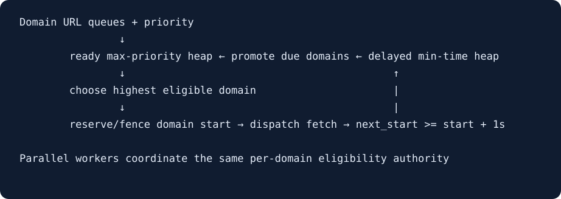

# W386. Priority-Based Rate-Limited Web Crawler Design

**Priority group:** Fourth 100 — role-dependent depth

**Category:** Crawling and fan-out pipelines

**Study position:** 386 of 547

[Group list](../FOURTH_100.md) · [All categories](../ALL_CATEGORIES.md) · [Chapter guide](../README.md)

<span class="practice-page"></span>

## Question

Design a Web Crawler with the following requirements:

Each domain can be crawled at most once per second.
Different domains have different priorities.
Ensure that higher-priority domains are processed first.
Example

### Input

domain1 2
domain2 1
domain3 3

Each line is domain priority; higher priority is served first, subject to the per-domain once-per-second rate limit.

## Worked solution

<!-- architecture:W386:start -->
### Architecture and request flow



[Open the diagram](../diagrams/W386_final_architecture.svg). A high-priority domain that is not yet eligible cannot be fetched early. Choose the highest priority only among currently eligible domains, then move that domain to the delayed heap until its next permitted start. Store/fence the per-domain reservation so concurrent workers do not violate the one-start-per-second limit.
<!-- architecture:W386:end -->

### Choose highest priority among currently eligible domains

Maintain a FIFO URL queue/domain, priority, monotonic next_allowed, a ready max-priority heap and a delayed min-time heap. Before each dispatch, promote every domain whose next_allowed≤now, then pop highest priority ready domain (ties here use lexical domain). After starting one fetch, set that domain's next_allowed=now+1 and delay its remaining work. Do not block all workers waiting for high-priority domain3's cooldown when eligible lower-priority domains can run.


```python
import heapq
from collections import deque


class PriorityCrawlerScheduler:
    def __init__(self, priorities):
        self.priorities = dict(priorities)
        self.queues = {d: deque() for d in priorities}
        self.next_allowed = {d: float("-inf") for d in priorities}
        self.state = {d: "idle" for d in priorities}
        self.ready = []
        self.delayed = []

    def submit(self, domain, url, now):
        if domain not in self.queues:
            raise ValueError("unknown domain")
        self.queues[domain].append(url)
        if self.state[domain] == "idle":
            if self.next_allowed[domain] <= now:
                heapq.heappush(self.ready, (-self.priorities[domain], domain))
                self.state[domain] = "ready"
            else:
                heapq.heappush(self.delayed, (self.next_allowed[domain], domain))
                self.state[domain] = "waiting"

    def take(self, now):
        while self.delayed and self.delayed[0][0] <= now:
            _, domain = heapq.heappop(self.delayed)
            heapq.heappush(self.ready, (-self.priorities[domain], domain))
            self.state[domain] = "ready"
        if not self.ready:
            return None
        _, domain = heapq.heappop(self.ready)
        url = self.queues[domain].popleft()
        self.next_allowed[domain] = now + 1.0
        if self.queues[domain]:
            heapq.heappush(self.delayed, (now + 1.0, domain))
            self.state[domain] = "waiting"
        else:
            self.state[domain] = "idle"
        return domain, url

    def next_wakeup(self):
        return None if not self.delayed else self.delayed[0][0]


if __name__ == "__main__":
    s = PriorityCrawlerScheduler({"domain1": 2, "domain2": 1, "domain3": 3})
    for d in s.priorities:
        s.submit(d, d + "/a", 0)
        s.submit(d, d + "/b", 0)
    assert [s.take(0)[0] for _ in range(3)] == ["domain3", "domain1", "domain2"]
    assert s.take(0.99) is None and s.next_wakeup() == 1.0
    assert s.take(1) == ("domain3", "domain3/b")
    assert s.take(1) == ("domain1", "domain1/b")
    assert s.take(1) == ("domain2", "domain2/b") and s.take(1) is None
    s.submit("domain3", "later", 1.1)
    assert s.take(1.9) is None and s.take(2.0) == ("domain3", "later")
    print(
        "W386: priority among eligible domains and inclusive one-second spacing passed"
    )
```

### Trace and operationalize

With priorities domain3=3, domain1=2, domain2=1 and two URLs/domain, at 0 the three eligible choices are domain3, domain1, domain2; before 1 second none can start again; at 1 the order repeats. Equality is allowed exactly at 1 second. The pure fake-clock implementation takes O(log D) heap work per start/promotion and O(queued URLs+D) storage; with idle/ready/waiting states one domain does not accrue duplicate heap entries.

A service wrapper waits on a condition/timer until work arrives or next_wakeup, then claims dispatch under a lock before IO. Per-domain limits apply across all workers; distributed host ownership or atomic rate leases prevent two schedulers spending the same slot. Fetch failures still consume the start budget, retry with backoff/robots constraints, and use at most one in flight/domain if politeness requires it. This exercise's strict priority can starve lower priority work under limited worker bandwidth; aging/weighted fairness is a policy change, not a strict priority guarantee. Persist queues/last start with conservative clock margin for failover and monitor actual start spacing, queue age and priority latency.

### Further study

- [F166: Design a token-bucket rate limiter.](../17_distributed_systems_depth.md#f166)
- [F169: Explain backpressure in a multi-stage data pipeline.](../17_distributed_systems_depth.md#f169)
