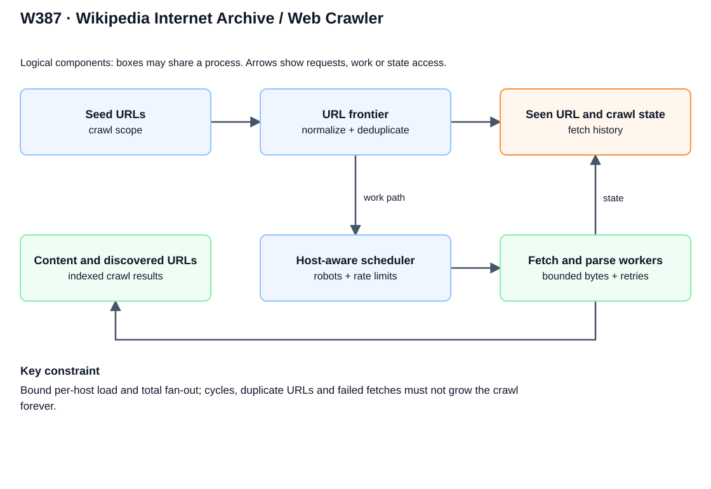

# W387. Wikipedia Internet Archive / Web Crawler

**Priority group:** Fourth 100 — role-dependent depth

**Category:** Crawling and fan-out pipelines

**Study position:** 387 of 547

[Group list](../FOURTH_100.md) · [All categories](../ALL_CATEGORIES.md) · [Chapter guide](../README.md)

## Question

Design a crawler/archive system that starts from a primary VM and roughly 1000 small bot VMs, creates an initial copy of Wikipedia-like content, and keeps the archive updated over time.

### Requirements

Start from a primary VM and around 1000 small bot VMs.
Create an initial copy of Wikipedia-like web content.
Keep the copied content updated over time.
Fetch web pages at large scale; one prompt note mentions roughly 100m pages.
Bots must parse fetched pages and discover new URLs.
Handle scheduling, deduplication, frontier management, retry, and politeness/rate control.
Store page content and metadata so updates can be detected.
Notes
Split the design into frontier service, crawler workers, parser/extractor, content store, metadata/index store, and scheduler.
A clean data flow is: pop URL from frontier, resolve/fetch, parse content, store page/blob plus metadata, extract links, normalize/dedup links, enqueue new or recrawl candidates.
The strongest design decision is how to partition URLs across 1000 bots while avoiding duplicate fetches. Consistent hashing or URL-host partitioning are natural options.
Per-host politeness belongs near scheduling, not inside ad hoc worker sleeps. Use host-level rate limits and queues so one large domain cannot starve the rest of the crawl.
Update handling can use periodic recrawl, content hashes, ETag/Last-Modified when available, and priority queues for frequently changing pages.
Candidate failures tend to come from shallow follow-up handling: bottleneck ownership, worker failure, duplicate URL explosions, and how to recover progress after a bot dies.

## Worked solution

<!-- architecture:W387:start -->
### Architecture and request flow

[Open the diagram at full size](../diagrams/W387_architecture.svg). This is a baseline component diagram for this question. The boxes describe responsibilities; they do not require a separate microservice for every box.

- **Request and state:** Seed URLs — crawl scope → URL frontier — normalize + deduplicate. That component consults or updates **Seen URL and crawl state — fetch history** under the required access and consistency rules.
- **Work and result:** the work path passes through **Host-aware scheduler — robots + rate limits** and **Fetch and parse workers — bounded bytes + retries**, producing **Content and discovered URLs — indexed crawl results**. Bound waiting and retries where a slow dependency can stall this path.
- **Correctness point:** Bound per-host load and total fan-out; cycles, duplicate URLs and failed fetches must not grow the crawl forever.

When explaining the drawing, trace one normal request first, then a duplicate request, an unavailable dependency and recovery from saved state. If the question requires stricter guarantees or a different scope, state the change explicitly rather than treating this baseline as the only possible design.
<!-- architecture:W387:end -->

### The primary coordinates; it must not own all progress in RAM

Start with one primary scheduler/control VM and about 1,000 bots, but put frontier/seen/fetch metadata in durable replicated storage and content blobs in object storage. A standby/reconciling replacement can resume primary duties from versioned leases; one primary failure must not erase 100M page progress. Store URL, host, next_fetch, priority, state, lease_epoch, attempt, ETag, LastModified, content hash, current blob ref and immutable FetchVersion/links. Admin create/status/pause APIs freeze crawl scope and agent identity.

Partition host queues into sufficient virtual shards by consistent hash; assign shard leases to bots/scheduler groups with fencing. This keeps one host's politeness budget coordinated even when many bots fetch different URLs. Within a shard, ready-time/priority queues avoid one huge host blocking others; bots can request batched leases from ready hosts. Atomic unique URL insert plus lease claim deduplicates discovery and worker retries. URL hash alone without shared host rate coordination can overwhelm one popular origin.

### Initial copy versus incremental archive

Initial crawl seeds allowed URLs/sitemaps (or permitted bulk export for Wikipedia-like sources), fetches with DNS/TLS/size/redirect/time bounds, parses HTML, archives body+metadata and normalizes/enqueues links. Preserve URL → content hash/version; identical bodies can reuse blob storage without merging distinct URL history. Respect source access/politeness; adding bots does not increase allowed rate against a single domain. For a chosen 100M pages at 50 KB, initial content is 5 TB raw; at 1,000 bots each averaging 1 eligible fetch/s it needs 100,000 s ≈ 27.8 h, **only if** host diversity/network/policy allow 1000/s. A single host limited to 1/s cannot be done faster than ~3.17 years without a bulk/negotiated source feed.

Incremental recrawl priority uses observed change rate, importance/expiry and max staleness, with per-host quotas. Conditional GET with ETag/If-Modified-Since can avoid unchanged body transfer; 304 updates fetch metadata without creating duplicate content. Hash 200 responses to detect changes, preserve timestamped versions, update link graph, and handle deletes/redirects/tombstones under archive policy. Don't assume Last-Modified is always present or trustworthy. Frequently changing pages get more budget but aging ensures tail coverage.

### Failures, bottlenecks and proof of progress

After fetch/upload, before completion commit, worker loss can leave refetchable leased work/orphan blob; unique version/outbox commits avoid duplicate index effects. Expired leases recover with fencing, transient DNS/5xx/429 retry backoff, permanent failures get diagnostics, and poison pages do not crash the bot fleet. Primary restart rebuilds ready queues from durable state; rebalancing shards must not create concurrent host owners. Protect public crawl workers from private-network redirects/SSRF and unbounded decompression/JS execution.

Separate fetch, parse and storage queues with backpressure so the network cannot outpace object store/parser memory forever. Monitor pages/s by host, raw and changed bytes, frontier size/oldest age, recrawl staleness, duplicate/trap rate, politeness violations, bot leases and content hash coverage. Test bot loss, primary loss, duplicate URL explosion, 304/change/delete and one hot domain. An archive is complete only for the chosen finite observed scope; an updating web requires ongoing versioned coverage, not a static visited flag forever.

### Further study

- [F166: Design a token-bucket rate limiter.](../17_distributed_systems_depth.md#f166)
- [F169: Explain backpressure in a multi-stage data pipeline.](../17_distributed_systems_depth.md#f169)
