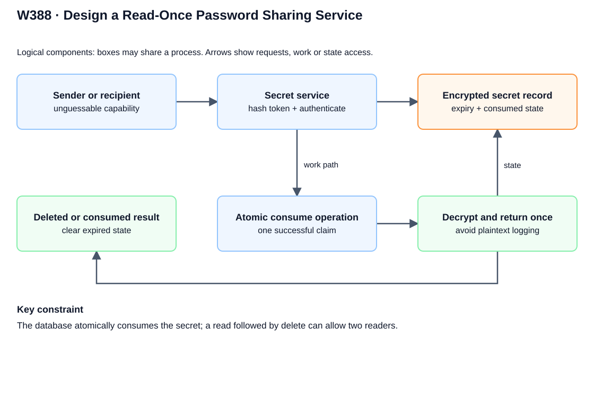

# W388. Design a Read-Once Password Sharing Service

**Priority group:** Fourth 100 — role-dependent depth

**Category:** Distributed consistency and recovery

**Study position:** 388 of 547

[Group list](../FOURTH_100.md) · [All categories](../ALL_CATEGORIES.md) · [Chapter guide](../README.md)

<span class="practice-page"></span>

## Question

Design a service that lets a signed-in user hand a password to another person through a link that works only once. The user creates the secret, receives a URL, and sends the URL to someone else. The first time the recipient opens it they see the password; every later attempt must fail.

### Requirements

1. Create: a signed-in user submits a secret (a short text of up to 4,096 bytes) and gets back a URL. The user can add a label such as the recipient's name.
2. Read once: the URL reveals the secret to exactly one successful reader. Two people opening it at the same moment must not both succeed. After a successful read the stored secret is gone.
3. Many users: any number of users can create secrets independently. A user sees only their own secrets and their status.
4. Same password, many creators: two users may share the same password text. Their secrets must stay separate, and nothing in storage may reveal that the two texts are equal.
5. Same password, many recipients: one user may share the same password with several people. Each recipient has their own URL, reading one URL does not use up the others, and the user can see which recipient has read it.
6. Confirm the read: the creator can ask whether a URL has been read, and when. Say precisely what the system can and cannot confirm.
7. Expiry and revoke: a secret expires after a time the creator picks, at most 7 days. The creator can revoke an unread secret early. An expired, revoked or already read URL gives the same answer as an unknown one.
8. Recipients are anonymous: a recipient does not need an account.
Scale

```text
2,000,000 secrets are created per day, spread over the day, with a peak of 10 times the average.
```

On average each URL receives 3 page loads, because chat tools and mail scanners fetch links to preview them, and 90% of URLs are eventually read by a person.
Metadata (not the secret) is kept for 90 days for audit.
Deliverables
1. The API: endpoints, request and response fields, and status codes.
2. The data model and what is stored in plain, hashed and encrypted form.
3. The URL: what it contains and why it cannot be guessed.
4. How the read-once rule holds when two requests race, when the server crashes mid-request, and when a link-preview bot opens the URL first.
5. Capacity estimates for request rates and storage.
6. The corner cases from requirements 4 to 7, each with the behavior you choose.

### Examples

Alice creates one secret and sends the URL to Bob. Bob opens it and sees the text. Bob opens it again and gets the same "not found" answer a random URL would give. Alice sees the status change from pending to read, with the time.
Alice and Carol both choose the password hunter2. Alice shares it with Bob and Dave using two URLs. Bob reads his; Dave's URL still works; Carol's secret is unaffected, and the stored data for the three secrets looks unrelated.

## Worked solution

<!-- architecture:W388:start -->
### Architecture and request flow



[Open the diagram at full size](../diagrams/W388_architecture.svg). This is a baseline component diagram for this question. The boxes describe responsibilities; they do not require a separate microservice for every box.

- **Request and state:** Sender or recipient — unguessable capability → Secret service — hash token + authenticate. That component consults or updates **Encrypted secret record — expiry + consumed state** under the required access and consistency rules.
- **Work and result:** the work path passes through **Atomic consume operation — one successful claim** and **Decrypt and return once — avoid plaintext logging**, producing **Deleted or consumed result — clear expired state**. Bound waiting and retries where a slow dependency can stall this path.
- **Correctness point:** The database atomically consumes the secret; a read followed by delete can allow two readers.

When explaining the drawing, trace one normal request first, then a duplicate request, an unavailable dependency and recovery from saved state. If the question requires stricter guarantees or a different scope, state the change explicitly rather than treating this baseline as the only possible design.
<!-- architecture:W388:end -->

### Contract and API

There is a fundamental delivery boundary: the service can guarantee **at most one successful consume transaction**, but cannot guarantee exactly one human receives the plaintext. A server can commit consumption and crash before returning bytes; a recipient can receive bytes and lose the response acknowledgment. This design burns the secret on a committed consume, favoring confidentiality over retryable delivery. The creator's status means “consumed by the service”, not proof that Bob read or understood it.

`POST /v1/secrets` requires the creator's session and CSRF protection; body `{text, label, expires_at}` is validated as UTF-8 text of at most 4096 bytes and an expiry in the next seven days. Return 201 `{id, url, expires_at, status:"pending"}`; invalid input is 400 and unauthenticated creation 401. `GET /v1/secrets?cursor=…` and `GET /v1/secrets/{id}` require ownership and return label, creation/expiry times, status and consumed_at, never plaintext or the capability URL again. Wrong owner and unknown IDs both return 404. `DELETE /v1/secrets/{id}` revokes pending data atomically; return 204 for an owned existing record, including an already terminal record.

`GET /s/{token}` returns a generic landing page with a Reveal button and does **not** consume. `POST /s/{token}/reveal` returns 200 `{text}` only for the consume winner; unknown, expired, revoked and consumed capabilities all return the same 404 body. Rate limiting can return 429 independently of token validity. Responses use TLS, `Cache-Control: no-store`, no third-party scripts/analytics, a restrictive CSP and `Referrer-Policy: no-referrer`.

This deliberately interprets “opens” as an explicit reveal action: ordinary preview GETs must not consume. If the literal first HTTP GET must reveal, a preview bot may be the one reader; that requirement cannot simultaneously guarantee the intended person wins. A button reduces accidental consumption but is not proof of humanity; a bot can also POST.

### Records, encryption and independent links

Store `Secret(id, owner_id, token_lookup, label, created_at, expires_at, state, consumed_at, ciphertext, nonce, wrapped_dek)`. Generate an independent 256-bit cryptographically random token for every link; the URL contains that capability alone. Store HMAC(server_lookup_key, token), indexed uniquely, rather than the token itself; protect and rotate the lookup key. A random ID is an owner-facing identifier, not a substitute for authorization.

Encrypt each secret using an independent random data key and authenticated encryption with a fresh nonce. Authenticate immutable record identity as associated data; wrap the data key using a managed encryption key. Plain metadata includes owner, dates and state; labels may themselves be sensitive and can be encrypted separately. Never store deterministic ciphertext, plaintext hashes, content-deduplication keys, plaintext secrets or full capability URLs in logs. Identical text consequently produces unrelated stored ciphertext. A compromised encryption service is outside this storage-only secrecy guarantee.

### Atomic consume, revoke and cleanup

Route each token to one authoritative database partition. Within a transaction lock its record, test `state=pending AND expires_at>database_now`, retrieve encrypted material, clear ciphertext/nonce/wrapped key, and mark consumed with a database timestamp. Commit before decrypting and returning the winning in-memory material. A competing consume or revoke serializes on the same row; only one state transition wins. Crash before commit rolls back; crash after commit can permanently burn the secret. Never automatically retry an ambiguous consume in a way that returns plaintext twice. If commit acknowledgment is lost, resolve transaction status where possible, but return the same unavailable result once consumed. A read replica must not authorize reveal.

A cleanup job erases unread expired payloads, while the transaction's time predicate enforces expiry even if cleanup lags. Keep terminal audit metadata for 90 days, then delete it. Backups and database history need bounded retention and encrypted key lifecycle: clearing a live column alone does not erase historical copies. Decryption rights must reject consumed/expired records and expired per-record keys must become unrecoverable according to the stated backup policy.

### Worked example and capacity

Alice creates two independent links labeled Bob and Dave, and Carol creates a third, all for `hunter2`. Each has a distinct random token, key and ciphertext. Bob's consume changes only Bob's row; Dave and Carol remain pending. Alice sees Bob's consumed_at, not Bob's identity, since anonymous recipients can forward URLs. Revocation racing Bob is decided by transaction order; no later caller can distinguish revoked from unknown.

Two million creates/day average 23.15/s, peak about 232/s. Six million landing GETs/day average 69.44/s, peak about 695/s; 1.8 million eventual human reveals/day average 20.83/s, peak about 209/s, before malicious traffic or retries. These are separate request classes; a landing GET plus reveal is two requests. At most 14 million seven-day pending records require 57.344 GB at the 4096-byte maximum payload, or 14.336 GB at an assumed 1 KB average, before encryption/index/replication overhead. Ninety-day metadata holds about 180 million records; at an explicitly assumed 200 bytes each, 36 GB logical, plus indexes and replicas. Deletes reduce ordinary live payload below the all-unread upper bound. Test simultaneous reveals, consume/revoke races, expiry exactly at the boundary, crash after commit, duplicate plaintext across creators, independent recipient links and preview-only GETs.

### Further study

- [F164: Design a read-once secret-sharing service.](../17_distributed_systems_depth.md#f164)
