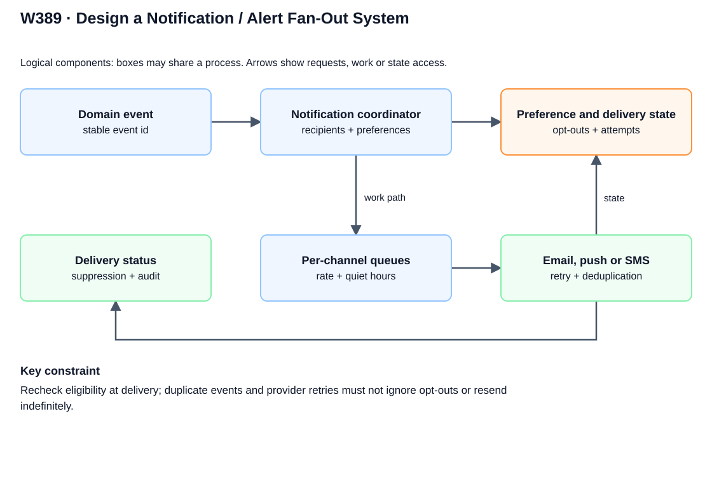

# W389. Design a Notification / Alert Fan-Out System

**Priority group:** Fourth 100 — role-dependent depth

**Category:** Feeds, notifications and social graphs

**Study position:** 389 of 547

[Group list](../FOURTH_100.md) · [All categories](../ALL_CATEGORIES.md) · [Chapter guide](../README.md)

## Question

Design a notification system that receives alerts from upstream services and fans out to all subscribers across multiple channels — email, SMS, push, in-app.

Functional

Upstream services publish alerts (order ready, dasher arrived, promo, system incident).
Subscriber model: per user, per alert type, per channel.
Alerts fan out to all matching subscribers via their preferred channels.
Users can mute / opt out per alert type and per channel.
Throttle: a user never receives more than N notifications/minute regardless of upstream volume.

Non-functional

High fan-out: one system-incident alert can target millions of subscribers.
Per-channel SLAs differ: push near-real-time; email/SMS tolerate 1-2 min; in-app eventually consistent.
Email/SMS have hard provider rate limits; backpressure must propagate, not drop.
At-least-once delivery; dedupe by (user_id, alert_id, channel).

## Worked solution

<!-- architecture:W389:start -->
### Architecture and request flow

[Open the diagram at full size](../diagrams/W389_architecture.svg). This is a baseline component diagram for this question. The boxes describe responsibilities; they do not require a separate microservice for every box.

- **Request and state:** Domain event — stable event id → Notification coordinator — recipients + preferences. That component consults or updates **Preference and delivery state — opt-outs + attempts** under the required access and consistency rules.
- **Work and result:** the work path passes through **Per-channel queues — rate + quiet hours** and **Email, push or SMS — retry + deduplication**, producing **Delivery status — suppression + audit**. Bound waiting and retries where a slow dependency can stall this path.
- **Correctness point:** Recheck eligibility at delivery; duplicate events and provider retries must not ignore opt-outs or resend indefinitely.

When explaining the drawing, trace one normal request first, then a duplicate request, an unavailable dependency and recovery from saved state. If the question requires stricter guarantees or a different scope, state the change explicitly rather than treating this baseline as the only possible design.
<!-- architecture:W389:end -->

### Delivery unit and API

Create an alert once with `POST /alerts {idempotency_key, type, audience_ref, template_version, variables, expires_at}`. Expand a versioned audience snapshot into recipients using checkpointed chunks, then select each user's enabled channels from `Preference(user,type,channel,enabled,quiet_hours,timezone,version)`. Store `Delivery(alert,user,channel,status,next_attempt,attempt_count,provider_id)` with a unique `(alert,user,channel)` key. The producer's outbox makes event creation durable; an accepted alert returns 202 and a status URL, not a promise of immediate receipt.

Define N as the maximum **channel dispatches** per user in any rolling 60 seconds across all alert types and channels. Sending one alert by email and push consumes two units. This is an explicit interpretation of the cross-channel limit; if the product means N logical alerts, reserve one alert unit and separately bound its channel fanout.

### Shared rate authority and queues

Before dispatch, all channel workers reserve from the same per-user atomic limiter. Under a lock or a single-key transaction, remove reservations at or before `now−60s`, check the remaining count, and insert a unique delivery reservation if below N. Repeating the same reservation must not spend a second unit. If full, return the oldest reservation's expiry as next eligibility and move the delivery to a delayed queue. A fixed calendar-minute counter permits 2N requests around a boundary and does not satisfy a rolling limit. Rate-authority failure defers sends; disconnected workers cannot spend independent copies of the budget.

Use separate durable priority queues and worker pools for push, in-app, email and SMS, with provider-wide quotas and per-user serialization. Push can normally start within seconds while email/SMS drain within one or two minutes. Large audiences are partitioned by recipient, never processed as one transaction. Recheck preferences and quiet hours immediately before dispatch. A high-priority lane can reserve infrastructure capacity but cannot silently bypass the hard N limit. Provider errors use exponential backoff with jitter, retry deadlines and a dead-letter queue; invalid tokens and permanent addresses terminate their delivery.

### Correctness, overload and example

There is an unavoidable overload constraint: if a user generates more than N channel deliveries/minute indefinitely, “all within two minutes” and the hard cap cannot both hold. Choose durable deferral with a maximum age, then explicit expiration or a permitted digest; expose backlog age and suppressed/expired totals. Do not discard unexpired work silently.

For example, with N=3, email+push for alert A reserve two units, SMS for B reserves the third, and email for C waits until a reservation ages out. Two workers racing for the last unit cannot both reserve. Use a monotonic authority clock and retain reservation IDs long enough to distinguish retry attempts. Whether retries consume another unit must be defined: to enforce a hard bound on **send attempts**, every new provider request consumes one, even if the previous result was unknown.

A provider timeout may have delivered the message. A durable logical-delivery key plus a provider idempotency key prevents duplicates only to the extent the provider honors it; otherwise choosing retry trades possible duplicates against possible loss. Arrival times and duplicate deliveries inside an external provider cannot be bounded by this limiter. Report separately durable creation, accepted dispatch and user interaction. Size from audience deliveries rather than alert count: an assumed one-million-recipient alert on two channels creates two million tasks; with a 100k-task/s expansion budget that takes at least 20 seconds, excluding provider quotas. Monitor queue age, limiter delays, provider acceptance/error rates, duplicate keys and end-user latency by channel.

### Further study

- [F090: Design a rate-limited LLM classification pipeline.](../09_ml_system_design.md#f090)
- [F162: Design a durable work queue with retries and leases.](../17_distributed_systems_depth.md#f162)
