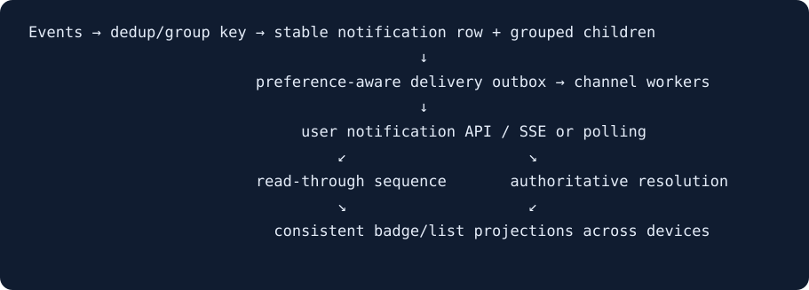

# W390. Design a Notification System with Preferences and Fan-out

**Priority group:** Fourth 100 — role-dependent depth

**Category:** Feeds, notifications and social graphs

**Study position:** 390 of 547

[Group list](../FOURTH_100.md) · [All categories](../ALL_CATEGORIES.md) · [Chapter guide](../README.md)

## Question

Design a notification system with user preferences, fan-out, multiple delivery channels, retries, and observability.

Requirements surfaced in the round: distinguish read vs resolved state (unresolved action items must persist until completed); group/dedupe related events (e.g. 12 friend-activity events → one grouped row); expose a stable notification_id and dedupe_key; cross-device consistency for unread counts and resolution; a compact count endpoint for the badge; polling vs SSE; and accessibility.

## Worked solution

<!-- architecture:W390:start -->
### Architecture and request flow

[Open the diagram](../diagrams/W390_final_architecture.svg). Reading and resolving are independent. A read-through sequence updates unread state consistently across devices, while unresolved action items remain visible until the relevant business action resolves them. Grouped children retain provenance and a stable group identity; retries and duplicate events do not inflate the badge.
<!-- architecture:W390:end -->

### Read and resolved are different states

Model `Notification(id,user,group_key,type,created_at,version,payload,action_ref)`, `Group(user,group_key,last_activity,child_count,latest_child_seq)` and `UserGroupState(user,group_key,read_through_seq,resolved_at,resolution_version)`. A notification can be read while its required task remains unresolved. Only the authoritative action service—such as an approval or payment service—can emit resolution; opening a panel or clicking “mark read” cannot prove the task completed.

For example, twelve comments on one document produce twelve durable child events but one group row, “12 new comments on Plan”. The unread badge counts groups containing at least one visible child newer than read_through_seq. An unresolved approvals list uses domain resolution and can still contain a read group. A thirteenth comment makes a previously read group unread again. Define whether a new task reopens a resolved group; preferably use a new action ID when it is a different obligation.

### APIs and synchronization

`GET /notifications?cursor=…&filter=unread|unresolved|all` returns stable group IDs, summary, latest sequence, read/resolution state, actions and an opaque pagination cursor ordered by `(last_activity,id)`. `PUT /groups/{id}/read {through_seq}` atomically advances a per-user maximum; it cannot mark concurrently arriving later children read. `POST /actions/{action_id}/complete` goes to the domain service with an idempotency key and authorization. Its transactional outbox publishes the resolution, which the notification projection applies idempotently by version. `GET /notification-summary` returns unread-group count and a state version.

Use WebSocket/SSE updates containing group changes and count/version, with polling and cursor-based catch-up after reconnect. Canonical read state belongs to the user, so a phone read propagates to the laptop; a per-device delivery receipt only describes transport. Out-of-order events cannot lower read_through_seq or overwrite newer resolution. On a sequence gap or expired cursor, fetch a fresh snapshot. Projection lag is visible through versions; completion may return a pending indicator until the group projection catches up.

### Storage and usability

Partition by user for list, state and badge transactions, and deduplicate source events by `(source,event_id,user)`. Atomically update the group and its unread-count contribution so replay cannot inflate badges. Keep payloads minimal and check current document permissions when rendering; deleted or inaccessible content is redacted. A group key must include tenant and resource identity to prevent accidental merging.

Make the badge a navigation aid with accessible text, keyboard actions, clear read styling and a separate “needs action” filter. Avoid twelve interrupting toasts for the grouped example; collapse updates without losing the underlying events. Bound retained history, group sizes and payload size, and paginate the children. Test new child versus mark-read races, simultaneous reads on two devices, duplicate resolution events, completion failures, reconnect gaps and permission revocation. These checks verify the two state machines independently rather than equating dismissal with completion.

### Further study

- [F090: Design a rate-limited LLM classification pipeline.](../09_ml_system_design.md#f090)
- [F162: Design a durable work queue with retries and leases.](../17_distributed_systems_depth.md#f162)
