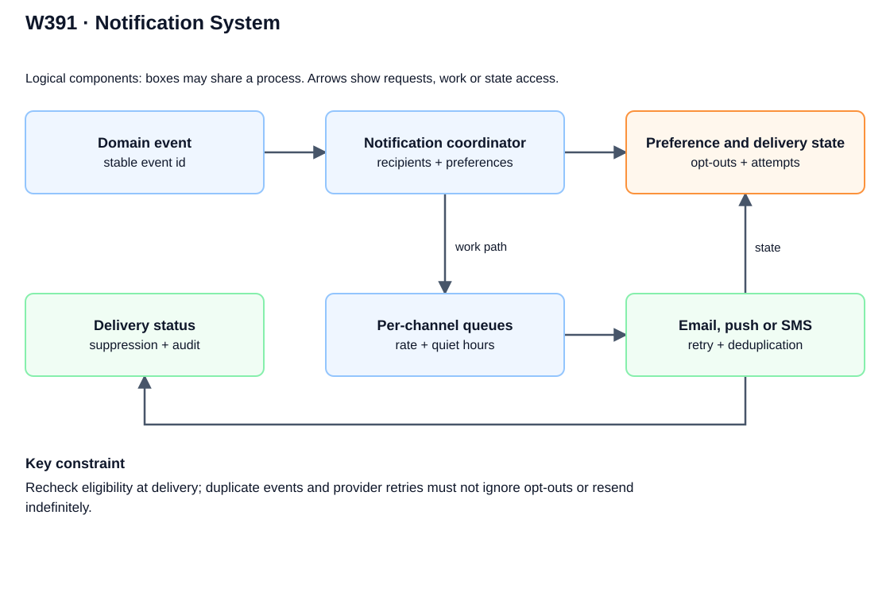

# W391. Notification System

**Priority group:** Fourth 100 — role-dependent depth

**Category:** Feeds, notifications and social graphs

**Study position:** 391 of 547

[Group list](../FOURTH_100.md) · [All categories](../ALL_CATEGORIES.md) · [Chapter guide](../README.md)

## Question

Design Reddit's notification system: deliver in-app, push (APNs/FCM), and email notifications for events (reply, mention, mod action, trending post). Supports per-channel preferences, bundling/digesting, and throttling. Scale: hundreds of millions of users, tens of millions of notifications per minute.

Interviewer drives at
Event trigger pipeline (transactional outbox -&gt; Kafka, partitioned by user, idempotency via request id).
Preference resolution (inline vs cached vs Bloom pre-filter; the high-fanout celebrity-post collapse).
Channel selection and dispatcher topology (per-provider DLQ, backoff, webhook status updates).
Bundling / sliding-window aggregation into digests; throttling against APNs/FCM hard quotas.
Deduplication via dedup_key.
Delivery-semantics triad: exactly-once logical creation, at-least-once dispatch, best-effort user-visible delivery.

## Worked solution

<!-- architecture:W391:start -->
### Architecture and request flow

[Open the diagram at full size](../diagrams/W391_architecture.svg). This is a baseline component diagram for this question. The boxes describe responsibilities; they do not require a separate microservice for every box.

- **Request and state:** Domain event — stable event id → Notification coordinator — recipients + preferences. That component consults or updates **Preference and delivery state — opt-outs + attempts** under the required access and consistency rules.
- **Work and result:** the work path passes through **Per-channel queues — rate + quiet hours** and **Email, push or SMS — retry + deduplication**, producing **Delivery status — suppression + audit**. Bound waiting and retries where a slow dependency can stall this path.
- **Correctness point:** Recheck eligibility at delivery; duplicate events and provider retries must not ignore opt-outs or resend indefinitely.

When explaining the drawing, trace one normal request first, then a duplicate request, an unavailable dependency and recovery from saved state. If the question requires stricter guarantees or a different scope, state the change explicitly rather than treating this baseline as the only possible design.
<!-- architecture:W391:end -->

### Solution outline

1. Store durable notification intents with event id, recipient, channel, preference version and delivery status. Expand recipients through a partitioned fan-out pipeline rather than blocking the initiating request.
2. Check current opt-outs and quiet hours at the appropriate sending boundary. Deduplicate per event/recipient/channel and use bounded retries with provider-specific throttles.
3. Separate immediate alerts from digests; batch by recipient and time window while preserving the meaning of urgent events. Treat delivery, receipt and read status as different observations.
4. Support preference changes, stale-device tokens, replay and partial provider outages. Report end-to-end lag and user-visible duplicates, not only successful API calls.

### Understand why the approach works

#### Separate authoritative events from their many derived deliveries

A post, like or notification intent should have one logical identity even if it produces many feed entries or channel deliveries. Store the event/state transition durably, then use idempotent fan-out tasks keyed by event, recipient and destination.

Fan-out-on-write makes common reads cheaper but can be expensive for very large follower counts. Fan-out-on-read avoids those writes but adds read-time merging. A hybrid can materialize ordinary publishers and merge high-follower publishers later; explain pagination and consistent deletion/privacy behavior in both paths.

A notification also needs preferences, channel budgets, quiet hours and a distinction between provider acceptance, device receipt and user read. A social count may be a current-state view rather than a blind event sum: repeated “like” is not two active likes, and “unlike” should not make a count negative.

Walk through replay, a membership change and one unavailable delivery provider. Permissions must remain effective at serving time under the declared revocation policy, even if a feed was cached earlier. Measure end-to-end freshness, missing/duplicate delivery and user outcome, not only worker throughput. A fast queue that quietly omits hard-to-reach recipients does not satisfy an all-recipient delivery contract.

### Work a small example

An event that fans out to one million followers becomes many idempotent delivery tasks; replaying the event must not create a second notification per recipient.

### Edge cases and common mistakes

Sending directly to every follower inside the posting request or treating provider acceptance as proof the user read the message.

### Check your reasoning on related cases

**Design a rate-limited LLM classification pipeline.** If a request times out after the provider processed it, a retry must not create two independent downstream records for the same item.

How do you handle backlog growth? Scale within budget, reduce per-item cost or apply admission and prioritization policies.

**Design a durable work queue with retries and leases.** If a worker completes a side effect and crashes before acknowledgment, the task can be delivered again.

How do fencing tokens help? They allow downstream systems to reject writes from an expired owner.

### Further study

- [F090: Design a rate-limited LLM classification pipeline.](../09_ml_system_design.md#f090)
- [F162: Design a durable work queue with retries and leases.](../17_distributed_systems_depth.md#f162)

### Explain it back

Close the answer. State the main invariant or equation, work the example with changed inputs, and explain which assumption would make your solution fail. For a design, walk through a retry or partial failure; for a derivative, check a shape and a finite-difference case.
