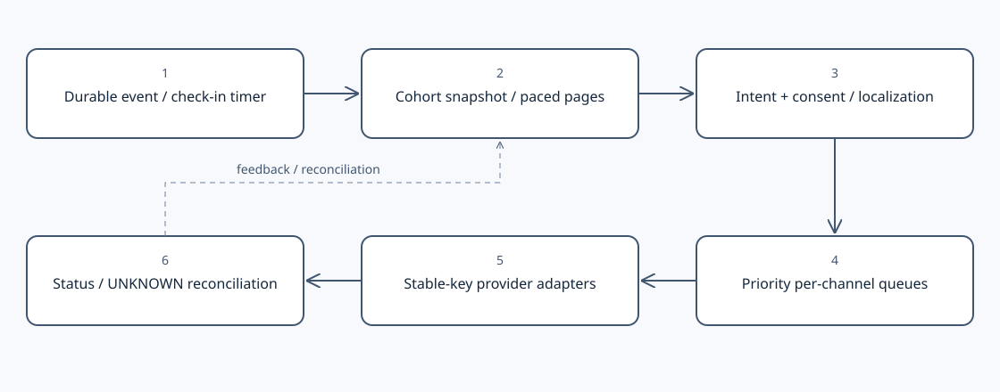

# W392. Notification System (Event + Batch)

**Priority group:** Fourth 100 — role-dependent depth

**Category:** Feeds, notifications and social graphs

**Study position:** 392 of 547

[Group list](../FOURTH_100.md) · [All categories](../ALL_CATEGORIES.md) · [Chapter guide](../README.md)

<span class="practice-page"></span>

## Question

Design Airbnb's notification system. Supports two pipelines: event-triggered single notifications (booking confirmation, check-in lock code) and bulk batch sends (promotional pushes to host cohorts). Delivery channels include email, SMS, push, and X / Twitter.

### Requirements

Functional
Event pipeline: subscribe to upstream events (booking placed, check-in date reached) and emit a notification to the affected user.
Batch pipeline: scheduled or on-demand mass sends to a cohort (e.g. promotional push to potential hosts).
Multi-channel: email, SMS, mobile push, third-party social.
Per-user channel preferences and global quiet hours.
Templating with localization.
Non-functional
Tens of millions of notifications per day, with bursty event traffic.
At-least-once delivery with idempotency; user must not receive the same booking confirmation twice.
Configurable per-channel retry and backoff.

## Worked solution

### Event and campaign paths share delivery, not priority

A booking confirmation and a host-marketing campaign must not compete equally for an SMS/provider quota. Subscribe to booking/check-in events through transactional upstream outboxes or an equivalent durable event source. Check-in-time notifications additionally use durable timers keyed by booking, scheduled instant and event version; a canceled or rescheduled booking invalidates the old timer. The batch API creates a Campaign(id,template_version,cohort_snapshot,scheduled_at,expiry,state), then expands its immutable cohort through checkpointed pages. Both paths create the same recipient/channel delivery intent, but use separate priority queues, concurrency budgets and provider-rate allocations, reserving capacity for time-critical transactional events.

`POST /campaigns` supports scheduled/on-demand campaigns and idempotency; `/campaigns/{id}:pause|cancel` stops undispatched work. `GET /notifications/{id}` returns intent/attempt status, and preference APIs version the user's opt-ins, channel order, language, timezone and quiet hours. Events/timers carry booking_id and version so a stale check-in code is not sent after cancellation. Never send a private booking code through a public social post: a social connector is only for explicitly authorized, appropriate content and only where the provider supports the chosen authenticated operation.

### Data, template and policy boundary

```text
Notification(id, source_event_or_campaign, recipient, kind, template_version,
             locale, payload_ref, business_version, expires_at, state)
Delivery(id, notification_id, channel, destination_version, scheduled_for,
         state, provider_key, provider_message_id, next_retry_at, lease)
Preference(user, version, allowed_channels, quiet_hours, timezone, locale)
CampaignShard(campaign, shard_id, cursor, state, emitted_count)
Template(id, version, locale, channel, body, approved_variables)
Attempt(delivery_id, number, request_time, response, error)
Inbox/Outbox(source,event_id UNIQUE,payload_hash,processing_state)
```

Deduplicate intents by (business event/version,recipient,notification kind) and deliveries by (notification,channel,destination). Do not generate a new confirmation because an upstream booking event was replayed. Version templates, localize with explicit fallback, validate variables and escape per channel. Sensitive booking data belongs behind restricted references or an authenticated deep link; ordinary logs contain IDs/reason codes, not lock codes. Channels are chosen by a documented rule: promotional opt-outs are binding, quiet hours defer to the next valid local instant, and any emergency/transactional exception must be explicitly configured rather than silently bypass global policy. Recheck consent, booking state, token validity and expiry immediately before dispatch; campaign-start eligibility can be stale by send time.

### Delivery guarantees and retry states

The diagram follows durable source/timer or cohort expansion → shared intent store/policy → priority channel queues → adapters → result/reconciliation. A worker leases a Delivery, renders a deterministic payload/version, and calls its provider using the same stable provider_key on retry. States SCHEDULED→QUEUED→SENDING→ACCEPTED/DELIVERED where observable, with UNKNOWN, RETRY_WAIT, SUPPRESSED, EXPIRED and EXHAUSTED alternatives. Provider acceptance is not user receipt/read. Repeated callbacks deduplicate by provider event ID and cannot regress a terminal result. Expired check-in/promotional messages are suppressed; a quiet-hours delay past useful expiry becomes an explicit expired outcome.

At-least-once queue processing can give one durable logical confirmation, but **no duplicate external delivery** also requires provider-side idempotency/status lookup or client presentation dedup. A send accepted externally followed by a lost response is ambiguous. Do not switch providers/channels and blindly resend it as a new confirmation. Query the original identity where supported; otherwise retain UNKNOWN and choose an explicit manual/at-most-once-versus-retry policy. An unconditional once-only email/SMS promise is impossible across a non-idempotent provider timeout. Treat alternate channels as independently intended deliveries only if product policy authorizes them, not as an accidental duplicate workaround.

Choose per-channel deadlines/rate limits: for example, a configured exponential retry base of one second, full jitter, one-minute cap and maximum useful age; honor bounded Retry-After and stop on permanent invalid-address/token errors. Circuit breakers and fair tenant/campaign queues prevent a failed promotional provider from exhausting transactional workers. An outbox preserves committed intents through broker failure; campaign progress advances only after a page's deduplicated intents commit, so a restarted expander neither skips nor duplicates recipients.

### Capacity, failure walkthrough and validation

For a concrete assumption use 50 million intended notifications/day: about 579/s average, or 5,787/s at a chosen tenfold peak. If 1.4 channels/intent are actually selected, mean dispatch is 810/s and peak 8,102/s. At an assumed 300-byte intent plus 200-byte delivery, logical metadata is roughly 29 GB/day before attempts/indexes/replicas. Campaigns can exceed that peak: ten million recipients in ten minutes require 16,667 expansions/s, constrained by provider quotas and consent/quiet-hours scheduling. A bounded queue absorbs temporary throttling, but cannot guarantee unbounded backlog storage or deadlines above sustained provider capacity; pause campaigns/admit slower and expose delayed status.

Example: booking event E is delivered twice. The first transaction creates one confirmation; the second resolves to it. A provider accepts its send then times out: the delivery stays UNKNOWN under the same key, and a late success closes it without another send. A campaign recipient opts out after expansion: dispatch recheck marks it SUPPRESSED. Test these, booking cancellation against a timer, cohort-page crash, timezone/DST quiet hours and template version replay. Monitor event-to-intent/dispatch/delivery percentiles, oldest urgent work, campaign completion, provider throttle, expired/suppressed/UNKNOWN rates and visible duplicate reports; availability includes preserving durable pending work, not inventing successful delivery.

<!-- architecture:W392:start -->


Read the numbered path as Durable event / check-in timer → Cohort snapshot / paced pages → Intent + consent / localization → Priority per-channel queues → Stable-key provider adapters → Status / UNKNOWN reconciliation. The dashed return represents replay/reconciliation under the stated version, deduplication and authority rules; the slow delivery/read side does not own the accepted input.
<!-- architecture:W392:end -->

[Batch behavioral checks](../test_review_392_396.py) validate the explicit notification, crossing, uniqueness and ranking fixtures. The capacity/SLO numbers are calculations and targets, not production measurements.

### Further study

- [F090: Design a rate-limited LLM classification pipeline.](../09_ml_system_design.md#f090)
- [F162: Design a durable work queue with retries and leases.](../17_distributed_systems_depth.md#f162)
