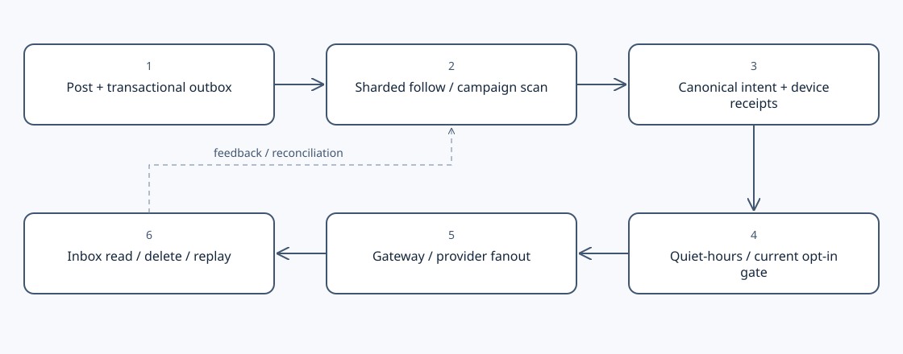

# W393. Notification System — Push to Followers on New Post

**Priority group:** Fourth 100 — role-dependent depth

**Category:** Feeds, notifications and social graphs

**Study position:** 393 of 547

[Group list](../FOURTH_100.md) · [All categories](../ALL_CATEGORIES.md) · [Chapter guide](../README.md)

<span class="practice-page"></span>

## Question

Notification System — Push to Followers on New Post

Onsite SD round. Design a push-notification service: when a user creates a new post, every follower receives a notification. The interviewer treats it as a product-flavored design (not pure infra), so weighting is on data model + fanout strategy + delivery guarantees rather than on cluster topology.

### Requirements

Functional:

A user creates a post → every follower of that user gets a notification.
Notifications must be deliverable to multiple device types (mobile push via APNs / FCM, web push, in-app inbox).
Support read / unread state, mark-as-read, and delete from inbox.
Tolerate offline followers — notifications queue until the device reconnects.

Scale (rough working numbers for the discussion):

100M users, average 300 followers, peak post rate ~10K/s.
Latency target: p50 &lt; 5s, p99 &lt; 30s for normal authors (first-batch delivery should feel real-time); availability 99.9%+; durability is the hard requirement — a lost post event is unrecoverable.

Decision points the interviewer probes:

Fanout-on-write vs fanout-on-read — when does each break down (celebrity users with millions of followers)?
Hybrid fanout: write for normal users, read for celebrities. Where do you draw the line?
Idempotency and deduplication when a worker retries.
Backpressure when a downstream provider (APNs) throttles.
Notes
The round is in-person on a laptop — type your reasoning into the shared doc rather than relying on a whiteboard photo.
The product-design angle matters: define the notification payload schema, the inbox API, and how it interacts with feed ranking.
Cover the celebrity problem explicitly. Pure fanout-on-write with a 50M-follower account writes 50M rows per post; degrade to fanout-on-read for that segment and merge at fetch time.
Discuss exactly-once vs at-least-once delivery — push providers are at-least-once; the inbox layer must dedupe by (post_id, user_id).
Mention metrics: delivery latency p50/p99, fanout queue depth, provider throttle rate.
The standard hybrid threshold in production designs is on the order of ~10K followers: under it, fan-out-on-write into a per-user precomputed-feed table (≤200 recent × ~2KB per row); over it, store the post once and merge at read time. Celebrities are flagged in the Follow table so the post-create worker can skip their write-fanout.
Two *different* thresholds are in play: the fan-out-on-write-vs-read line (~10K) above, and a separate *paced-campaign* trigger for true hot authors — below ~100K opted-in followers enqueue all shards at high priority; above it, create a campaign that splits followers into ~50K-follower shards and *paces* shard dispatch so provider quotas are respected and progress is checkpointed (never scan all of a celebrity's followers in one query).
Use a pub/sub bus (Kafka / Redis pub-sub) keyed on user_id for the delivery side: each post-create publishes a fanout job, sharded workers consume and route to the per-device WebSocket or push provider. This is the same shape WhatsApp-style designs use to scale a single chat-server farm — any worker can serve any user because routing is decoupled from connection ownership.
Track delivery per (user_id, client_id) not per user_id — a user with phone + tablet + web has three rows in the Inbox table and three independent ack states.
Behind the fanout bus, a bounded queue is doing two jobs that often get conflated: (1) decoupling post-create latency from delivery latency, and (2) backpressure when APNs/FCM throttle — the queue absorbs the slowdown without spilling 429s back to the author. Surface both in the design.
Cache hot-key reads (viral post inbox entries) in a non-sharded Redis replica set to avoid a single shard's CPU melting.
Provider failures & token hygiene: retry *temporary* provider errors with exponential backoff + jitter; on a *permanent* error mark the device token invalid and stop sending, emitting an invalid-token event back to the Device service for cleanup. Cap retry age so a stale "new post" push is never delivered hours late, and batch sends by provider + platform. Provider acceptance ≠ user-visible delivery — an APNs/FCM success only means the message was accepted, not seen.
Multi-region: run stateless API / orchestration / dispatch workers in several regions with region-local, mirrored-failover queues; the follower graph and notification store tolerate eventual consistency across regions — only the initial post write needs strong consistency, so keep it off the cross-region synchronous path.
Canonical data model & write-path details
Transactional outbox between POST /posts and the post_created event: write the post row and an outbox row in the *same* transaction, then a relay publishes to the bus. Publishing separately is the classic lost-notification bug — the post commits but the trigger is dropped if the process crashes.
Model the follower edge as (author_id, shard_id, follower_id) so a celebrity never collapses to one partition; carry per-edge notify_on_post / muted / blocked on the edge, but keep user-global quiet_hours + timezone in a separate preference so a timezone change does not rewrite every follow edge.
Split the record in two: a follower-level Notification (canonical, with a UNIQUE dedupe_key on (post_id, follower_id, channel)) and per-device NotificationReceipt rows. The parent status aggregates from children — dispatched = ≥1 device accepted, opened = any device opened, exhausted = all devices permanently failed or retry budget spent. The full Notification.status lifecycle is scheduled → queued → dispatched → opened, with terminal suppressed (filtered out before send), expired, and exhausted.
Quiet hours = defer, not drop. Create the notification, compute the next valid send time in the user's timezone, set scheduled_for, and release it from a delayed queue later.
Filter as late as possible (during shard expansion / just before dispatch), not at event-creation time — otherwise a user who mutes or unfollows seconds after the post still gets pushed.
Working capacity numbers for the estimate: ~30M DAU, ~15M posts/day, ~200 opted-in followers/post → ~3B candidate notifications/day (~35K/s avg, 350K/s peak), celebrity fanout up to ~20M recipients per post; store ~250 bytes of compact metadata per recipient (template id, actor, post id, state) and render the provider payload at dispatch time. At ~250 bytes × ~3B/day that is ~750 GB/day of hot notification state, ~5.25 TB at 7-day retention before replication.

## Worked solution

### Resolve the two workloads and two thresholds

For the rough peak, 10,000 posts/s×an assumed 200 opted-in recipients/post is **two million candidate notifications/s**; using all 300 average followers gives three million/s. The later daily scenario is 15 million posts/day×200=three billion/day≈34,722/s, with its separately assumed tenfold peak≈347,222/s. These are different peak assumptions. Design for the two-million/s envelope if that post rate and fanout coincide, or explicitly bound/admit workload; do not quote 350,000/s as the consequence of 10,000 posts/s.

Use the supplied ~10,000-follower line as an initial **inbox materialization** threshold, tuned by posting frequency/active-reader ratio. Ordinary authors fan out compact inbox references; high-follower authors retain one author stream and merge candidates at inbox fetch. A separate ~100,000 opted-in-recipient trigger creates a **paced delivery campaign** with roughly 50,000-recipient pages/shards; below it, enqueue expansion shards promptly under the normal budget. Neither threshold removes the work of sending a push to every opted-in recipient: a 20-million-recipient celebrity still needs O(20 million) delivery decisions, 400 such expansion shards and enough provider quota. Lazy celebrity inbox reads save inbox writes, not the outbound pushes or required delivery receipts. If all followers demand pushes, that write/fanout cost remains.

### Canonical model and APIs

```text
Post(id,author,version,state,created_at), PostOutbox(event_id UNIQUE,post_id,...)
Follow(author_id,shard_id,follower_id,notify_on_post,muted,blocked,version)
Preference(user_id,timezone,quiet_hours,channel_optins,version)
Device(user_id,client_id,platform,token,token_version,valid)
Notification(id,post_id,follower_id,channel,dedupe_key UNIQUE,
             scheduled_for,expires_at,state,template_id)
NotificationReceipt(notification_id,client_id,token_version,
                    state,provider_id,attempt_count,ack_cursor)
InboxEntry(user_id,notification_id,created_at,read_at,deleted_at,version)
FanoutCampaign(post_id,policy_version,state), FanoutShard(campaign,shard,cursor,state)
```

`POST /posts` atomically commits the post and outbox, then ACKs; a relay may replay. `GET /notifications?cursor=`, `PUT /notifications/{id}/read`, `DELETE /notifications/{id}`, `/devices` and `/preferences` support inbox/devices. Parent Notification deduplicates (post,follower,channel); receipts track phone/tablet/web independently. Read/open state may synchronize across devices at user level while transport ACK remains per device. Delete writes a tombstone/read-model version so replayed fanout cannot reinsert a removed inbox entry. Return compact payloads with notification/post/actor/template IDs and deep link; render channel/localized content near dispatch.

### Fanout, live routing and semantics

The diagram is post outbox → author/shard fanout → preference/dedup intents → user-keyed durable delivery partitions → connection directory/gateways or APNs/FCM/web push. Author follow lists partition by (author,shard), avoiding one huge celebrity query. A follower snapshot/cursor defines eligibility as of the post; recheck current follow/mute/block/consent at expansion and dispatch so a later removal can suppress a pending push. An eventually consistent remote graph can violate immediate mute/block expectations: route dispatch checks to an authoritative preference version or state the permitted propagation delay. Post/notification recovery requires durable replicated state; asynchronous regional mirrors alone cannot promise zero acknowledged-event loss through a whole-region disaster.

Normal-author inbox notifications are materialized idempotently. Celebrity candidates merge from author streams at fetch, then acquire stable virtual notification IDs and per-user read/delete exceptions; outbound push workers upsert the same canonical identity when needed. Feed ranking may order candidates, but cannot silently discard a required inbox notification. Use snapshot/high-watermark cursors and dedup push/pull overlap. New devices fetch canonical unread history; provider queues/TTL are only wakeups, not the sole offline store. At-least-once retries may repeat transport; clients render notification_id once. Provider acceptance means dispatched on at least one device, opened means any device opened; exhausted means every intended valid device failed permanently or spent its retry/age budget. No devices is an explicit no-destination/pending-inbox state, not a fake successful push.

### Backpressure, quiet hours and capacity

Bounded queues both detach post-create latency from expansion and buffer temporary provider throttling. They do not create unlimited rate: pause paced campaigns, isolate provider/tenant quotas and reserve normal-author capacity for the stated p50<5 s/p99<30 s target. Celebrity full completion is separately estimated; first-batch speed is not all-recipient speed. Quiet hours create SCHEDULED until the next local valid time, then consent/expiry is checked again. Retry transient errors with capped backoff+jitter, bounded Retry-After and useful-age TTL; permanent bad tokens are invalidated by token version and reported to Device service, avoiding deletion of a newly rotated token. Ambiguous provider sends retain the same identity where supported; externally exactly-once notification display needs provider/client dedup, not just a worker ACK.

Three billion×250 bytes is **750 GB/day**, **5.25 TB/seven days** compact recipient metadata before replication. At an assumed 1.5 devices and 64-byte receipt, another 288 GB/day precedes indexes/attempts. The rough graph is 100 million×300=30 billion edges; at assumed 24 bytes/edge, 720 GB logical before adjacency indexes/replicas. Shared post payloads belong in read replicas/CDN caches; a replicated hot-object cache can relieve a viral key, but a single nonsharded cache is not a universal scaling cure. Inbox writes still shard by recipient. Test outbox crash, fanout-page replay, celebrity pacing, duplicate per-device ACK, quiet hours, mute/delete/token rotation during queueing and regional replay. Track p50/p99 separately by author class, fanout/dispatch age, throttle/token failures, duplicate rendering and completeness of campaign shard coverage.

<!-- architecture:W393:start -->


Read the numbered path as Post + transactional outbox → Sharded follow / campaign scan → Canonical intent + device receipts → Quiet-hours / current opt-in gate → Gateway / provider fanout → Inbox read / delete / replay. The dashed return represents replay/reconciliation under the stated version, deduplication and authority rules; the slow delivery/read side does not own the accepted input.
<!-- architecture:W393:end -->

[Batch behavioral checks](../test_review_392_396.py) validate the explicit notification, crossing, uniqueness and ranking fixtures. The capacity/SLO numbers are calculations and targets, not production measurements.

### Further study

- [F090: Design a rate-limited LLM classification pipeline.](../09_ml_system_design.md#f090)
- [F162: Design a durable work queue with retries and leases.](../17_distributed_systems_depth.md#f162)
