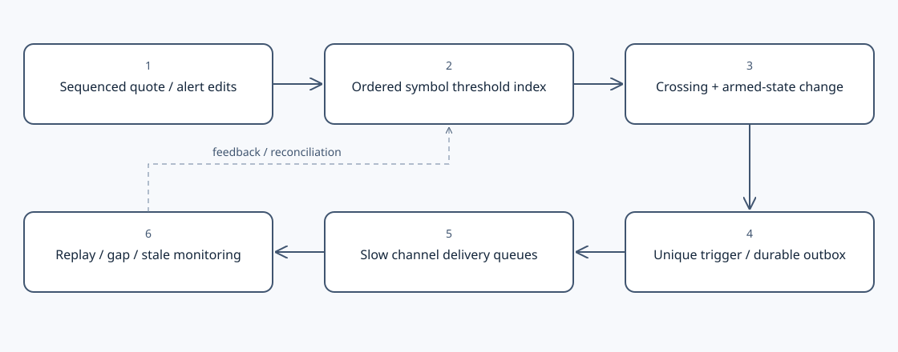

# W394. Stock Price Alert Notification System

**Priority group:** Fourth 100 — role-dependent depth

**Category:** Feeds, notifications and social graphs

**Study position:** 394 of 547

[Group list](../FOURTH_100.md) · [All categories](../ALL_CATEGORIES.md) · [Chapter guide](../README.md)

## Question

Design a stock price alert notification system similar to a Robinhood-style watchlist alert feature. Users create threshold alerts; the system ingests real-time quotes, detects threshold crossings, and delivers notifications via push, email, or SMS.

The core challenge is indexing millions of alerts so each quote update does not scan everything, and decoupling fast threshold matching from slower notification delivery.

## Worked solution

### Define a crossing, then index that predicate

Assume one-shot alerts by default; recurring alerts need an explicit rearm/hysteresis/cooldown policy. Choose an authoritative quote type (e.g. consolidated last trade) and market session, currency/price precision, adjusted-versus-raw treatment and how an alert behaves when created while already above its threshold. For this answer creation records the latest valid price and waits for a future crossing; it does not retroactively trigger from an old quote. Prices/thresholds use fixed-point integer ticks. This is an alert service, not trade execution.

`POST /alerts` takes instrument, direction ABOVE/BELOW, threshold, channels, recurrence and idempotency key; update/cancel uses alert version, and reads expose active/triggered/expired/delivery status. Store Alert(id,user,instrument,direction,threshold,version,armed,state,created_at), SymbolState(instrument,feed_epoch,last_seq,last_price), Trigger(alert,alert_version,quote_event_id,cycle UNIQUE,observed_price,time), Delivery and Outbox. Instrument identity includes market/currency, not just a text ticker.

For consecutive valid prices p_old,p_new, an upward crossing satisfies **p_old<T≤p_new**, so query an ordered threshold index in (p_old,p_new]. A downward crossing satisfies **p_new≤T<p_old**, querying [p_new,p_old). Keep separate ABOVE/BELOW ordered indexes per instrument, each threshold mapping to alert IDs. Unchanged prices trigger nothing; a jump can match many thresholds. Work is O(log A_symbol+M) per quote/shard, where M is actual matches, rather than scanning every alert. For an instrument with a million alerts, a small price move that crosses ten thresholds need not inspect a million rows. A simultaneous jump crossing 100,000 alerts still has unavoidable O(100,000) intent work.

### Ordered evaluator, durable trigger, slow channel pipeline

The diagram is sequenced quote intake → instrument-partitioned threshold match/state → atomic trigger/outbox → independent notification queues/workers. A single fenced owner per instrument shard applies quote and alert-config changes in order. Many quiet symbols share workers; very hot symbols can split their alert sets by alert-ID hash and broadcast each quote to those shards, which each maintain ordered price/config state and threshold indexes. This trades repeated small quote processing for parallel match fanout, without losing any alert subset.

Reject duplicate/old source sequence numbers within a feed epoch; detect gaps and obtain replay before claiming all crossings were observed. Epoch resets require a trusted recovery snapshot/replay boundary, not comparing unrelated sequences. If only a last-price snapshot is available after a gap, a transient threshold crossing may be unrecoverable: mark the gap/degraded coverage rather than invent complete detection. A replayed old quote must not rearm or retrigger an already processed alert.

Commit last applied quote cursor, armed-state transition and Trigger/Outbox identity together within each shard. Huge match sets can be checkpointed as a durable in-progress quote job with paged matches; finish/resume its ordered state transitions before applying later quotes for that shard. Never advance the only durable quote cursor beyond work that can no longer be reconstructed. Config edits/cancel carry versions; a queued old-version trigger is suppressed according to the documented cancel boundary. Notification delivery does not block the quote matcher; retries use trigger/delivery IDs and provider rate limits.

### Recurrence, example and operations

An ABOVE=100 alert seeing 99→100 fires once; 100→101 does not fire again. A recurring variant might rearm only below 99 (chosen one-unit hysteresis), then require another below-to-at/above100 crossing after cooldown. Store this state and, at scale, index rearm boundaries too; scanning every disabled alert on every tick defeats the index. BELOW alerts mirror the inequality. A quote 100→99 crosses BELOW=99, whereas 99→99 does not.

Scale is unspecified. Assume ten million alerts, 10,000 instruments, 100,000 quotes/s peak and 200 bytes/alert: 2 GB logical alert metadata before indexes/replicas. Mean 1,000 alerts/instrument conceals hot-symbol skew. If 1% of quotes generate fifty triggers, output is 50,000 delivery intents/s, sized independently of ingestion. At assumed 200 bytes/intent, ten MB/s is the triggered-path metadata rate before replication. Snapshot indexes, replay configuration/quote logs, enforce per-user alert limits and expire obsolete alerts.

A worker crash replays the last in-progress quote using unique Trigger keys. A provider outage grows an isolated bounded backlog; alert messages include observed price/time and expire rather than arrive hours later pretending current price. Corporate actions/symbol changes require versioned threshold adjustment or user reconfirmation, not silent unit changes. Monitor quote age/gaps, match/trigger lag, hot shard pressure, trigger dedup, delivery latency and stale/expired alerts. Tests cover equal endpoints, price jumps, reverse movement, duplicate/out-of-order quotes, cancel race and recurring rearm. Freshness/coverage metadata is essential when upstream data is incomplete.

<!-- architecture:W394:start -->

Read the numbered path as Sequenced quote / alert edits → Ordered symbol threshold index → Crossing + armed-state change → Unique trigger / durable outbox → Slow channel delivery queues → Replay / gap / stale monitoring. The dashed return represents replay/reconciliation under the stated version, deduplication and authority rules; the slow delivery/read side does not own the accepted input.
<!-- architecture:W394:end -->

[Batch behavioral checks](../test_review_392_396.py) validate the explicit notification, crossing, uniqueness and ranking fixtures. The capacity/SLO numbers are calculations and targets, not production measurements.

### Further study

- [F090: Design a rate-limited LLM classification pipeline.](../09_ml_system_design.md#f090)
- [F162: Design a durable work queue with retries and leases.](../17_distributed_systems_depth.md#f162)
