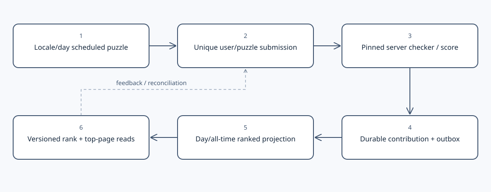

# W395. Daily Puzzle Submission and Leaderboard System

**Priority group:** Fourth 100 — role-dependent depth

**Category:** Games, simulations and object design

**Study position:** 395 of 547

[Group list](../FOURTH_100.md) · [All categories](../ALL_CATEGORIES.md) · [Chapter guide](../README.md)

## Question

Design a daily-puzzle product where users submit one answer per day, see their score, and view a leaderboard; the system also schedules puzzles.

Functional: schedule one puzzle per day per locale; accept a single submission per user per puzzle, score it server-side, return the score and current rank; serve a leaderboard (per locale/day and all-time).

Scale: 10M+ users, ~1M DAU; heavy leaderboard reads; submission burst at midnight local time; single-region or active-active. Design decisions: where to score, idempotent submission, leaderboard storage (Redis sorted-set vs columnar batch).

## Worked solution

### Puzzle identity and one durable submission

A locale/day puzzle uses an explicit IANA timezone and local calendar date; it is not a rolling UTC24-hour bucket. Store Puzzle(id,locale,local_date,publish_at_utc,close_at_utc,state,content_ref,checker_version,answer_ref), unique (locale,local_date). Prepublish content/version in advance, then a durable scheduler atomically activates the due row with an outbox; duplicate timers cannot create a second daily puzzle. Define DST boundaries and locale switching: assume each user selects one competition locale per competition round, recorded in UserRound(user_id,round_id,locale) with a unique (user_id,round_id) key. Puzzle records map to that round. Submission checks this immutable assignment, preventing several all-time contributions by changing timezone.

`GET /puzzles/today?locale=`, `POST /puzzles/{id}/submissions`, `GET /leaderboards?locale=&day=&cursor=`, `/leaderboards/all-time` and `/me/rank` form the API. Submission(user,puzzle,answer_hash,received_at,score,checker_version,submission_id,board_version) has **UNIQUE(user,puzzle)** independently of the client idempotency key. Two devices with different keys still get one attempt. Matching retry returns the original score/result; a different answer conflicts and cannot replace a low score. The server validates trusted receive/close time, authorizes locale and scores with the pinned checker, never trusts a client score. Answers/checkers are restricted so ordinary puzzle delivery does not reveal them.

### Scoring, rank and the transactional boundary

Choose a concrete illustrative rule: 100 points for a correct answer, zero otherwise, with earlier valid server submission time then submission ID breaking ties. Actual puzzle scoring can replace this versioned checker. CPU-cheap deterministic checking can occur inside the submission flow; expensive untrusted checks run in isolated workers with PENDING status and one immutable submission claim. If product demands an immediate scored response, admission/checker latency must meet that contract; a queued check cannot honestly return a final score yet.

Commit accepted submission/score and an outbox in one database transaction. The diagram's leaderboard materializer applies a uniquely keyed score contribution once to a per-locale/day ordered board and an all-time total. All-time is additive across **distinct** accepted puzzles, so outbox replay must not increment twice. For corrections, retain a score/version ledger and replace its contribution by the difference with version checks. Submission receipt returns score plus a rank from a leaderboard snapshot that includes that submission; wait for its board watermark or query the authoritative index. Do not return an absent rank as “current” merely because the cache has not caught up. Return rank_as_of/version, because subsequent submissions can change it immediately.

Use Redis sorted sets/order-statistic indexes for hot top-N and personal rank; a relational score table remains canonical. A plain score-only ZSET tie order is insufficient for time/ID ties. Encode a collision-free ordered composite in a lexicographic index with constant numeric scores, or use a ranked index with comparator (−score,received_at,submission_id); do not pack unbounded timestamp fields into a floating score and lose precision. Rebuild cache from accepted scores if lost, then replay after a coherent snapshot watermark. A columnar warehouse is useful for long-term analytics/rebuilds, not the sole low-latency mutable rank path.

### Midnight, replication and example

One million DAU submitting once/day means about 11.6 submissions/s average. If a chosen 30% arrive within the first minute of the busiest locale's day, that is 5,000/s before retries; real locale distribution determines the burst. At ten million accounts, an assumed 64-byte all-time index row is 640 MB logical before index overhead/replicas. One million 200-byte submissions/day add 200 MB/day plus answer/history storage. Cache puzzle content/top pages, reserve submission/checker capacity and stagger **publishing work**, never move the official puzzle opening just to hide overload.

Single-region multi-zone storage is simplest for the stated scale. If active-active ingress is required, route a (user,puzzle) claim to one authority or use global conditional uniqueness; asynchronous independent writes in two regions can accept two answers. Losing a region may sacrifice new-submission availability unless the uniqueness authority fails over safely. Leaderboards can be stale with disclosed rank_as_of, but the one-attempt rule cannot be eventually reconciled after awarding two attempts.

Example: user U submits answer A at midnight from phone and answer B from browser. One unique insert wins; both operations resolve to that one attempt or the conflicting request is rejected. Two correct users receive 100 each and rank by accepted server time/ID. Broker outage does not lose accepted scores; it delays materialization and the API either waits/reads authority or reports rank temporarily unavailable. Monitor publish coverage, midnight p99, duplicate/conflict rates, score/rank watermark lag, all-time drift and abuse. Test timezone/DST day boundaries, simultaneous submissions, duplicate score events, correction/rebuild and pagination pinned to a rank snapshot. No all-time ranking should average daily ranks or blindly add the same daily score twice.

<!-- architecture:W395:start -->

Read the numbered path as Locale/day scheduled puzzle → Unique user/puzzle submission → Pinned server checker / score → Durable contribution + outbox → Day/all-time ranked projection → Versioned rank + top-page reads. The dashed return represents replay/reconciliation under the stated version, deduplication and authority rules; the slow delivery/read side does not own the accepted input.
<!-- architecture:W395:end -->

[Batch behavioral checks](../test_review_392_396.py) validate the explicit notification, crossing, uniqueness and ranking fixtures. The capacity/SLO numbers are calculations and targets, not production measurements.

### Further study

- [F168: Design a state-wide temperature ingestion and query system.](../17_distributed_systems_depth.md#f168)
- [F162: Design a durable work queue with retries and leases.](../17_distributed_systems_depth.md#f162)
