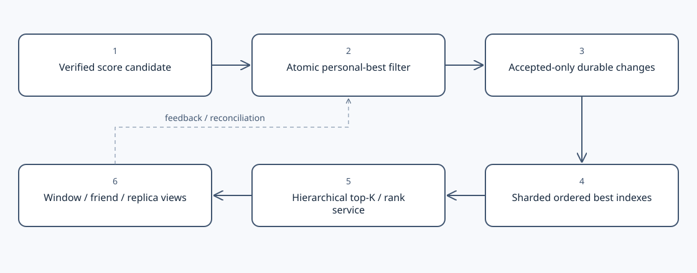

# W396. Game Leaderboard System Design

**Priority group:** Fourth 100 — role-dependent depth

**Category:** Games, simulations and object design

**Study position:** 396 of 547

[Group list](../FOURTH_100.md) · [All categories](../ALL_CATEGORIES.md) · [Chapter guide](../README.md)

## Question

Design a real-time global game leaderboard supporting score updates and top-K queries for millions of players. Starts single-server (top-K reads, 1 write/sec, no friends) and incrementally adds friend leaderboards, time windows, and replication toward 100K writes/sec and 1M reads/sec.

### Requirements

Functional: submit a score; read top-K (K configurable, default 100); read personal best / rank; read neighborhood (top-K around a player); client learns whether a submission updated personal-best, rank, or neither.
Core framing: NOT store-every-score-forever; persist only a new personal best or a top-K break; filter the rest before durable storage.
Design anchors

Redis Sorted Set (ZADD / ZREVRANGE / ZREVRANK, O(log N)); shard by player-id with scatter-gather top-K; friend leaderboard = per-user ZSCORE + client sort; rolling sorted set per time window; durable log + leaderboard processor with idempotency; deterministic tiebreak (score DESC, achieved_at ASC, submission_id ASC); hot-game hierarchical top-K.

## Worked solution

### Start small and preserve the storage rule

At one update/s, use a per-player Best record and one ordered index with total comparator **(score DESC, achieved_at ASC, submission_id ASC)**; rank is ordinal position and neighborhood is the K entries centered on it, clipped at board ends. The server supplies trusted achieved time and verifies the score/session so clients cannot backdate a tie. Bound configurable K, e.g. an assumed maximum of 1,000, to prevent an unbounded query. APIs: `POST /scores` with game/player/submission ID, score and evidence; `GET /top?k=`, `/players/{id}/best`, `/rank`, `/neighbors?k=`, and `/friends/top`.

The core retention constraint is not an append-only log of **every** attempt. Serialize an authoritative comparison per player/board, reject nonimproving candidates before durable score storage, and append only a new personal best or an explicitly retained top-K entrant plus its outbox. Equal scores with later timestamps do not improve the ordered best. Distinguish all-time best from a period best: a score below lifetime best can still improve this week's board. If “top-K break” means a separate best-attempts board rather than one row/player, define/store that additional bounded index; otherwise global top-K membership implies a per-player best in the ordinary best-per-player board. Discarded attempts can increment aggregate telemetry without retaining each original score forever.

Best(player,board,score,time,submission_id,version), AcceptedScoreEvent(id,player,board,old_best,new_best), BoardManifest(window,generation,watermark), friend adjacency and an outbox are sufficient. A discarded attempt need not get a durable per-attempt dedup record under this rule: retransmission is harmless because best comparisons are monotone, but an exactly repeated historical response is not promised. Accepted submission IDs/request hashes deduplicate persisted changes. Return `best_updated`, observed rank/best/version, and whether that rank differs from a client-provided prior rank/version; rank may change because others improved, so do not claim every reported rank change was caused by this submission.

### Atomic update, tie order and replicas

The diagram's score gate atomically compares stored best, updates it and commits the accepted-event/outbox before ACK. A Redis Lua compare-and-update can serialize a cache index, but a non-durable cache followed by a later database write can lose an acknowledged best. Either use durable transactional best state plus replayable materialization or define/test Redis durability/replication/fencing explicitly. A local fast rejection cache must not hide a valid window improvement; use authoritative monotone versions and never reject solely from speculative uncommitted state. Process accepted events idempotently by player/board version, replacing an old member rather than summing personal-best values.

Redis ZADD/ZREVRANK gives O(log N) update/rank, and top/neighbor range reads O(log N+K), but score-only reverse order uses its own member tie order. Implement the requested time/ID comparator with an exact composite ordered key (e.g. fixed-width inverted score/time/ID lex keys at constant numeric score, removing the prior key), or another augmented order-statistic tree. Do not cram arbitrary fields into double precision and assume ties remain exact. Serve replica reads with board generation/watermark; require the submitting player's minimum applied version for read-your-update, or disclose a pending rank until applied. A replica failing over must not regress an acknowledged durable best.

### Grow to 100K writes/s and one million reads/s

Shard best ownership by player ID within a game. For global top-K, fetch each shard's local top-K and merge: this is **exact** for a disjoint player partition with the same total comparator, because a player outside its local K already has at least K globally better players. Hierarchical top-K mergers/cache generations reduce a query from every read scattering to every shard. At assumed 100 shards and K=100, a full refresh merges at most10,000 candidates, while cached top pages serve the million-read/s hot path. Local score updates invalidate/coalesce refreshes; return as_of/watermarks rather than claim all cached views are instantly current.

Global **rank/neighborhood** are harder: a local shard rank is not a global rank. Count entries with comparator better than the player's across shards at a coherent snapshot; use score-range histograms/count trees for bounded domains or range-partitioned ordered indexes with prefix counts to reduce fanout. Exact current rank requires coordinated/version-consistent counts and may cost more than top-K. Cache rank snapshots/refresh boundedly or provision a dedicated rank service; do not promise one-million/s arbitrary exact scatter-gather ranks on the strength of a top-K cache. Cross-shard neighborhood uses global rank/range selection and merged predecessor/successor candidates, not merely adjacent local players.

Friends: obtain authorized friend IDs, batch ZMSCORE/point best lookups across relevant shards, then sort the bounded friend set by the same comparator. Client-side sorting is optional presentation only; enforce access server-side and cap/paginate very large friend lists. Recheck privacy/blocks. At assumed 10 million players×64-byte best metadata, raw state is 640 MB before indexes/replicas/window multiplication. Worst case every 100K incoming update/s is an accepted new best, so provision the durable path for 100K/s; filtering is not guaranteed to reduce peak. If accepted events are 100 bytes, sustained worst-case event volume is864 GB/day before replicas; compact old accepted changes into versioned best snapshots when history is not required, rather than retaining every accepted improvement forever. One million top reads/s returning 100 compact 32-byte entries is 3.2 GB/s payload, motivating replicated page caches/edge delivery.

### Windows, failure cases and a necessary limitation

Fixed calendar day/week/season boards use separate keys, period-scoped bests and TTL after late-arrival/correction grace; all-time bests remain separate. Exact **sliding** per-player maxima are incompatible with retaining only the current best/top-K changes in general. Counterexample: score 100 at t0, then 90 at t1 is discarded as neither an improvement nor a top-K entrant; after 100 ages out,90 should become the sliding best, but its data is gone. To offer exact sliding windows, relax retention to keep nondominated future-best candidates (e.g. monotone per-player deques with timestamps) or bounded time-bucket bests with explicitly approximate boundary semantics. A “rolling sorted set” alone cannot reconstruct discarded candidates. This is a product/retention decision, not a cache algorithm fix.

On owner/cache failure, restore a verified best snapshot and replay only accepted changes under fenced leadership; index updates use versions so old events cannot replace newer records. Stable snapshot cursors avoid duplicated/skipped pages during score movement. Test two concurrent improvements, rejected retry, deterministic ties, local-top-K union, exact global rank versus local rank, friend access and the sliding-window counterexample. Observe update acceptance ratio, durable/mirror lag, top-page/rank freshness, shard skew, late-window updates and reconciliation. This grows the initial simple service while preserving the explicit filter-before-durable-storage rule and naming the costs of stronger rank/window guarantees.

<!-- architecture:W396:start -->

Read the numbered path as Verified score candidate → Atomic personal-best filter → Accepted-only durable changes → Sharded ordered best indexes → Hierarchical top-K / rank service → Window / friend / replica views. The dashed return represents replay/reconciliation under the stated version, deduplication and authority rules; the slow delivery/read side does not own the accepted input.
<!-- architecture:W396:end -->

[Batch behavioral checks](../test_review_392_396.py) validate the explicit notification, crossing, uniqueness and ranking fixtures. The capacity/SLO numbers are calculations and targets, not production measurements.

### Further study

- [F168: Design a state-wide temperature ingestion and query system.](../17_distributed_systems_depth.md#f168)
- [F162: Design a durable work queue with retries and leases.](../17_distributed_systems_depth.md#f162)
