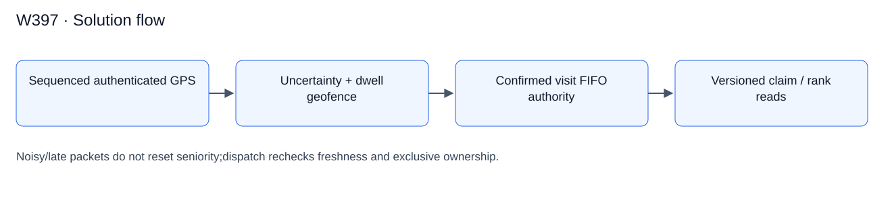

# W397. Design a Pickup Area Driver Queue

**Priority group:** Fourth 100 — role-dependent depth

**Category:** Geospatial, dispatch and tracking systems

**Study position:** 397 of 547

[Group list](../FOURTH_100.md) · [All categories](../ALL_CATEGORIES.md) · [Chapter guide](../README.md)

## Question

Design an internal pickup-area driver queue service that maintains, in real time, an ordered queue of eligible drivers for each geofenced pickup zone (such as an airport staging lot).

The core challenges are real-time geofence membership and ordered state management:

Deciding when a driver is inside an area.
Keeping queue order stable under continuous movement and noisy location events.
Serving fast queue reads (position, next-up).

Discuss ingestion, geofence detection, ordering/state machine, storage, idempotency, and how you keep the queue correct despite GPS noise and out-of-order events.

## Worked solution

### Define a queue entry as a confirmed visit, not a GPS packet

Choose FIFO among eligible drivers' **confirmed zone visits**. Position is assigned when the service confirms entry, not from an untrusted device timestamp. A location update never resets an existing visit's queue sequence. Clarify priority classes, temporary exits and decline policy before launch; here there is one FIFO class, a deliberate decline joins the tail, and a brief connectivity pause preserves seniority for 60 seconds. Physical arrival time cannot be inferred perfectly from noisy GPS, so this is an explicit fairness contract.

Use `Location(driver,session_epoch,sequence,fix_time,received_at,lat,lon,accuracy)`, versioned `Zone(id,polygon,entry_margin,exit_margin,dwell_policy)`, `DriverState(driver,visit_id,zone,state,last_sequence,last_fresh_fix,version)` and `QueueEntry(zone,visit_id,driver,enqueue_seq,state,offer_id,offer_expiry)`. An active-driver uniqueness constraint prevents simultaneous active entries in different zones. Index `(zone,state,enqueue_seq)` for next-up and `(driver,visit_id)` for own position. Location history and audit transitions retain evidence without turning every packet into a queue rewrite.

### Detect entry and exit with uncertainty and hysteresis

Authenticated telemetry appends to a durable log partitioned by driver. Process only the current session epoch and increasing sequence; retain older packets for diagnostics but never let them roll current membership backward. Bound unreasonable/future fix timestamps and excessive transport delay. A spatial cell cover/R-tree finds nearby zones, followed by exact polygon/uncertainty checks. A cell match alone is not inside proof.

For an illustrative policy, require a good-quality fix confidently inside an eroded entry boundary for 10 seconds; exit requires a fix confidently beyond an expanded boundary for 20 seconds. Accuracy ellipses overlapping the boundary remain uncertain rather than flipping state. Exact margins/dwell depend on the lot and measured error, not one universal meter threshold. Overlapping zones use a deterministic priority/explicit check-in rule and one active visit. A trusted server arrival sequence establishes queue order after confirmation. Eligibility also checks availability, vehicle/airport permission and no active trip; being geographically inside is insufficient.

State transitions are `OUTSIDE -> ENTERING -> QUEUED -> OFFERED -> ASSIGNED`, with confirmed exit returning to OUTSIDE. Stale GPS/disconnection first changes QUEUED to PAUSED, excluding it from dispatch while retaining its sequence during the stated grace; after the grace remove the visit. A confirmed physical exit ends the visit, so a later re-entry gets a new sequence. Noisy inside packets preserve the same visit/position. An assigned vehicle does not automatically rejoin merely because it drives through the zone.

### Keep ordering and exclusive claims authoritative

`POST /zones/{id}/check-ins` creates/returns the current visit after eligibility confirmation; `GET /zones/{id}/me` returns visit, state, position, queue_version and location freshness. `GET /zones/{id}/next` is advisory. Internal `ClaimNext(zone,ride_id,request_key)` atomically selects the first fresh eligible QUEUED entry, changes it to OFFERED, writes an offer lease and the ride/request dedup result, then publishes via an outbox. Accept compares offer ID, visit/version and expiry before ASSIGNED. Two matchers cannot claim the same driver, and a retry of one ride cannot advance the queue twice. Timeout pauses/revalidates the driver under the grace policy; explicit decline moves it to the tail as a new sequence.

For a modest metro, keep zone entries, driver active-visit authority and enqueue counters in one transactionally replicated shard. The high-rate position stream is separate; only confirmed membership/eligibility transitions reach this database. A Redis sorted-set projection can answer fast rank/head reads, but its lag is shown by queue_version and it is not the final assignment authority. Its score is the server enqueue sequence, not continuously changing distance. A ranked tree gives O(log n) rank/head updates; SQL counting earlier active entries is sufficient for small queues. A driver's fresh state is rechecked at claim even if the projected head is stale.

### Size and walk through failures

Assume 100,000 reporting drivers at one fix/5 seconds: 20,000 packets/s. At 200 bytes/packet that is 4 MB/s, about 346 GB/day raw before replication; retain/compact only what the operational/privacy policy needs.500 zones averaging 100 queued drivers give 50,000 entries; at 64 packed bytes each only3.2 MB logical, though indexes/history/runtime overhead are extra. A hotspot of 5,000 entries is an ordering/claim contention concern, not a reason to process every GPS update under one global lock. Target, for example, p99 own-position reads<100 ms and confirmed transitions visible within 2 seconds, validated under hotspot bursts.

Example: A has sequence41 and B42. A's sequence105 location confirms continued presence; delayed location103 says outside and is ignored. An uncertain edge fix does not move A behind B. Two ClaimNext calls serialize; one offers A and the other offers B, while a duplicate ride key returns the original offer. If A's session becomes stale before claim, it is paused and B becomes next. Recovery replays confirmed transitions/idempotent events, rebuilds projections and fences old leaders. Cross-metro movement transfers a fenced driver-ownership lease and closes the old active visit before the new owner can enqueue; an unreachable old owner cannot be bypassed with an unfenced second visit. A network minority cannot issue new authoritative claims; serve visibly stale positions or a temporary unavailable response. Monitor false entry/exit appeals, paused age, location lag, queue/projection divergence, claim conflicts, offer timeouts and fairness by visit—not just telemetry throughput.

<!-- architecture:W397:start -->
### Follow the diagram

Read left to right: Sequenced authenticated GPS → Uncertainty + dwell geofence → Confirmed visit FIFO authority → Versioned claim / rank reads. Noisy/late packets do not reset seniority; dispatch rechecks freshness and exclusive ownership.
<!-- architecture:W397:end -->

### Further study

- [F081: Structure an ML system-design answer.](../09_ml_system_design.md#f081)
- [F165: Design idempotency for an order or booking API.](../17_distributed_systems_depth.md#f165)
- [F168: Design a state-wide temperature ingestion and query system.](../17_distributed_systems_depth.md#f168)
