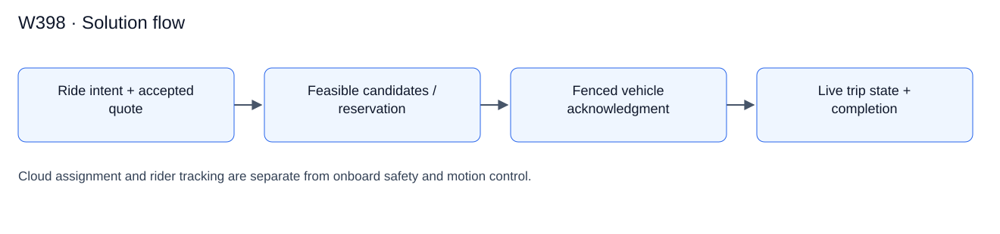

# W398. Design a Waymo-like Autonomous-Vehicle Ride-Hailing App

**Priority group:** Fourth 100 — role-dependent depth

**Category:** Geospatial, dispatch and tracking systems

**Study position:** 398 of 547

[Group list](../FOURTH_100.md) · [All categories](../ALL_CATEGORIES.md) · [Chapter guide](../README.md)

## Question

Design a user-facing autonomous-vehicle ride-hailing app (Waymo-like). A user requests a ride, the system matches an available vehicle, the user tracks the vehicle en route and during the trip, and the system handles the full ride lifecycle and edge cases.

This is a product/system-design round: cover the request → match → pickup → in-trip → drop-off lifecycle, real-time location tracking, and edge cases (no cars available, cancellations, vehicle becomes unavailable mid-assignment, GPS/network loss, surge). Discuss the core services, data flow, and how matching and live tracking scale.

## Worked solution

### Separate the ride service from onboard driving safety

The cloud product owns ride intent, matching, customer-visible state and payment. The vehicle owns real-time motion planning/control and a safe response to lost connectivity. A successful app request is not permission to bypass the vehicle's operational design domain, health checks or safety controller. Scope to one rider party per vehicle; pooling and route optimization across parties are separate extensions.

APIs include `POST /quotes {pickup,destination,accessibility}` returning a price/ETA/validity version; `POST /rides {quote_id,request_key}` returning 202 ride ID; `GET /rides/{id}`; a versioned ride/location stream; `POST /rides/{id}/cancel`; and a pickup verification/unlock request bound to this rider, vehicle and assignment. Quote expiry or surge changes require a newly accepted quote before commitment, not a surprise fare update during a retry. Derive rider identity from authentication and keep location history access scoped to the trip.

Store `Ride(id,rider,request_key,payload_hash,state,vehicle,assignment_epoch,pickup,destination,quote_version,version)`, `Vehicle(id,home_region,health,battery,capabilities,ODD_version,availability,assignment_epoch)`, short-lived latest telemetry, an append-only ride transition log, and idempotent payment operations. A unique live assignment constraint covers both vehicle and ride. State progresses `REQUESTED -> MATCHING -> VEHICLE_RESERVED -> EN_ROUTE -> ARRIVED -> IN_TRIP -> COMPLETED`, with valid cancellation/failure branches. Transitions require the expected version/actor; a delayed ARRIVED message cannot move a completed ride backward.

### Match feasible cars, then commit one assignment

Vehicle telemetry enters a partitioned stream; sequence plus boot/session epoch rejects stale/reordered updates. A geospatial index finds nearby available vehicles. Filter freshness, charge/range, seats, accessibility, maintenance and road/ODD serviceability first, then rank a small candidate set by road ETA, deadhead cost and fleet balance. Straight-line distance is only candidate generation. A vehicle near the pickup but across an inaccessible road or outside its allowed operating area is not eligible.

A regional assignment authority atomically changes an available vehicle to reserved and binds a ride/assignment epoch. The outbox sends `Assign(ride,vehicle,epoch)`; the vehicle accepts only a current valid epoch and acknowledges. Do not tell the rider pickup is confirmed merely because a message was queued. Retries carry the same command ID. If the acknowledgement is unknown, retain the reservation and reconcile; blindly timing out the database lease and giving the car to another rider can leave two physical assignments. Lease/epoch validation must also be enforced by the vehicle agent, including after reboot.

Pickup uses an authorized rider handshake and vehicle boarding/door state. IN_TRIP follows a validated onboard event, not proximity alone. Drop-off/completion is acknowledged by the vehicle and produces one final fare/payment operation; a missing acknowledgement leaves a reconciling state. An app disconnect does not cancel a rider already onboard. Cancellations race assignment/boarding through the same versioned authority, with explicit policy for fees and post-boarding changes.

### Track live progress without treating stale telemetry as live

Clients subscribe to the authenticated ride channel over WebSocket/SSE. Send a snapshot plus increasing state/location sequences; reconnect resumes or receives a newer snapshot if history expired. Conflate high-rate positions to the UI cadence and discard older updates. Show last-updated age and a lost-signal state; interpolation for smooth maps must not claim a stale position is current. Ride lifecycle events are durable and replayable, while intermediate map positions may be replaceable. Vehicle/rider channels and operational fleet telemetry have different audiences and retention.

Assume 100,000 vehicles reporting1 Hz at 200 bytes: 100K updates/s, 20 MB/s and 1.73 TB/day raw if retained. Assume 1M rides/day: 11.6 requests/s average or 116/s at 10× peak; with 30-minute mean ride lifecycle, about 20,800 rides are concurrently active on average. Candidate evaluation of 50 vehicles at 116/s is 5,800 scored pairs/s; telemetry/fan-out dominates more than matching arithmetic. 100K subscribed screens at 1 Hz×200 bytes imply20 MB/s payload before protocol overhead. Partition by metro/vehicle for locality, replicate hot trip snapshots and isolate a busy city. Benchmark p99 match/stream latency separately from total pickup ETA.

### Define every failure as a state transition

No eligible cars returns a bounded waitlist/unavailable result with honest ETA and optional user-approved broader search; never an indefinite spinner. A vehicle becoming unavailable before pickup is removed/fenced, reconciled and rematched with rider notification. A mid-trip fault triggers the vehicle's safe local procedure and support/recovery workflow; the cloud cannot simply declare another car assigned to an occupied rider. GPS loss removes the vehicle from new dispatch and labels tracking uncertain; network loss relies on onboard behavior and command leases, not continued blind cloud control. Surge/admission limits protect matching and provider dependencies, with bounded queues and retry budgets.

Example: two rides shortlist V7; only one reservation transaction wins. The loser's retry chooses another car. If V7's assignment response is lost, the winning ride stays reserved/reconciling and retries the same epoch; an old cancellation cannot later clear V7's new assignment. Exercise duplicate requests, late vehicle acks, cancel-vs-board, stale telemetry and regional failover. Monitor assignment conflicts, unknown reservations, tracking age, no-car rate, pickup failures, cancellation fairness, ride-state lag and payment reconciliation. Availability does not justify an unfenced second assignment or a safety promise beyond the onboard system.

<!-- architecture:W398:start -->
### Follow the diagram

Read left to right: Ride intent + accepted quote → Feasible candidates / reservation → Fenced vehicle acknowledgment → Live trip state + completion. Cloud assignment and rider tracking are separate from onboard safety and motion control.
<!-- architecture:W398:end -->

### Further study

- [F081: Structure an ML system-design answer.](../09_ml_system_design.md#f081)
- [F165: Design idempotency for an order or booking API.](../17_distributed_systems_depth.md#f165)
- [F168: Design a state-wide temperature ingestion and query system.](../17_distributed_systems_depth.md#f168)
