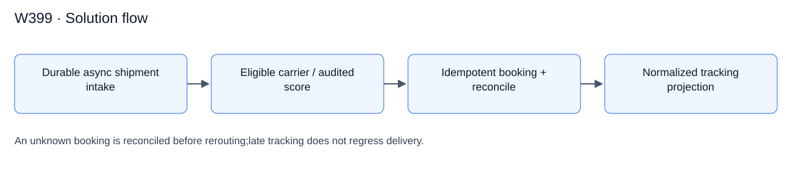

# W399. Design Multi-Carrier Package Delivery Routing System

**Priority group:** Fourth 100 — role-dependent depth

**Category:** Geospatial, dispatch and tracking systems

**Study position:** 399 of 547

[Group list](../FOURTH_100.md) · [All categories](../ALL_CATEGORIES.md) · [Chapter guide](../README.md)

## Question

Design a system that ships customer packages through multiple delivery partners (UPS, USPS, FedEx, last-mile contractors), choosing a partner per package based on cost, capacity, and SLA, and tracking the package through each partner's API.

### Requirements

Functional: accept a package creation request (origin, destination, weight, dimensions, service-level requested); select a carrier; book the shipment with that carrier; track status updates from the carrier and surface them to the customer; handle exceptions (carrier rejects pickup, package lost, address invalid).
Non-functional: carrier API quirks (per-carrier auth, rate limits, request schemas, webhook formats) must be isolated; the order placement path cannot block on carrier API latency; tracking updates must be eventually consistent across the customer-facing UI; the routing decision must be auditable.
Data model: Shipment (id, order_id, carrier_id, carrier_tracking_number, status, created_at, sla_target_at); Carrier (id, name, capability_matrix, rate_card_url); RoutingDecision (shipment_id, candidates_considered, chosen_carrier, reason); CarrierEvent (shipment_id, carrier_event_type, raw_payload, normalized_status, observed_at).

## Worked solution

### Route to a carrier service; do not solve an unrelated vehicle-routing problem

This system chooses a delivery partner/service for one package. Each carrier owns its own physical route. The order placement API must return after durable local acceptance rather than wait for quotes, booking or tracking APIs. `POST /shipments {order_id,origin,destination,weight,dimensions,service_level,request_key}` validates basic units/required fields, stores intent and returns 202 `{shipment_id,status:"routing"}`. A repeated key with the same payload returns that shipment; changed payload returns 409. `GET /shipments/{id}` exposes status, timestamps and exceptions; customer identity/ownership is checked independently of tracking-number knowledge.

Extend the supplied data model with `CarrierService(carrier,service,coverage,weight/dimension_limits,capacity_policy,version)`, `BookingAttempt(shipment,attempt_key,carrier,state,provider_reference,lease_epoch)`, and an outbox. Shipment retains its accepted package snapshot and SLA deadline. RoutingDecision records every candidate's eligibility/rejection reason, quoted/estimated cost, currency, delivery estimate/capacity watermark, policy version and final choice. CarrierEvent additionally stores provider event ID, occurred_at, received_at and payload/version. Keep credentials in a secret store, not rate-card rows or audit JSON.

### Make hard eligibility distinct from cost ranking

A worker leases the shipment, validates the address asynchronously, then filters carrier services by origin/destination coverage, package limits, requested service and required capabilities. Read versioned local rate cards/capacity where possible; call live quote APIs through per-carrier adapters and independent bounded concurrency/rate budgets. Different authentication, schemas, error codes, webhook signatures and tracking enums stay behind `quote/book/query_by_client_key/track/cancel` interfaces. These are internal adapter contracts, not claims that every carrier supports identical endpoints.

Choose the cheapest eligible service or an explicit expected-cost objective such as postage+surcharges+expected late penalty. A hard on-time/SLA threshold cannot be bought away by a cheap score. Example: A costs$6 but has zero remaining contracted capacity;B costs$7 with estimated on-time probability.98; C costs$6.50 with.80. Under a>=.95 threshold,only B qualifies. Under an allowed soft$10 late penalty, B's score is 7.20 versus C8.50, also B. Those probabilities/costs are an illustrative fixture, not measured carrier performance. Atomically reserve any capacity/quota owned by this service while recording the decision; external carrier acceptance remains authoritative for partner capacity.

### Book through a durable, idempotent state machine

States include `ACCEPTED -> VALIDATING -> ROUTING -> BOOKING_PENDING -> BOOKED -> IN_TRANSIT -> DELIVERED`, with address/action-required, lost/exception, return and cancellation branches. A committed routing decision and stable booking key precede the external call; no database transaction stays open during it. On success, persist carrier reference/tracking number and publish the customer event atomically with an outbox. A crash after carrier acceptance but before saving its response retries/queries by the same partner idempotency/client key.

If a carrier definitively rejects pickup, release the reserved capacity and reroute under a new audited decision/attempt. If the result is **unknown**, do not book a second carrier yet: reconcile the first attempt or require an operational decision. Without partner idempotency or lookup by client reference, exactly-once external booking after an ambiguous timeout cannot be guaranteed. A local dedup table alone cannot prevent two physical pickups/labels/charges. Definitive invalid-address errors wait for an authorized correction/version rather than consume endless retries.

### Normalize tracking without losing the carrier's evidence

Signed webhook ingestion and fallback polling append raw events idempotently by `(carrier,provider_event_id)` or a documented stable event fingerprint. A callback arriving before the booking response goes to a pending inbox by carrier tracking/client reference until it can be attached. Preserve both source event time and receipt time. A status projector applies the carrier's valid transition/revision policy: a delayed IN_TRANSIT packet cannot regress DELIVERED, but a legitimate later RETURN_STARTED is a new branch, not a smaller ordinal to discard. Carrier corrections remain auditable. Customer read models are eventually consistent—for example, p95 within 30 seconds after our receipt—with last-reported/source age visible; this cannot bound a partner's reporting delay.

Lost packages enter exception/claim/support flow with SLA breach alerts; customer messages do not imply a refund/claim succeeded until confirmed. Polling uses due-time buckets, backoff and global per-partner budgets, not one thread per shipment. Provider circuit breakers and separate queues prevent a slow carrier blocking unrelated bookings/tracking; reserve recovery capacity and a DLQ with replay keys.

Assume 10M shipments/day ≈ 116/s average, 1,157/s at 10× peak. Three live quote calls each would be 3,472 partner calls/s peak, so local rate cards/batching/cache and negotiated quotas matter. At 20 tracking events/shipment, 200M events/day ≈ 2,315/s average, 23K/s peak; 1 KB/event is 200 GB/day raw before indexes/replicas. Partition intent by shipment/order and events by shipment/time; cache status projections but retain routing/source evidence under the audit policy. Validate duplicate creates/webhooks, out-of-order delivery events, carrier rejection, unknown booking outcomes, address correction and replay. Monitor routing cost/on-time calibration, capacity conflicts, booking ambiguity, partner throttles, tracking lag and exception age.

<!-- architecture:W399:start -->
### Follow the diagram

Read left to right: Durable async shipment intake → Eligible carrier / audited score → Idempotent booking + reconcile → Normalized tracking projection. An unknown booking is reconciled before rerouting; late tracking does not regress delivery.
<!-- architecture:W399:end -->

### Further study

- [F081: Structure an ML system-design answer.](../09_ml_system_design.md#f081)
- [F165: Design idempotency for an order or booking API.](../17_distributed_systems_depth.md#f165)
- [F168: Design a state-wide temperature ingestion and query system.](../17_distributed_systems_depth.md#f168)
