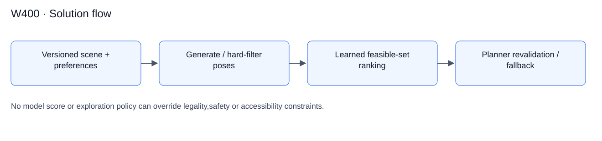

# W400. ML System Design: Choose Passenger Drop-off Location

**Priority group:** Fourth 100 — role-dependent depth

**Category:** Geospatial, dispatch and tracking systems

**Study position:** 400 of 547

[Group list](../FOURTH_100.md) · [All categories](../ALL_CATEGORIES.md) · [Chapter guide](../README.md)

## Question

L6 ML design round: when a Waymo passenger arrives at the destination, decide where exactly to pull over. Walk through model features, ranking objective, safety constraints, and how human / regulatory rules interact with the ML score.

### Requirements

At trip end, choose a curbside parking spot for the AV to stop and drop off the passenger.
Inputs: ego state + sensor view of the immediate area, map data (lane markings, parking regulations, building entrances), passenger preferences (door choice, accessibility needs), historical drop-off data at the same location.
Output: a ranked list of candidate stop poses with scores; the planner consumes the top feasible candidate.
Constraints: legality (no-stopping zones, fire hydrants), safety (clear lane visibility, distance from intersections), passenger experience (proximity to the destination door, lighting), and operational considerations (re-merge cost into traffic).
Notes
Candidate generation. Sample candidate stop poses along the destination block face, e.g. every 0.5 m. Filter for legality from map annotations. Filter for safety from real-time perception (no obstacles in the proposed spot).
Scoring. Use a learned ranker that combines (a) walking distance from the stop pose to the destination door, (b) historical success rate at the same micro-location, (c) lane congestion / disruption cost, (d) passenger preference signals. Calibrate the score so the top-K candidates form a usable shortlist for the planner.
Hard constraints vs soft scoring. Legality and safety are hard filters — never let the model override them. The learned ranker only orders the remaining feasible set.
Long-tail and human override. Rare failure modes (unusual side request, construction zones, special events) require either a high-confidence override path or a graceful fallback to a rule-based default. Capture these in training data via labeling pipelines on overridden rides.
Evaluation. Offline: walking distance, override rate, ranker-vs-rule agreement. Online: passenger satisfaction (1–5), planner abort rate, time spent searching for a new spot, second-pull-over rate. Run a multi-armed bandit at deployment to balance exploitation of the learned ranker with exploration of new candidate generation strategies.
Personalization. Per-rider preferences (curb side, walking budget, accessibility) are stored as features but kept narrow to avoid privacy / fairness issues.

## Worked solution

### The learned model ranks only safe, legal, serviceable poses

The output is a shortlist of `(pose,utility_score,estimated_success,context_version,valid_until)`, not a command to stop. Pose includes position, heading and coordinate frame. The motion planner must still prove reachability and collision-free maneuvering under its latest world state; it can reject every candidate. Passenger accessibility requirements are serviceability constraints, not a soft preference that a high model score may override. Applicable map/regulatory rules are versioned policy inputs; no numeric hydrant/intersection distance is invented here.

Generate poses along relevant destination block faces, for example every.5m over 100m gives about 200 longitudinal samples before orientation/side variants. Align vehicle footprint/heading to curb geometry, check sufficient contiguous free length and door/ramp clearance, and connect to a traversable walking route to the **actual entrance**. A nearby point across a barrier or an inaccessible staircase is not a short usable walk. Filter no-stopping restrictions, time-dependent regulations, intersection visibility and mapped access. Then filter using current perception for occupied space, pedestrians/cyclists, construction, visibility/uncertainty and a safe exit/remerge path. Missing/stale legality or safety evidence yields unknown/infeasible, not a permissive default.

### Features, labels and the ranking objective

Use ego pose/speed/localization uncertainty; curb/lane geometry and road restrictions; perception occupancy/visibility and predicted road-user motion; walking-route distance/grade/crossings; lighting proxy; expected traffic disruption/remerge time; explicit door/accessibility/walking preferences; and historical micro-location outcomes with sample counts/recency. Historical success needs smoothing and exposure information: a curb used once successfully should not outrank a well-observed safe curb merely because its empirical rate is 100%.

Start with a transparent feasible-closest-entrance rule. A gradient-boosted pointwise success/cost model or pairwise/listwise ranker can improve ordering without requiring a large neural model. Label completed drop-offs, planner aborts, second pull-overs, override reasons, search time and voluntary satisfaction, with versioned candidate/perception/map context. Only the chosen pose's real outcome is observed; unchosen poses are not automatically failures. Human annotators compare feasible candidates in recorded scenes/simulation, while logged exploration propensities support exposure-aware evaluation. A human override may reflect a preference or new hazard, not unconditional proof the previous candidate was unsafe; record the reason and adjudicate difficult cases.

For an illustrative utility,$U=10p_{success}-.02d_{walk}-.1t_{disrupt}-.05t_{remerge}$, with meters/seconds and weights chosen through product/safety review. It trades passenger/operational quality **after** hard filters. Calibrate a separately defined probability of a successful no-replan/no-assistance drop-off on held-out production-like contexts; an arbitrary rank score or candidate-set softmax is not inherently a calibrated probability. Return both utility and calibrated success/uncertainty so the planner receives a usable top-K with diversity across nearby poses when useful.

Example: A is 2m from the door but in a no-stopping zone, so it is removed regardless of score. B is legal/clear/accessibly reachable with p=.98, walk15m, disruption5 s and remerge10 s; U=8.50. C is feasible with p=.90, walk5m, disruption20 s and remerge5 s; U=6.65. Rank B before C, then let the planner revalidate B. If a cyclist enters B's maneuver space, the stale shortlist cannot authorize it; recheck or replan.

### Keep the real-time boundary local and explicit

An onboard/local service receives map/rule versions, ego/perception snapshot and narrow trip preference flags. Candidate generation, hard filters, feature assembly and batched rank scoring share that context. An illustrative budget is 20 ms generation/map filters, 30 ms dynamic feasibility, 10 ms ranking and 40 ms planner/interface margin within 100 ms, refreshed at 5 Hz; actual measured worst-case deadlines and planner cadence determine validity. A cloud feature outage must not block the local safety loop. Cache approved local rules/map tiles and simple historical aggregates; do not put a remote database lookup in each 200-pose evaluation.

The planner validates the selected pose against the **latest** state and owns execution. Expired context/version or missed compute deadlines trigger the known safe local fallback: continue a permitted route/search, stop only where the safety system allows, or request assistance. A rule-based default must pass the same hard filters. A human operator may propose a different allowed candidate or clarify the destination; neither a high-confidence model nor an operator UI silently waives a hard restriction. Route/map-policy changes require the appropriate authorized versioned process.

### Evaluate rare failures and constrain exploration

Split by time, trip and geographic blocks/entrances to avoid memorizing neighboring samples in train/test. Offline report feasible-candidate recall against expert scenes, success calibration, top-K planner acceptance, walking distance, override reasons and long-tail slices (construction, night, accessibility, events). Rule agreement is a diagnostic, not ground truth. Simulation/replay and controlled tests cover unsafe candidates that cannot be explored with passengers. Online measure satisfaction1–5 with response bias, abort/search time, second-pull-over rate, assistance and safety/compliance guardrails; aggregate walking reduction alone is insufficient.

Deploy shadow scoring, then small guarded cohorts. The requested bandit chooses among **preapproved candidate-generation/ranking strategies within the feasible set**, with bounded exploration, logged propensities, a baseline fallback and automatic guardrail rollback. It never explores legality/safety violations or treats rare harm as an acceptable unbounded reward trade-off. Delayed/sparse satisfaction and correlated micro-location outcomes require uncertainty and cluster-aware analysis. Store only necessary opt-in preference flags; monitor service quality across accessibility needs rather than infer sensitive traits. Override examples enter a reviewed labeling loop and versioned retraining/canary plan. This is a design with illustrative parameters, not a claim of demonstrated autonomous-driving safety or measured model gains.

<!-- architecture:W400:start -->
### Follow the diagram

Read left to right: Versioned scene + preferences → Generate / hard-filter poses → Learned feasible-set ranking → Planner revalidation / fallback. No model score or exploration policy can override legality, safety or accessibility constraints.
<!-- architecture:W400:end -->

### Further study

- [F081: Structure an ML system-design answer.](../09_ml_system_design.md#f081)
- [F165: Design idempotency for an order or booking API.](../17_distributed_systems_depth.md#f165)
- [F168: Design a state-wide temperature ingestion and query system.](../17_distributed_systems_depth.md#f168)
