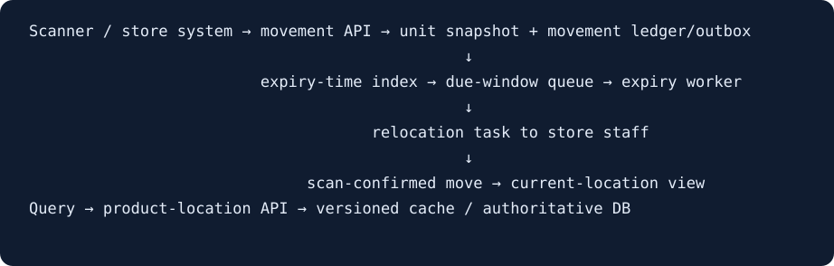

# W401. Perishable-Goods Tracking & Location System

**Priority group:** Fifth 100 — specialized practice

**Category:** Geospatial, dispatch and tracking systems

**Study position:** 401 of 547

[Group list](../FIFTH_100.md) · [All categories](../ALL_CATEGORIES.md) · [Chapter guide](../README.md)

## Question

Phone-screen system design (part of a combined ~55-min round). Design a service that tracks and locates perishable products across multiple stores: when an item expires it moves to a storage area, and the system must locate any product by ID, persist a ledger, and answer 'which store has which expired items, and where in storage they are now.'

### Requirements

Track perishable products across multiple stores. When a product expires it is moved to a storage area; many stores, many products, many storage areas.
Functional: locate any product by ID; persist a durable ledger of product state and movements; answer at query time which store holds which expired products and where in the storage area each currently is.
This is a high-level design round (API + data model + scaling), not a low-level schema-DDL exercise.
Notes
API: REST web tier, GET /products/{id}/location. Datastore probe: relational (RDS/Postgres/MySQL) vs NoSQL (DynamoDB) - consistency is NOT the only justification; bring query flexibility (store x expiry x location joins favor relational) and key-based scale/throughput (favor DynamoDB). Expiry-scan probe: do not re-scan the full table; index on expiry time and pull only items expiring in the next window into a time-bucketed queue. Read-heavy: cache layer for hot location lookups, load balancing + horizontal autoscaling.

## Worked solution

### Track physical units separately from catalog products

A SKU identifies a kind of product; the location query needs a specific unit or lot/container ID. Model a unit/lot with SKU, quantity if appropriate, store, expiry, current location, state and version. Locations form store → storage area → bin. A durable movement ledger records old/new locations, actor/device, event ID, event time and commit time.

[Open the architecture diagram](../diagrams/W401_review_architecture.svg).

### Expiry is not evidence of physical movement

At expiry, mark the product EXPIRED and create a relocation task. It remains at its last confirmed location until a staff/device scan acknowledges the move. Returning “storage bin B” merely because a timer fired would confuse intended work with physical reality. States such as EXPIRED_AWAITING_MOVE and EXPIRED_IN_STORAGE make the distinction visible.

`GET /products/{unit_id}/location` returns store, area/bin, last confirmed timestamp, state and version. `POST /movements` takes an event ID, unit, expected version and scanned destination. Validate store/bin membership and permissions, then append ledger and update the current snapshot in one transaction. Duplicate event IDs return the recorded result; stale/out-of-order scans require reconciliation rather than overwriting a newer location blindly. `GET /stores/{id}/expired?area=&cursor=` queries current expired units, not every historical movement.

### Expiry, storage choice and scale

Index `(state,expires_at)` and fetch only the next scheduling window into time buckets. Queue delivery may repeat; workers conditionally transition the current product version/state. A periodic indexed reconciliation catches missed jobs and expiry edits. Avoid full-table scans every minute.

A relational database naturally supports store × expiry × area queries, location hierarchy checks and transactional ledger/snapshot updates. A key-value store offers predictable high-volume unit-key access but requires planned secondary indexes/materialized views and careful update/replay semantics for cross-dimensional queries. Choose from access patterns, scale and operational needs, not an assertion that one category has all consistency and the other none.

Partition units and ledger writes by store/unit ownership, retain indexes for expiry, and cache hot unit locations with versions/short TTL. A freshly committed movement response can carry the new version for read-after-write. Cache invalidation is an outbox consumer; cache loss never deletes the ledger. Retention/archive rules can move old movements to cheaper storage while preserving current state.

Test duplicate scans, a unit moved after expiry but before a task runs, an expiry date correction, offline scanner replay and unknown bins. Monitor relocation age, stale location timestamps, indexed-scheduler lag, cache age and ledger/snapshot reconciliation. Do not promise exact physical location when the last scan is old; expose freshness.
