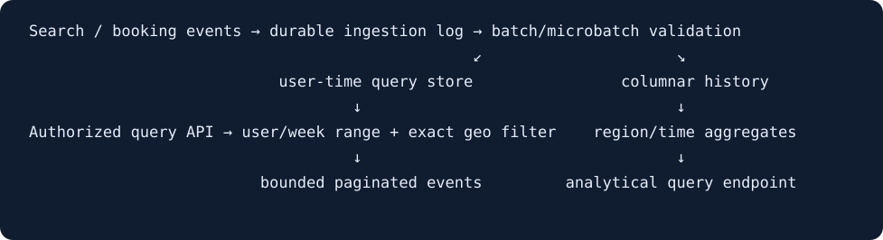

# W402. Query System — Time + Geo Filtered User Activity

**Priority group:** Fifth 100 — specialized practice

**Category:** Geospatial, dispatch and tracking systems

**Study position:** 402 of 547

[Group list](../FIFTH_100.md) · [All categories](../ALL_CATEGORIES.md) · [Chapter guide](../README.md)

## Question

Design a query system that lets internal users look up an end-user's searches and bookings, filtered by time window and geographic region. Read-heavy, batch-tolerant freshness, large catalog.

### Requirements

Functional
Query API: (user_id, start_ts, end_ts, geo_bbox) → list of search + booking events.
Aggregations by region and time bucket (count, sum amount).
Non-functional
Tens of TB of historical data.
Query latency &lt; 1s for the typical (single user, week-window, country-sized region) query; multi-second acceptable for analytics-style sweeps.
Eventual consistency on ingest is fine — staleness up to ~5 minutes.

## Worked solution

### Optimize two different access patterns

The typical query selects one user, one week and a geographic bounding box, while analytics scans aggregate many users. A single broad geospatial/time index is unlikely to serve both cheaply. Keep a user-time event-serving view plus an analytical columnar/time-partitioned store, both derived from durable raw events with up to five minutes' lag.

[Open the architecture diagram](../diagrams/W402_review_architecture.svg).

### Schema, API and indexes

An event contains unique event ID, user/account, kind, event timestamp, location with coordinate convention, booking amount/currency where applicable, schema version and ingest timestamp. Deduplicate event IDs and preserve correction/deletion versions. `GET /activities?user_id=&start=&end=&bbox=&cursor=` uses a half-open time interval and a bounded limit. Authorization checks the internal caller's permitted account/purpose before using the user ID; internal access is not universal access.

Partition the serving store by user hash, with sort key `(event_time,event_id)` or a relational composite index on those fields. A single-user week query first prunes the narrow user-time range, then applies exact bounding-box checks; add spatial indexing when measured per-user volume warrants it. Use a stable cursor including time/ID and query scope. An anti-meridian-crossing box requires split longitude intervals, and all timestamp inputs need explicit timezone conversion.

### Tens of terabytes without subsecond full scans

Partition analytical files by event date and, if useful, coarse geo cells; use column pruning/compression and statistics. Materialize common `(region,time_bucket,event_kind,currency)` aggregates, retaining counts/sums so larger windows can combine them correctly. Administrative regions need a versioned point-in-polygon mapping; a rectangular country-sized box is not the same as a country's exact boundary. Do not combine amounts across currencies without an explicit conversion policy.

A batch watermark exposes data freshness and late-event corrections. Count/sum updates must be replay-idempotent, and booking cancellations must have defined gross/net semantics. Serving under one second is a target for the narrow indexed request, not tens-of-TB arbitrary analytics. Send wide sweeps to a separate endpoint/resource pool with multi-second latency, query budgets and pagination/async jobs.

Estimate cost from events per user-week and bytes per selected row, not just total catalog size. Cache repeated authorized query/aggregate results with scope and freshness keys. Monitor ingest-to-query lag, late events, scan bytes, per-query p99, hot users and access audits. Test geo boundaries, duplicated/corrected events, daylight-saving inputs, stale materialized views and cursor retries under new arrivals.
