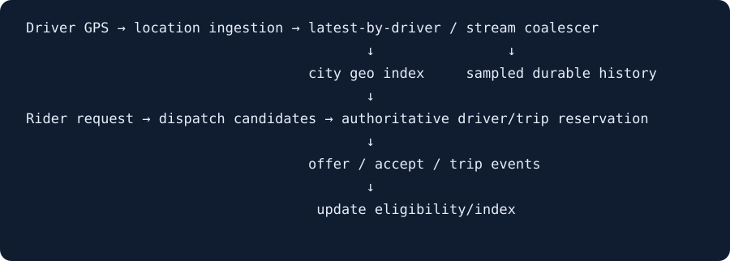

# W403. Ride-Hailing System Design (Uber)

**Priority group:** Fifth 100 — specialized practice

**Category:** Geospatial, dispatch and tracking systems

**Study position:** 403 of 547

[Group list](../FIFTH_100.md) · [All categories](../ALL_CATEGORIES.md) · [Chapter guide](../README.md)

## Question

Design an Uber-style ride-hailing service. The interviewer drives on high-frequency driver GPS writes (dedup/throttle), geospatial indexing (Quadtree vs H3), and Redis GEO caching.

### Requirements

Design a ride-hailing service (Uber/Lyft-style): riders request rides and the system matches them to nearby drivers.
Ingest high-frequency driver GPS updates and keep a fresh driver-location index.
Match a rider to nearby available drivers via a geospatial query.
Serve location reads with low latency under heavy write load.
Notes
Driver GPS write path is the hot spot: dedup/throttle/coalesce updates (a driver pinging every second does not need every ping persisted). Geospatial indexing is the central trade-off - Quadtree vs H3 (hex grid): cell uniformity, neighbor lookup, hot-cell handling, rebalancing cost. Use Redis GEO (sorted-set / geohash backed) as the hot cache for 'drivers near a point'; discuss GEOSEARCH mechanics and TTL/eviction for stale locations. Follow-ups: driver-state consistency (available vs on-trip), matching fairness, surge / hot-region handling.

## Worked solution

### Make the location index fast without making it the assignment authority

Drivers send frequent coordinates; dispatch needs the latest sufficiently fresh available locations. A raw location history and a live geo index have different purposes. Authenticate the driver/session, sequence updates and coalesce redundant pings rather than persisting every one-second sample synchronously.

[Open the architecture diagram](../diagrams/W403_review_architecture.svg).

### Handle out-of-order writes and staleness

Each ping carries driver/session epoch, sequence, coordinate and observation time. Reject old epochs/sequences, validate implausible movement and record receive time. Update the live index only with a newer accepted ping. Persist compact trajectories asynchronously at a product-defined sampling/movement threshold, retaining more detail where safety/legal requirements demand it. A coalescer must not erase important trip events.

Quadtree cells adapt to spatial density but require split/merge/rebalance logic. H3 gives hierarchical hexagonal cells, easy neighbor expansion and convenient partition keys, though cell areas/distortion and pentagons still matter. With either, query nearby cells then compute true distance/ETA and apply freshness/eligibility filters; a cell match is only a candidate test. Redis GEO can serve a hot radius/box query using geohash-backed sorted sets. **Individual GEO members do not have independent key TTLs**: maintain last-seen timestamps, filter results and remove stale members explicitly (or rotate bucketed keys). A whole-key expiry cannot safely expire one stale driver among active ones.

### Reserve the driver once

A rider request has an idempotent trip/request ID. After candidate retrieval, conditionally transition a driver from AVAILABLE to OFFERED/RESERVED under one trip ID in the authoritative store. An accepted offer confirms the trip; rejected/expired offers release only if the reservation generation still matches. Two dispatchers can see the same cached driver, but only one reservation succeeds. Do not rely on removing a GEO member as the entire consistency mechanism.

Partition by city/region and subdivide hot cells while querying neighbors to avoid boundary blind spots. Match fairness can account for wait time, idle time, ETA and prior offers; nearest straight-line distance alone is not a complete policy. Surge/hot areas need admission, supply-aware routing and retry caps rather than unlimited expanding searches.

Monitor GPS age, discarded old updates, per-cell load, candidate recall, reservation conflicts, offer timeout and pickup ETA. Test stale/out-of-order pings, driver movement across cells, duplicate rider requests and two riders competing for one driver. No QPS is supplied: derive location input as active drivers divided by ping interval and benchmark geo update/query capacity at the expected hot-city peak.
