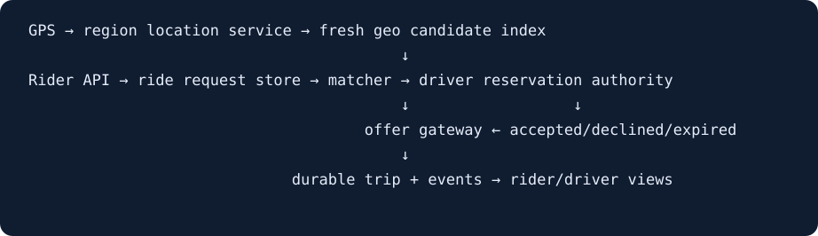

# W404. Rider-Driver Matching System

**Priority group:** Fifth 100 — specialized practice

**Category:** Geospatial, dispatch and tracking systems

**Study position:** 404 of 547

[Group list](../FIFTH_100.md) · [All categories](../ALL_CATEGORIES.md) · [Chapter guide](../README.md)

## Question

Design Uber's rider-driver matching system. The round emphasizes low-latency geospatial search, scalable service decomposition, database choice, and consistency around match state.

Requirements: accept rider requests and find nearby eligible drivers with low latency; continuously ingest driver location updates and keep the search index fresh for dispatch; maintain a match lifecycle so a driver is never double-assigned and rider/driver state stays consistent. Scale across cities/regions without one global hot partition.

## Worked solution

### Give locations and matches different consistency contracts

Locations can be slightly stale and still produce a useful candidate list. A match cannot assign one driver to two riders. Use a fast derived geospatial index for search and a strongly coordinated reservation record for assignment.

[Open the architecture diagram](../diagrams/W404_review_architecture.svg).

### Requests, stores and lifecycle

`POST /rides` validates pickup/dropoff and returns one request ID under a client idempotency key. Store the request, rider and current state durably. Location pings have driver/session sequence and freshness; index by city plus H3/geohash cells and expand into neighboring cells before computing travel-time estimates. Keep only eligible, fresh candidates and cap the search radius/deadline.

Driver state follows AVAILABLE → RESERVED_FOR_OFFER → ASSIGNED → ON_TRIP → AVAILABLE, with explicit offline/reject/expiry paths. Each reservation contains ride ID, lease/generation and expiry. Atomic compare-and-set from AVAILABLE prevents competing matchers from winning the same driver. Accepting an offer verifies both driver and ride state under a coordinated transaction/owner; unique active driver and active rider-request constraints provide protection against duplicate assignments. A stale expiry worker can release only its own reservation generation.

A relational transactional store works well for ride/reservation constraints. A partitioned key-value system can work with conditional writes and a deliberate cross-record transaction/owner model; “eventual consistency everywhere” cannot enforce the no-double-assignment rule. The geo index remains derived, so a stale candidate can lose reservation and the matcher tries another within a bounded budget.

### Regional scale and recovery

Route each ride and driver to one city/region authority and define transfer when a driver crosses ownership boundaries. Do not let two regions concurrently consider the same driver available. Partition large cities by cells or driver hash, querying adjacent cells while preserving per-driver reservation ownership. Candidate scoring can use ETA, rider waiting and driver fairness; monitor the trade-off instead of always favoring the newest nearest driver.

Persist transition and outbox notification together, deduplicate events and let clients reconnect by ride ID/cursor. If a matcher crashes after reserving but before sending, a reconciler can resend the same offer or safely expire it. A declined/expired offer releases capacity, while an uncertain acceptance must be reconciled before reassignment. If the index fails, use a bounded fallback or report matching delay; never fabricate an assignment from unavailable state.

Size location writes as drivers × ping frequency and matching QPS as ride arrival/retry rate, with hot-city skew separately. Monitor request-to-match latency, GPS/index age, reservation conflicts, unaccepted lease age, double-assignment invariant and regional failover. Test concurrent matching, duplicate acceptance, lost notification, cancellation/accept races and a driver crossing a partition boundary.
