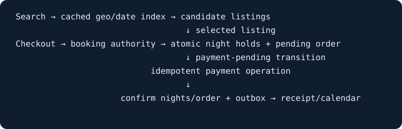

# W405. Airbnb Booking System Design

**Priority group:** Fifth 100 — specialized practice

**Category:** Inventory, reservations and marketplaces

**Study position:** 405 of 547

[Group list](../FIFTH_100.md) · [All categories](../ALL_CATEGORIES.md) · [Chapter guide](../README.md)

## Question

Design the core booking pipeline: search availability, hold a listing for a date range, complete payment, confirm reservation. Race conditions over the same listing-date pair are the central deep-dive.

### Requirements

Functional
Search listings by date range, location, guest count.
Tentatively hold a listing on a date range for ~10 minutes during checkout.
Confirm the booking once payment succeeds; release the hold otherwise.
Cancel / refund.
Non-functional
Concurrent booking attempts on the same listing-date pair must produce exactly one confirmation.
Search is read-heavy and cache-tolerant; booking is write-heavy and consistency-critical.
Geographically distributed users; place reads near the user.

## Worked solution

### Search can be stale; booking ownership cannot

Search returns likely available listings filtered by geography, capacity and dates. Checkout acquires a short authoritative hold for **every night** in the requested half-open stay `[check_in,check_out)`. The checkout date is not an occupied night. Concurrent overlapping requests must compete at the listing-night authority rather than trust search results.

[Open the architecture diagram](../diagrams/W405_review_architecture.svg).

### Data and atomic hold

Use Listing, ListingNight `(listing_id,date,state,hold_id,version)`, Hold `(id,user,expiry,state)`, Reservation and PaymentAttempt. Pre-create or transactionally create unique night rows for the bookable horizon. To hold a range, lock its night rows in date order, clear only provably expired ordinary holds, require all nights free, then write one hold and update every night in a transaction. If any night is unavailable, roll back the entire range. A PostgreSQL exclusion constraint over date ranges is another valid model, with careful state/expiry handling.

`POST /holds` takes listing/dates/guest count and a client key; repeat requests return the same hold, while changed payload under the same key conflicts. `POST /reservations` starts payment against the accepted price snapshot. Return `409` with conflicting dates when a stale search result loses the hold race.

### Expiry must not race an uncertain payment

Before calling the provider, conditionally change HELD to PAYMENT_PENDING while still unexpired. An expiry worker and this transition serialize on the hold; only one wins. During payment pending, retain night allocation until the external outcome is resolved, or use a verified void/refund compensation before release. A timeout is not evidence of failure. Use stable provider operation keys and query status after a lost response; provider idempotency/lookup is a required dependency for duplicate-charge protection.

Verified success atomically marks nights BOOKED, confirms the reservation and creates an outbox event. Idempotent completion cannot book the range twice. Failed/voided payment releases only that hold's nights. Cancellation applies policy, records an idempotent refund job and updates availability under explicit timing rules; a stale retry cannot free nights now owned by another reservation.

### Geography, capacity and failure

Serve search near users with caches/index replicas, but route a listing's booking writes to one home shard/region. Multi-night transactions remain within that listing's authority. An outage can delay checkout for affected listings while search stays available; confirming from a stale replica would sacrifice the central invariant. Hot listings need rate limits and bounded lock waits, not just more stateless workers.

Monitor hold/lock conflicts, expiry lag, payment-pending age, confirmed reservations versus allocated nights and search-to-hold failure rate. Test overlapping/adjacent date ranges, double-submit, payment success after timeout, expiry/start-payment races and concurrent cancellation/new holds. Exactly one confirmation follows from authoritative atomic allocation plus guarded finalization, not from caching or a distributed lock that expires without fencing.
