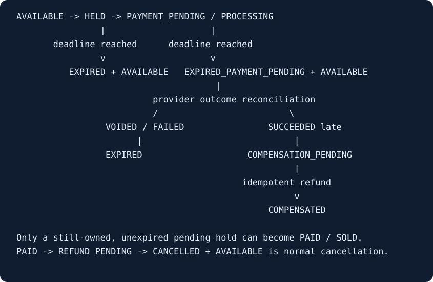

# W406. Airline Booking System: Search, Seat Hold, Purchase and Cancel

**Priority group:** Fifth 100 — specialized practice

**Category:** Inventory, reservations and marketplaces

**Study position:** 406 of 547

[Group list](../FIFTH_100.md) · [All categories](../ALL_CATEGORIES.md) · [Chapter guide](../README.md)

<span class="practice-page"></span>

## Question

Design and implement a simplified airline booking system that lets a traveller find a flight, reserve a specific seat for a short time, pay for it, and cancel it later.

### Requirements

1. Search: find flights by departure city, arrival city, or a departure-time range. Any combination of these filters may be given.
2. Seat map: for one flight, list which seats are available.
3. Hold: temporarily reserve one seat for one user so that the user can finish payment. If payment does not complete in time, the seat must become available again without any manual step.
4. Purchase: turn a hold into a purchase. The payment provider may be a stub in your implementation.
5. Cancel: cancel a purchased seat so that it can be sold again, and leave a record of the refund.
Assumptions
Every aircraft has the same fixed layout, for example 24 rows with 6 seats per row.
The flight list may be hardcoded.
The system must be callable and testable, for example through a small command-line tool or a set of functions with tests.
Deliverables
1. The data model: how a seat is represented, which states it can be in, and which transitions are allowed.
2. The schema of the tables, including the time columns and the indexes that serve the search in requirement 1.
3. The reference logic for hold, purchase, cancel and expiry, and how it behaves when two users ask for the same seat at the same moment.
4. The transaction and locking plan: when a lock is taken, when it is released, and what happens when a client disconnects in the middle of a flow.
5. The payment plan: how a retried request never charges twice, and what is written when a purchase is cancelled.
6. A short note on how the design changes if a new column, such as a seat class, must be added later.

### Constraints

A seat must never be held or sold to two users at once.
A transaction must not stay open while waiting for the user or for the payment provider.
State the capacity assumptions you use and compute them.

## Worked solution

### Enforce the hold deadline independently of the payment outcome

The default is a **strict hold expiry**. A seat is unavailable only until the hold deadline unless a purchase is finalized before it. Starting a payment does not extend that deadline. Both HELD and PAYMENT_PENDING expire at `clock >= expires_at`, and seat-map/new-hold requests apply expiry automatically. A maintenance worker also sweeps expiry and reconciles financial outcomes. A slow or UNKNOWN payment can leave a financial record pending, but cannot keep the seat reserved indefinitely.

Use `(flight_id, seat)` as the inventory key and a unique hold ID as its ownership generation. Every expiry, cancellation, confirmation and compensation update checks that generation. The purchase's `now` argument is merely a request-start snapshot; the authoritative injected clock is read again under the claim transaction, immediately before dispatching the charge, and after the provider returns. A response observed too late creates no ticket even if the provider charged earlier: its charge is refunded.



[Open the state diagram](../diagrams/W406_review_architecture.svg).


Payment state and inventory state are deliberately separate. A late compensation belongs to the old hold and never removes another customer's newer HELD or SOLD allocation.

### Provider and API contracts

The injected provider exposes four operations:

- `charge(key, amount)` is idempotent and binds that key to the amount. It returns a stable successful charge reference, raises `PaymentDeclined` only for a definitive no-charge result, or raises on an uncertain network result.
- `charge_status(key)` returns SUCCEEDED with reference/amount, definitive FAILED/VOIDED, or PENDING/NOT_FOUND. NOT_FOUND alone does not prove a delayed original request cannot arrive.
- `void_charge(key)` atomically fences a not-yet-charged key, or reports an already successful charge. The fence must also reject a delayed `charge` using that key. A real adapter unable to resolve/cancel a pending operation returns PENDING; the seat still expires while financial reconciliation continues. Never replace this with a racy status lookup followed by a locally assumed cancellation.
- `refund(refund_key, charge_reference, amount)` is idempotent. A returned reference means the refund is confirmed; an unknown or still-pending refund raises and leaves the durable refund intent pending. A real adapter can perform its provider-specific status lookup inside this contract. Retrying the same refund key cannot create a second refund.

Provider idempotency/status records must survive independently of the airline process. `PaymentStub` keeps them in an externally injected in-memory object for the demo; restarting that mock object is not proof of real-provider durability. If a partner lacks status or a safe void/fence, retain and monitor the unknown financial intent instead of replaying a new charge after expiry. A later observed successful charge is compensated. Strict inventory expiry is still possible; instantly resolving an unknowable external payment is not.

`purchase` returns the charge reference only for a PAID booking. `HoldExpired` means no ticket was issued; `booking_status` distinguishes EXPIRED_PAYMENT_PENDING, COMPENSATION_PENDING and COMPENSATED. A lost charge/refund reply raises while leaving a retryable durable record. Normal purchased-seat cancellation records the refund intent first and releases its own seat after confirmed refund. Amounts are positive integer minor units calculated by the server, not client-authoritative fares.

### Runnable persistent implementation

[Download the SQLite implementation](../airline_406.py) and [behavior tests](../test_booking_logging_401_425.py).

```python
"""W406: strict seat-hold deadlines and durable late-payment compensation."""

from contextlib import closing, contextmanager
import sqlite3
import threading
import time
import uuid


class HoldExpired(ValueError):
    """No ticket was issued; inspect booking_status for payment/refund progress."""


class PaymentDeclined(RuntimeError):
    """The provider definitively guarantees this operation cannot charge."""


class PaymentStub:
    """An external-provider demo: stable keys, status, atomic void, idempotent refund.

    Real provider operation records must survive independently of Airline restarts.
    void_charge fences an unseen charge key, so a delayed old request cannot debit it.
    """

    def __init__(self):
        self.operations = {}
        self.lock = threading.Lock()

    def charge(self, key, amount):
        with self.lock:
            previous = self.operations.setdefault(key, ("charge", amount))
            if previous == ("void",):
                raise PaymentDeclined("Charge key was voided")
            if previous != ("charge", amount):
                raise ValueError("Payment-key mismatch")
            return key

    def charge_status(self, key):
        with self.lock:
            operation = self.operations.get(key)
            if operation is None:
                return {
                    "state": "NOT_FOUND"
                }  # Not proof a delayed request cannot arrive.
            if operation == ("void",):
                return {"state": "VOIDED"}
            if operation[0] != "charge":
                raise ValueError("Not a charge key")
            return {
                "state": "SUCCEEDED",
                "reference": key,
                "amount_minor": operation[1],
            }

    def void_charge(self, key):
        """Atomically fence a not-yet-charged key, or report its existing charge."""
        with self.lock:
            operation = self.operations.setdefault(key, ("void",))
            if operation == ("void",):
                return {"state": "VOIDED"}
            if operation[0] != "charge":
                raise ValueError("Not a charge key")
            return {
                "state": "SUCCEEDED",
                "reference": key,
                "amount_minor": operation[1],
            }

    def refund(self, key, charge_id, amount):
        with self.lock:
            charged = self.operations.get(charge_id)
            if charged != ("charge", amount):
                raise ValueError("Refund must reference the matching successful charge")
            previous = self.operations.setdefault(key, ("refund", charge_id, amount))
            if previous != ("refund", charge_id, amount):
                raise ValueError("Refund-key mismatch")
            return key


class Airline:
    def __init__(self, path, payments, clock=time.time):
        self.path = str(path)
        self.payments = payments
        self.clock = clock
        with self.transaction() as db:
            db.executescript(
                """CREATE TABLE IF NOT EXISTS flights(
              id TEXT PRIMARY KEY,departure TEXT,arrival TEXT,departs_at INTEGER);
              CREATE INDEX IF NOT EXISTS search_departure ON flights(departure,departs_at);
              CREATE INDEX IF NOT EXISTS search_arrival ON flights(arrival,departs_at);
              CREATE INDEX IF NOT EXISTS search_time ON flights(departs_at);
              CREATE INDEX IF NOT EXISTS search_pair ON flights(departure,arrival,departs_at);
              CREATE TABLE IF NOT EXISTS seats(flight_id TEXT,seat TEXT,state TEXT NOT NULL,
                hold_id TEXT,PRIMARY KEY(flight_id,seat),FOREIGN KEY(flight_id) REFERENCES flights(id));
              CREATE TABLE IF NOT EXISTS holds(id TEXT PRIMARY KEY,flight_id TEXT,seat TEXT,
                user_id TEXT,expires_at REAL,state TEXT,amount_minor INTEGER,charge_id TEXT,
                FOREIGN KEY(flight_id,seat) REFERENCES seats(flight_id,seat));
              CREATE INDEX IF NOT EXISTS expiring_holds ON holds(state,expires_at);
              CREATE TABLE IF NOT EXISTS payment_operations(operation_key TEXT PRIMARY KEY,
                hold_id TEXT NOT NULL,kind TEXT NOT NULL,amount_minor INTEGER NOT NULL,
                state TEXT NOT NULL,provider_ref TEXT,created_at REAL NOT NULL,
                FOREIGN KEY(hold_id) REFERENCES holds(id));
              CREATE INDEX IF NOT EXISTS pending_payments ON payment_operations(state,kind);
              CREATE TABLE IF NOT EXISTS payment_operation_errors(
                operation_key TEXT NOT NULL,observed_at REAL NOT NULL,message TEXT NOT NULL,
                FOREIGN KEY(operation_key) REFERENCES payment_operations(operation_key));"""
            )

    @contextmanager
    def transaction(self):
        db = sqlite3.connect(self.path, timeout=5)
        db.execute("PRAGMA foreign_keys=ON")
        try:
            db.execute("BEGIN IMMEDIATE")
            yield db
            db.commit()
        except BaseException:
            db.rollback()
            raise
        finally:
            db.close()

    def add_flight(self, identifier, departure, arrival, departs_at, rows=24):
        with self.transaction() as db:
            db.execute(
                "INSERT INTO flights VALUES(?,?,?,?)",
                (identifier, departure, arrival, departs_at),
            )
            db.executemany(
                "INSERT INTO seats VALUES(?,?,?,NULL)",
                [
                    (identifier, f"{row}{letter}", "AVAILABLE")
                    for row in range(1, rows + 1)
                    for letter in "ABCDEF"
                ],
            )

    def search(self, departure=None, arrival=None, start=None, end=None):
        clauses, values = [], []
        for condition, value in [
            ("departure=?", departure),
            ("arrival=?", arrival),
            ("departs_at>=?", start),
            ("departs_at<?", end),
        ]:
            if value is not None:
                clauses.append(condition)
                values.append(value)
        with closing(sqlite3.connect(self.path)) as db:
            return db.execute(
                "SELECT * FROM flights"
                + (" WHERE " + " AND ".join(clauses) if clauses else "")
                + " ORDER BY departs_at,id",
                values,
            ).fetchall()

    def _release_owned_seat(self, db, hold_id):
        # The ownership predicate fences every old expiry/refund/completion path.
        db.execute(
            "UPDATE seats SET state='AVAILABLE',hold_id=NULL WHERE hold_id=?",
            (hold_id,),
        )

    def _expire(self, db, now):
        rows = db.execute(
            "SELECT id,state FROM holds WHERE state IN ('HELD','PAYMENT_PENDING') AND expires_at<=?",
            (now,),
        ).fetchall()
        for hold_id, state in rows:
            next_state = "EXPIRED" if state == "HELD" else "EXPIRED_PAYMENT_PENDING"
            db.execute("UPDATE holds SET state=? WHERE id=?", (next_state, hold_id))
            self._release_owned_seat(db, hold_id)

    def expire(self, now=None):
        with self.transaction() as db:
            self._expire(db, self.clock() if now is None else now)

    def seat_map(self, flight_id, now=None):
        with self.transaction() as db:
            self._expire(db, self.clock() if now is None else now)
            return db.execute(
                "SELECT seat,state FROM seats WHERE flight_id=? ORDER BY seat",
                (flight_id,),
            ).fetchall()

    def hold(self, flight_id, seat, user_id, now=None, ttl=600):
        if ttl <= 0:
            raise ValueError("TTL must be positive")
        now = self.clock() if now is None else now
        identifier = str(uuid.uuid4())
        with self.transaction() as db:
            self._expire(db, now)
            row = db.execute(
                "SELECT state FROM seats WHERE flight_id=? AND seat=?",
                (flight_id, seat),
            ).fetchone()
            if not row or row[0] != "AVAILABLE":
                raise ValueError("Seat unavailable")
            db.execute(
                "INSERT INTO holds VALUES(?,?,?,?,?,?,NULL,NULL)",
                (identifier, flight_id, seat, user_id, now + ttl, "HELD"),
            )
            db.execute(
                "UPDATE seats SET state='HELD',hold_id=? WHERE flight_id=? AND seat=?",
                (identifier, flight_id, seat),
            )
        return identifier

    def _hold_row(self, db, hold_id):
        row = db.execute(
            "SELECT flight_id,seat,user_id,expires_at,state,amount_minor,charge_id FROM holds WHERE id=?",
            (hold_id,),
        ).fetchone()
        if row is None:
            raise ValueError("Hold not found")
        return row

    def _owned(self, db, hold_id, user_id):
        row = self._hold_row(db, hold_id)
        if row[2] != user_id:
            raise ValueError("Hold not found for user")
        return row

    def booking_status(self, hold_id, user_id):
        with self.transaction() as db:
            self._expire(db, self.clock())
            row = self._owned(db, hold_id, user_id)
            refund = db.execute(
                "SELECT state,provider_ref FROM payment_operations WHERE operation_key=?",
                ("refund:" + hold_id,),
            ).fetchone()
            return {
                "state": row[4],
                "expires_at": row[3],
                "charge_id": row[6],
                "refund_state": refund[0] if refund else None,
                "refund_id": refund[1] if refund else None,
            }

    def _error(self, key, error):
        with self.transaction() as db:
            db.execute(
                "INSERT INTO payment_operation_errors VALUES(?,?,?)",
                (key, self.clock(), type(error).__name__ + ": " + str(error)[:500]),
            )

    def _charge_failed(self, hold_id, provider_state="FAILED"):
        with self.transaction() as db:
            self._expire(db, self.clock())
            db.execute(
                "UPDATE payment_operations SET state=? WHERE operation_key=? AND state='PENDING'",
                (provider_state, "charge:" + hold_id),
            )
            state = self._hold_row(db, hold_id)[4]
            if state in ("PAYMENT_PENDING", "EXPIRED_PAYMENT_PENDING"):
                db.execute(
                    "UPDATE holds SET state=? WHERE id=?",
                    (
                        "PAYMENT_FAILED" if state == "PAYMENT_PENDING" else "EXPIRED",
                        hold_id,
                    ),
                )
                self._release_owned_seat(db, hold_id)

    def _charge_succeeded(self, hold_id, reference, amount):
        with self.transaction() as db:
            # Read time after the provider call, not its earlier request timestamp.
            now = self.clock()
            self._expire(db, now)
            flight, seat, _, expiry, state, expected_amount, _ = self._hold_row(
                db, hold_id
            )
            if amount != expected_amount:
                raise ValueError("Provider amount mismatch; reconciliation required")
            db.execute(
                "UPDATE payment_operations SET state='SUCCEEDED',provider_ref=? WHERE operation_key=?",
                (reference, "charge:" + hold_id),
            )
            db.execute("UPDATE holds SET charge_id=? WHERE id=?", (reference, hold_id))
            if state == "PAYMENT_PENDING" and now < expiry:
                changed = db.execute(
                    "UPDATE seats SET state='SOLD' WHERE flight_id=? AND seat=? AND hold_id=? AND state='PROCESSING'",
                    (flight, seat, hold_id),
                ).rowcount
                if changed == 1:
                    db.execute("UPDATE holds SET state='PAID' WHERE id=?", (hold_id,))
                    return "PAID"
            if state in (
                "PAID",
                "REFUND_PENDING",
                "CANCELLED",
                "COMPENSATION_PENDING",
                "COMPENSATED",
            ):
                return state
            # A late success has financial consequences but no inventory rights.
            db.execute(
                "UPDATE holds SET state='COMPENSATION_PENDING' WHERE id=?", (hold_id,)
            )
            self._release_owned_seat(db, hold_id)
            db.execute(
                "INSERT OR IGNORE INTO payment_operations VALUES(?,?,?,?,?,NULL,?)",
                ("refund:" + hold_id, hold_id, "refund", amount, "PENDING", now),
            )
            return "COMPENSATION_PENDING"

    def _refund(self, hold_id):
        key = "refund:" + hold_id
        with self.transaction() as db:
            _, _, _, _, state, amount, charge = self._hold_row(db, hold_id)
            operation = db.execute(
                "SELECT state,provider_ref FROM payment_operations WHERE operation_key=?",
                (key,),
            ).fetchone()
            if operation is None:
                raise ValueError("No durable refund intent")
            if operation[0] == "SUCCEEDED":
                return operation[1]
            if state not in ("REFUND_PENDING", "COMPENSATION_PENDING"):
                raise ValueError("Refund not valid for booking state")
        try:
            refund = self.payments.refund(key, charge, amount)
        except Exception as error:
            self._error(key, error)
            raise
        with self.transaction() as db:
            db.execute(
                "UPDATE payment_operations SET state='SUCCEEDED',provider_ref=? WHERE operation_key=?",
                (refund, key),
            )
            db.execute(
                """UPDATE holds SET state=CASE state
                         WHEN 'REFUND_PENDING' THEN 'CANCELLED'
                         WHEN 'COMPENSATION_PENDING' THEN 'COMPENSATED' ELSE state END WHERE id=?""",
                (hold_id,),
            )
            self._release_owned_seat(db, hold_id)
        return refund

    def purchase(self, hold_id, user_id, amount_minor, now=None):
        if type(amount_minor) is not int or amount_minor <= 0:
            raise ValueError("Positive server-calculated minor-unit amount required")
        # ``now`` is only a caller's request-start snapshot. It cannot extend a lease.
        expired = False
        with self.transaction() as db:
            now = self.clock()
            self._expire(db, now)
            flight, seat, _, expiry, state, amount, charge = self._owned(
                db, hold_id, user_id
            )
            if amount is not None and amount != amount_minor:
                raise ValueError("Amount changed")
            if state == "PAID":
                return charge
            if state in (
                "EXPIRED",
                "EXPIRED_PAYMENT_PENDING",
                "COMPENSATION_PENDING",
                "COMPENSATED",
            ):
                expired = True
            elif state == "HELD":
                db.execute(
                    "UPDATE holds SET state='PAYMENT_PENDING',amount_minor=? WHERE id=?",
                    (amount_minor, hold_id),
                )
                db.execute(
                    "UPDATE seats SET state='PROCESSING' WHERE flight_id=? AND seat=? AND hold_id=?",
                    (flight, seat, hold_id),
                )
                db.execute(
                    "INSERT INTO payment_operations VALUES(?,?,?,?,?,NULL,?)",
                    (
                        "charge:" + hold_id,
                        hold_id,
                        "charge",
                        amount_minor,
                        "PENDING",
                        now,
                    ),
                )
            elif state != "PAYMENT_PENDING":
                raise ValueError("Hold not purchasable")
        if expired:
            # Expiry must commit even though the API now rejects the purchase.
            raise HoldExpired(
                "Hold expired; any uncertain charge is reconciled/refunded"
            )
        if self.clock() >= expiry:
            self.expire()
            raise HoldExpired(
                "Hold expired before charge dispatch; reconciliation will void its key"
            )
        try:
            charge = self.payments.charge("charge:" + hold_id, amount_minor)
        except PaymentDeclined:
            self._charge_failed(hold_id)
            raise
        except Exception as error:
            # An UNKNOWN/lost response can arrive after the deadline too.
            self.expire()
            self._error("charge:" + hold_id, error)
            raise
        state = self._charge_succeeded(hold_id, charge, amount_minor)
        if state == "PAID":
            return charge
        if state == "COMPENSATION_PENDING":
            self._refund(hold_id)
        raise HoldExpired(
            "No ticket issued; late charge is refunded or durably pending compensation"
        )

    def cancel(self, hold_id, user_id):
        with self.transaction() as db:
            _, _, _, _, state, amount, _ = self._owned(db, hold_id, user_id)
            if state == "CANCELLED":
                return db.execute(
                    "SELECT provider_ref FROM payment_operations WHERE operation_key=?",
                    ("refund:" + hold_id,),
                ).fetchone()[0]
            if state not in ("PAID", "REFUND_PENDING"):
                raise ValueError("Not purchased")
            db.execute("UPDATE holds SET state='REFUND_PENDING' WHERE id=?", (hold_id,))
            db.execute(
                "INSERT OR IGNORE INTO payment_operations VALUES(?,?,?,?,?,NULL,?)",
                (
                    "refund:" + hold_id,
                    hold_id,
                    "refund",
                    amount,
                    "PENDING",
                    self.clock(),
                ),
            )
        return self._refund(hold_id)

    def reconcile(self):
        """One background-worker tick. Pending intents survive failure and restart."""
        self.expire()
        errors = []
        with closing(sqlite3.connect(self.path)) as db:
            pending = db.execute(
                """SELECT h.id,h.expires_at FROM payment_operations p
                JOIN holds h ON h.id=p.hold_id WHERE p.kind='charge' AND p.state='PENDING'"""
            ).fetchall()
        for hold_id, expiry in pending:
            key = "charge:" + hold_id
            try:
                # After expiry never initiate/replay a new charge. Atomically fence it.
                result = (
                    self.payments.void_charge(key)
                    if self.clock() >= expiry
                    else self.payments.charge_status(key)
                )
                if result["state"] == "SUCCEEDED":
                    self._charge_succeeded(
                        hold_id, result["reference"], result["amount_minor"]
                    )
                elif result["state"] in ("VOIDED", "FAILED"):
                    self._charge_failed(hold_id, result["state"])
                elif result["state"] not in ("PENDING", "NOT_FOUND"):
                    raise ValueError("Unknown provider charge state")
            except Exception as error:
                self._error(key, error)
                errors.append((key, str(error)))
        with closing(sqlite3.connect(self.path)) as db:
            refunds = db.execute(
                "SELECT hold_id FROM payment_operations WHERE kind='refund' AND state='PENDING'"
            ).fetchall()
        for (hold_id,) in refunds:
            try:
                self._refund(hold_id)
            except Exception as error:
                errors.append(("refund:" + hold_id, str(error)))
        return errors

    def run_maintenance(self, stop_event, interval=1.0):
        """Run on a supervised worker thread/process; no sleeping transaction."""
        if interval <= 0:
            raise ValueError("Positive maintenance interval required")
        while not stop_event.is_set():
            self.reconcile()  # Per-operation errors are durable and returned for monitoring.
            stop_event.wait(interval)
```

Run `run_maintenance(stop_event, interval=1.0)` in a supervised worker thread/process alongside the API, and run it again after restart. Its pending-operation scans recover lost replies using the same operation keys. Provider failures are recorded in `payment_operation_errors`; operational monitoring must alert on old pending intents, failed maintenance and repeated compensation failures. No SQL transaction is open during a provider request or while a traveler types. The ordinary seat APIs also enforce lazy expiry, so a missed sweep does not let an expired payment block the next purchaser.

### Schema, concurrency and recovery

The constructor includes the full schema. `flights` has route/time, departure/time, arrival/time and time-only indexes for optional search filters; the query uses a half-open departure range. Default aircraft layout is 24 rows × 6 seats = 144 seats. `seats` owns the current allocation; `holds` retains its user, deadline and lifecycle; `payment_operations` persists the stable charge/refund keys, amount, status and provider references; the error table preserves failed attempts. `(state, expires_at)` and pending-operation indexes serve maintenance.

SQLite `BEGIN IMMEDIATE` serializes short writes in this interview implementation. Two callers cannot both claim AVAILABLE. A production relational implementation uses affected-seat/hold row transactions and conditional updates rather than one global write lock. Charge intent is committed before the external request; charge outcome and any compensating refund intent are committed together. Refund confirmation and its terminal hold state also commit together. A crash between provider effect and local commit is recovered by status/idempotent retry, not by charging or refunding with a new key.

Example: Alice's hold expires at time 10. Her charge succeeds, but the response is delayed. At time 10 Bob acquires the same seat and may buy it. Alice's later response is processed against the fresh clock: her old hold becomes COMPENSATION_PENDING and gets one refund. The old ownership predicate cannot overwrite or release Bob's seat. If the refund succeeds but its reply is lost, the next maintenance tick repeats the same refund key and marks COMPENSATED without a second financial effect. An unseen charge key can instead be atomically voided so a late original request cannot debit it at all.

The behavior suite checks that exact deadline, a stale `now=0` snapshot when the clock is already 10, a clock advanced inside the provider, reallocation to both a new hold and a new sold seat, duplicate/concurrent compensation, lost charge and refund replies across an airline restart, voiding an unseen request, and UNKNOWN status without TTL extension. It also retains the unrelated event-logger tests unchanged. These are executable component checks, not a claim of production airline integration.

### Capacity and schema evolution

At an illustrative 10,000 flights/day, 144 seats each gives 1.44 million seat rows/day. Keeping 180 days gives 259.2 million seats; at an assumed 200 bytes/indexed allocation record, approximately 51.8 GB before hold/payment history and replication. Actual request QPS and provider rate limits need separate traffic assumptions. Batch expiry/reconciliation by indexed due time and bound provider concurrency at larger scale; do not run an unlimited provider call for every historical row.

To add seat class, deploy a nullable/defaulted column or related seat-type table compatibly, backfill in bounded batches, then enforce constraints after readers/writers migrate. Snapshot sold fare/class details on the booking so a later catalog change does not alter past purchases. Deadline semantics, idempotency and compensation keys remain unchanged by that migration.
