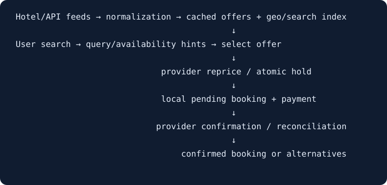

# W407. Design a Hotel Booking System with External Inventory

**Priority group:** Fifth 100 — specialized practice

**Category:** Inventory, reservations and marketplaces

**Study position:** 407 of 547

[Group list](../FIFTH_100.md) · [All categories](../ALL_CATEGORIES.md) · [Chapter guide](../README.md)

## Question

Design a hotel booking product integrated with external hotel inventory. The key evaluation point is consistency: search and booking depend on third-party room availability that can change outside our system.

### Requirements

Users search for hotels by location (prefer latitude/longitude over vague city/zip), date range, room count, and hotel/room filters.
Model hotels, rooms, room attributes, availability, and booking state.
Ingest hotel inventory from large chains, smaller hotels, or third-party APIs; you do not necessarily own source-of-truth inventory.
Pull or call external hotel APIs to fetch and confirm room availability.
Support search, room selection, and booking confirmation.
Handle concurrent competition for the same room from external systems.
Discuss indexes for location and availability queries.
Include a consistency plan for every booking step, especially external availability checks.

## Worked solution

### The hotel provider owns the final inventory decision

Search can use our cached room offers, but other sellers can consume the same rooms. A fresh availability check followed by a separate create call is still a race unless the provider offers an atomic hold/confirm operation or an exclusive inventory allotment. Our local database lock cannot lock the hotel's external inventory.

[Open the architecture diagram](../diagrams/W407_review_architecture.svg).

### Model and query

Store Hotel with latitude/longitude and attributes; RoomType with capacity/features; ProviderOffer with provider/hotel/room-type IDs, stay dates, cancellation terms, currency, price and freshness/version; and Booking with immutable selected offer, provider reservation/hold reference, status and payment operation. Room-type nightly quantity is different from an individually assigned physical room—confirm the provider's model.

`GET /hotels?lat=&lon=&radius=&check_in=&check_out=&rooms=&filters=` first applies geo/catalog constraints and then date/quantity offer availability. Use a spatial index or coarse geo cells plus exact distance filtering, along with indexes for provider/hotel/date/room type. Multiple requested rooms must be confirmed together under the provider's atomic quantity semantics, not merely because each of several independent checks once returned one room.

### Booking sequence and consistency

Create an idempotent booking intent. Revalidate the selected rate, restrictions and availability with the provider and obtain an atomic hold where available. Present changed price/terms before charging. Store provider hold and deadline, then use an idempotent payment authorization/capture flow consistent with the supplier's contract. Confirm the supplier reservation and local status through durable pending states and reconciliation. No local transaction spans the payment provider and supplier.

If one external step succeeds and another fails, follow the defined compensation: void/refund payment or cancel supplier inventory as policy permits. A timeout is UNKNOWN, so query by stable client/provider IDs before making another reservation or charge. Require provider idempotency/status lookup for safe retries; if absent, the exact guarantee is limited and manual reconciliation may be necessary.

### Cache and failures

Cache search offers with freshness metadata and update them through feeds/webhooks/polling. A short TTL reduces expected stale failures but cannot eliminate out-of-band sales. At final confirmation, the provider's atomic outcome wins. If sold out, report the conflict, refresh alternatives and preserve the user's search; do not silently substitute a different price/room. If the provider is slow, show pending/timeout status rather than a false confirmation.

Bulkhead/rate-limit each provider and serve partial search results with explicit freshness. A provider outage should not block all hotel groups. Monitor search latency, cache age, reprice/sold-out rate, unknown booking age, duplicate-provider operations and payment/supplier reconciliation. Test two sellers racing for the last room, multi-room partial failure, lost confirmation response and a provider hold expiring during payment.
