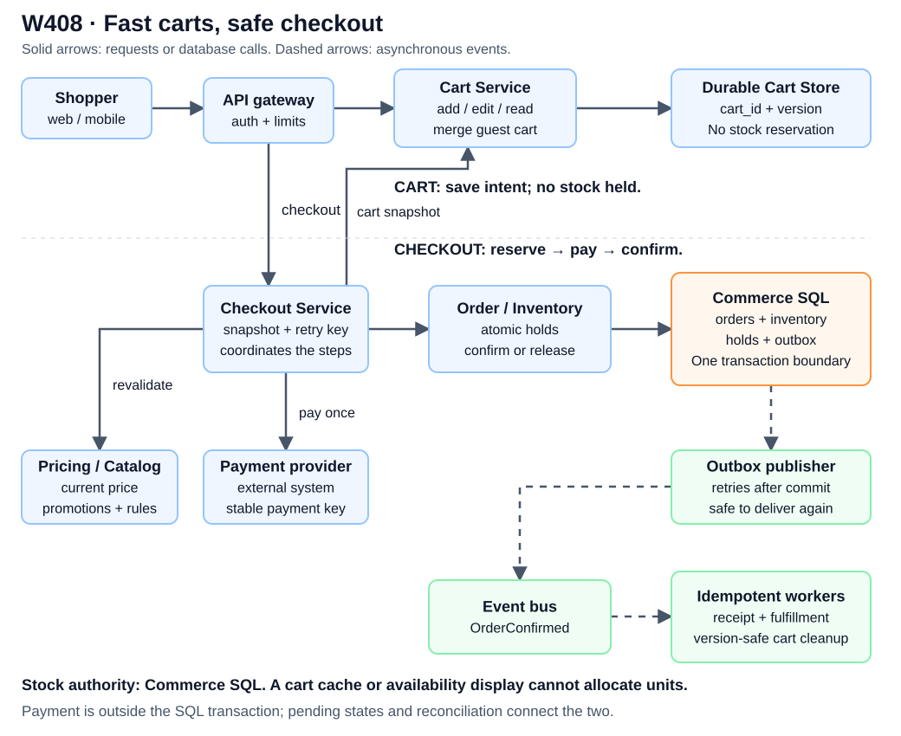
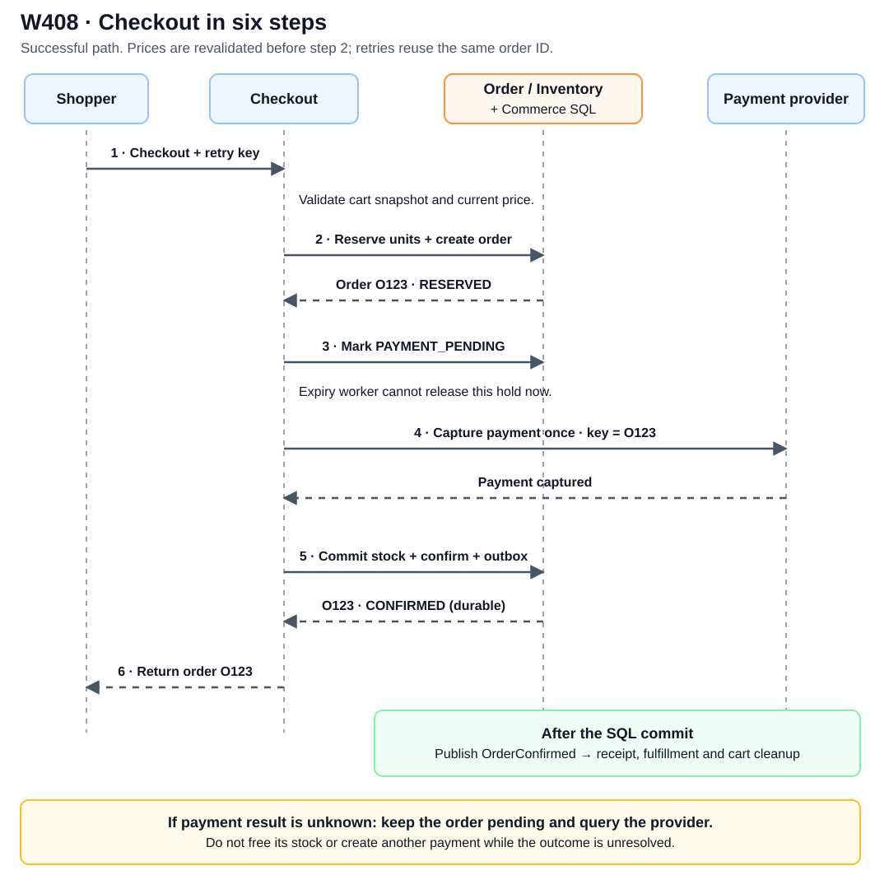

# W408. Design a Shopping Cart Service With Inventory Consistency

**Priority group:** Fifth 100 — specialized practice

**Category:** Inventory, reservations and marketplaces

**Study position:** 408 of 547

[Group list](../FIFTH_100.md) · [All categories](../ALL_CATEGORIES.md) · [Chapter guide](../README.md)

<span class="practice-page"></span>

## Question

Shoppers put items in a cart long before they pay, and during a sale many of them want the last few units of the same product. Design the cart service of a large online retailer: it stores carts, turns a cart into an order at checkout, and never confirms more orders than there are units in stock. The hard part is deciding how carts and inventory interact without making every cart action slow.

### Requirements

1. Cart operations: a shopper can add an item, remove an item, change a quantity and view the cart. Reads are far more frequent than writes, and every operation must feel instant.
2. Guest and signed-in carts: a guest keeps a cart without an account. When the guest signs in, the guest cart merges with the cart already saved on the account, and nothing the shopper added is silently lost.
3. Checkout: the cart turns into an order. Prices, availability and promotions are re-validated at that moment, and one click must never create two orders.
4. Availability: the cart must keep working when part of the system fails; a shopper should not lose a cart because one server restarted.

### Inventory consistency rules

1. Stock is limited and several shoppers may want the last units at the same time. The system must never confirm more orders than there are units.
2. Decide what, if anything, is reserved when an item is added to the cart, and what is reserved or decremented at checkout. Justify the choice both for ordinary items and for a very popular item during a sale.
3. Abandoned carts must not hold stock forever.

### Deliverables

1. The architecture: services, data stores and the path of a request for each cart operation.
2. The data model and the partitioning key for the cart store.
3. Back-of-envelope sizing for carts, request rate and storage, with every assumption stated.
4. The inventory strategy, including the order of operations at checkout, the handling of retries and the handling of a hot item.
5. Failure behaviour and what you would monitor.

### Follow-ups


#### Follow-up 1: two checkouts race for the last unit

What happens when two checkouts try to buy the last unit at the same moment?


#### Follow-up 2: reserving stock at add-to-cart

Why not reserve stock at add-to-cart for every item?


#### Follow-up 3: merging carts that hold the same item

How do you merge a guest cart and an account cart when both contain the same item?


#### Follow-up 4: stale price and stock in an old cart

How do you keep the displayed price and stock from going stale in a cart that has sat for a week?

## Worked solution

### 1. Start with the distinction that makes the design work

A **cart records what a shopper wants**. An **inventory hold records what the retailer has temporarily promised**. Those are different facts.

For ordinary items, adding to a cart does not reserve stock. Otherwise thousands of abandoned carts could make a product appear sold out without anyone paying. Reserve units when checkout starts, keep the reservation short-lived, and confirm the order only after resolving payment and committing the stock allocation.

For example, Alice and Bob can both have the last unit in their carts. That is acceptable. At checkout, the inventory database allows only one of them to reserve it. The other receives an explicit out-of-stock result; their cart remains available for editing.

### 2. Architecture: where each responsibility lives



[Open the architecture diagram at full size](../diagrams/W408_architecture.svg). Both diagrams are local SVG files, so they remain readable offline and do not need a diagram-rendering service.

Read the diagram along two paths:

- **Cart path, across the top:** the gateway routes add, edit, remove, view and merge requests to the Cart Service. The service saves the cart durably. Stock is not allocated on this path.
- **Checkout path, down the middle:** Checkout coordinates a frozen cart snapshot, current prices, inventory holds and payment. The Order/Inventory service owns the authoritative stock transitions.

The orange **Commerce SQL** box is the transaction boundary for this baseline. Orders, inventory counters, holds and outbox records live in the same transactional database. The payment provider is outside that boundary, so a SQL rollback cannot undo a charge. Explicit pending states and reconciliation handle that gap.

| Component | What it owns | Why it is separate |
|---|---|---|
| Cart Service + durable cart store | Desired quantities, cart version, guest/account ownership | Cart traffic can scale without contending on stock rows. |
| Pricing / Catalog | Current product rules, price and promotion validation | A week-old displayed price is not an authoritative checkout quote. |
| Checkout Service | The sequence of checkout steps and retry responses | It coordinates work while durable order state survives a server restart. |
| Order/Inventory + Commerce SQL | Holds, available units, committed units and order state | The last unit is allocated by an atomic database operation. |
| Payment provider | Payment outcome and its stable payment reference | A timeout must be resolved by querying or retrying the same payment operation. |
| Outbox publisher + event workers | Durable delivery of committed-order events | Receipt delivery and cart cleanup do not block the critical stock transaction. |

A cart cache can accelerate reads, but the durable cart store remains authoritative. For clarity it is omitted from the drawing; it must never become the inventory authority.

### 3. Cart APIs, storage and request paths

Use an opaque `cart_id` as the cart partition key. A guest cookie identifies a guest cart; an account mapping identifies the signed-in user's active cart. Store the cart version and its lines together, or in a partition that supports an atomic cart mutation.

A line key includes the SKU and selected variant, plus seller or fulfillment pool when those change what is being purchased. Store quantity and a displayed price snapshot; the snapshot is useful for presentation, not final billing.

| Request | What the Cart Service does |
|---|---|
| `GET /carts/{id}` | Read the current cart; optionally use a cache with version checks. |
| `POST /carts/{id}/items` | Validate the SKU and quantity, then atomically add or increment a line. |
| `PATCH /carts/{id}/items/{line}` | Set the quantity against an expected cart version. |
| `DELETE /carts/{id}/items/{line}` | Remove the line and increment the version. |
| `POST /carts/{id}/checkout` | Submit the expected cart version and a stable checkout idempotency key. |

Return the updated cart and new version after a successful mutation. If two devices edit the same version, reject the stale update with a conflict and let the client reload or merge explicitly. For increment-style operations, store a mutation id so retrying a timed-out add does not add the quantity twice.

A cache miss falls back to durable storage. After a mutation, update or invalidate the cache. A client can send its minimum observed version on a subsequent read; if the cached entry is older, fetch the durable value. This gives the shopper a practical way to see their own writes without requiring every cached view to be globally instantaneous.

### 4. Inventory: the transaction that prevents overselling

For each `(SKU, fulfillment_pool)`, track available units, held units and committed-but-not-yet-fulfilled units. A sale moves units between these buckets:

```text
available --reserve--> held --payment + confirmation--> committed
                         |
                         +--cancel / safe expiry-------> available
```

Within this allocation model, the counters must stay nonnegative. Shipment, replenishment and returns are separate inventory transitions that adjust the physical-stock accounting consistently.

A hold contains its order id, SKU, quantity, expiry and state. For a positive requested quantity, this conditional update allocates stock:

```sql
UPDATE inventory
SET available = available - :quantity,
    held = held + :quantity
WHERE sku_id = :sku_id
  AND fulfillment_pool = :pool
  AND available >= :quantity;
```

If exactly one row changes, the stock allocation succeeded. If no row changes, the requested stock is unavailable. Create the hold and pending order in the **same transaction** as this update. For a multi-item cart, update rows in a consistent order, require every item to succeed, and roll back the transaction if any item fails.

**Last-unit race:** suppose `available = 1` and two checkouts each request one unit. One update changes the row to `available = 0, held = 1`. The other cannot satisfy `available >= 1`, so it loses. Both clients may previously have seen an available item, but only one receives a hold.

The database must enforce this operation atomically; a read followed by an unconditional write is insufficient. Neither a stale availability cache nor a Redis decrement outside this transaction can override the result.

**Scaling boundary:** this baseline assumes an order's inventory rows fit inside one transactional Commerce SQL authority. If stock is split across independent databases, do not pretend the SQL block spans them. Use a real distributed transaction, or coordinated fulfillment suborders with explicit reservation, compensation and final-confirmation rules. That extension needs its own failure analysis.

### 5. Checkout: follow the six numbered steps



[Open the checkout sequence at full size](../diagrams/W408_checkout.svg).

**Step 1 — Validate a snapshot.** Read the requested cart version and revalidate prices, promotions, purchase limits and product rules. If the price changes, show the revised total and obtain the shopper's acceptance before charging. Save an immutable order snapshot with the accepted amount and currency.

**Step 2 — Reserve and create the order atomically.** Within Commerce SQL, insert an order in `RESERVED`, create its holds, and conditionally allocate each inventory line. Enforce a unique `(shopper, checkout_key)` mapping and store a request fingerprint. Repeating the same request returns the same order id; reusing the key for different contents is a conflict. If stock allocation fails, roll back the new order and all its holds.

**Step 3 — Hand the hold to payment processing.** Before contacting the provider, atomically change `RESERVED` to `PAYMENT_PENDING` if the reservation is still valid. This transition locks out the ordinary expiry worker. If expiry already won, the transition fails and no payment request is sent.

**Step 4 — Resolve payment using one stable operation.** Use the order id as the provider's idempotency key and charge the stored amount, not a new client-supplied total. Store the provider reference and result. A timeout means **unknown**, not declined: return a pending response with the same order id and reconcile with the provider. Do not create a second charge with a new key.

**Step 5 — Confirm durably.** After verified payment success, one SQL transaction moves that order's units from held to committed, changes `PAYMENT_PENDING` to `CONFIRMED`, and inserts an `OrderConfirmed` outbox event. Lock or conditionally claim the order transition so retries cannot commit its units again. If the order is already confirmed, return the existing result.

**Step 6 — Respond and finish asynchronous work.** Return the confirmed order id after the transaction commits. The outbox publisher can then retry event delivery. Receipt, fulfillment and cart-cleanup consumers deduplicate by event or order id. Clear the purchased cart only if its version still matches the checkout snapshot; if the shopper changed the cart in the meantime, preserve those edits rather than wiping the whole cart.

This separates **one logical order** from the number of network attempts. Checkout requests, payment calls and events can all be retried, while unique keys and conditional transitions make their effects idempotent.

### 6. Expiry, payment failures and recovery

A reservation can expire while it remains `RESERVED`. The expiry worker atomically claims that order/hold state and releases its units once. The payment-start transition and expiry transition compete on the same state; both cannot win.

Once payment is `PAYMENT_PENDING`, the ordinary TTL worker must not release the hold. A recovery worker queries the provider and completes or cancels the order. If the provider confirms a terminal decline or cancellation that cannot later settle, release the hold and cancel the order atomically. A temporary “not found” response is insufficient if an earlier payment request could still arrive. If payment may still succeed, retain the pending state until it is resolved or a verified void/refund makes release safe.

| Failure | Correct response |
|---|---|
| Cart server restarts | Another instance reads the durable cart. No stock hold was tied to that server's memory. |
| Inventory database is unavailable | Keep cart operations available where possible; reject or defer checkout allocation. Do not confirm from a cache. |
| Checkout crashes after creating a hold | Retry the same checkout key. A `RESERVED` hold can eventually expire if payment never starts. |
| Payment succeeds but its response is lost | Query or replay the same provider operation. Keep the order pending and protect its held units. |
| Payment succeeds, then SQL confirmation fails temporarily | Reconciliation retries confirmation from durable payment evidence. Do not release and resell the held units. |
| Confirmation commits but the client response is lost | The same checkout key returns the existing confirmed order. |
| Event bus is down | The outbox record remains committed. Publication and idempotent consumers catch up later. |

A stuck pending payment reduces availability temporarily. Monitor it and reconcile it; silently freeing its stock would trade a visible recovery problem for overselling. State the provider's query and idempotency guarantees, including their retention windows, and retain your own payment references for reconciliation.

### 7. Guest-cart merge without losing or duplicating items

Suppose the account cart contains two units of SKU A and the guest cart contains one. A sum-quantity merge produces three units, subject to an explicitly displayed per-customer limit. It does not reserve three units; availability is checked at checkout. Do not silently drop a line because today's stock is low.

Use a stable `merge_id` and a recoverable merge operation:

1. Freeze a versioned guest snapshot and record its target account cart. Further guest edits are routed to the target or rejected with a reload instruction; they must not disappear into a completed snapshot.
2. Atomically apply the snapshot to the account cart and record `merge_id` in that cart's partition. A retry sees that id and does not add the quantities again. Concurrent account edits use the normal version/conflict rules.
3. Mark the guest cart as merged and redirect future reads to the account cart. If a server crashes between steps, resume the same operation from its durable state.

This avoids assuming that two independently partitioned carts can always be changed in one local transaction. If the chosen store does support an atomic two-cart transaction, that can simplify the implementation.

### 8. Popular items, stale carts and rough sizing

For ordinary items, checkout-only holds avoid abandoned-cart hoarding. For a flash-sale SKU, add a bounded admission queue or rate limit before attempting the stock transaction. An admitted shopper can receive a short checkout hold with per-account limits. Reserving on every add-to-cart request would let bots and abandoned tabs capture stock before meaningful purchase intent.

The hot stock row still has an authoritative conditional update. Queueing reduces contention; it does not manufacture extra units. If stock is split across selling pools, allocate disjoint quotas durably so their total cannot exceed actual stock.

An old cart can display cached price and stock hints, with a freshness indicator. Refresh those hints on cart view, but always revalidate during checkout. Do not promise a week-old price or treat a visible cart line as proof that units are reserved.

For an interview, choose explicit assumptions and show the arithmetic. These are illustrative inputs, not measured traffic:

| Assumption | Estimate |
|---|---|
| 10 million new carts/day, retained for 30 days | Up to 300 million retained carts, ignoring early deletion. |
| Average stored cart size 2,000 bytes | About 600 GB of primary cart data. |
| Three replicas, then 50% index/metadata allowance | Roughly 2.7 TB; measure real item sizes before capacity planning. |
| 200 million cart reads/day | About 2,315 reads/second on average. |
| 50 million cart mutations/day | About 579 writes/second on average. |
| 1 million checkout attempts/day | About 11.6 attempts/second on average, each involving several internal operations. |
| Tenfold aggregate peak | About 23,150 reads/second and 5,790 cart writes/second. A sale can produce a much sharper per-SKU hotspot. |

Partition carts by a hash of `cart_id` to spread unrelated carts across nodes. Scale stateless service instances independently. Keep account-to-cart lookup small and durable. Inventory contention is governed by the concentration of requests on a SKU, not just total cart throughput.

### 9. What to monitor and how to explain the design

Track cart read/write latency and error rate; version conflicts and merge retries; inventory allocation failures; hold age and expiry lag; payment-pending age and reconciliation outcomes; duplicate checkout/payment attempts; and outbox/fulfillment lag. Alert on negative counters, a hold committed twice, or a confirmed order without the required stock allocation.

A useful interview explanation is:

“Saving a cart records intent and does not reserve stock. At checkout I validate a versioned snapshot, atomically create one order and reserve its units, then move it to payment pending before making the external call. A stable payment key handles retries. Verified payment success leads to one transaction that commits inventory, confirms the order and writes an outbox event. Unknown payments stay pending for reconciliation. Guest merges and cart cleanup use ids and versions so retries do not duplicate quantities or erase later edits.”

For more depth, see [idempotency](../17_distributed_systems_depth.md#f165) and [backpressure](../17_distributed_systems_depth.md#f169). The architecture diagram shows **who owns each fact**; the sequence diagram shows **when that fact is allowed to change**.
