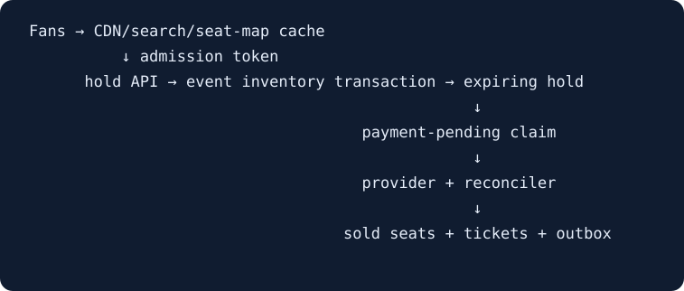

# W409. Design a Ticketing System with Flash-Sale Concurrency

**Priority group:** Fifth 100 — specialized practice

**Category:** Inventory, reservations and marketplaces

**Study position:** 409 of 547

[Group list](../FIFTH_100.md) · [All categories](../ALL_CATEGORIES.md) · [Chapter guide](../README.md)

## Question

Design a ticket-purchase system (Ticketmaster-style): browse events, view a seat map, hold seats for N minutes, complete purchase, and release on timer.

Scale is bursty — a concert on-sale can produce 100K+ concurrent holds within seconds. Discuss seat-hold semantics, inventory consistency, flash-sale handling, and the payment flow. Be ready for the interviewer to narrow scope mid-design (e.g., to a single-school ticket system).

## Worked solution

### Reserve seats with a short authoritative hold

Browsing and seat-map hints use caches; a hold request goes to the event's inventory authority. Store each `(event_id,seat_id)` with state, hold owner, hold version/expiry and final ticket reference. An order of several seats needs one all-or-nothing transaction within the event partition so a buyer does not unexpectedly receive half a group.

[Open the architecture diagram](../diagrams/W409_review_architecture.svg).

### Walk through the race

`POST /holds` takes event, seat IDs and a client key. Lock requested seats in sorted order, require AVAILABLE or safely expired ordinary holds, then write one hold and mark all seats HELD. A unique seat key/conditional update enforces ownership. If two users request the last seat, one transaction wins and the other receives a conflict/current seat state. A browser's earlier selection is not a reservation.

An indexed timer/reconciler releases only the matching ordinary HELD generation after N minutes. Before contacting payment, conditionally claim the unexpired hold as PAYMENT_PENDING. Expiry cannot simultaneously release those seats. Unknown payment outcomes retain protected inventory until reconciled or verified void/refund; otherwise a late successful payment could compete with a new sale. Use stable payment/order keys, deduplicate provider events, then atomically mark seats SOLD and create tickets/outbox events. A lost success response returns the existing order on retry.

### Survive a hundred-thousand-hold burst

Clarify whether 100K means attempts or actual accepted holds and how many seats exist. If the event has only 50K seats, it cannot accept 100K simultaneous unique seat holds. Use a virtual waiting room, signed short-lived admission tokens, per-account purchase limits and rate-limited hold traffic. Scale static seat geometry/CDN reads separately from the strongly consistent write shard. Admission is bounded by tested hold/payment capacity and inventory, not by how many web servers can accept sockets.

The hot event can be partitioned by section only if multi-section orders use a real cross-partition transaction or explicit grouped reservation protocol. Do not claim independent locks give atomic group purchase. Cache/live availability updates can lag; conflicts return fresh states and preserve the rest of the user's selection.

Monitor admission backlog, lock conflicts, hold age, expiry lag, pending payments, duplicate operations and confirmed tickets versus seats. Test crashed clients/servers, payment timeouts, expired tokens, stale maps and mass retries. Scope narrowing to one school can reduce deployment complexity, but the no-double-sale transaction and payment-uncertainty rules still apply.
