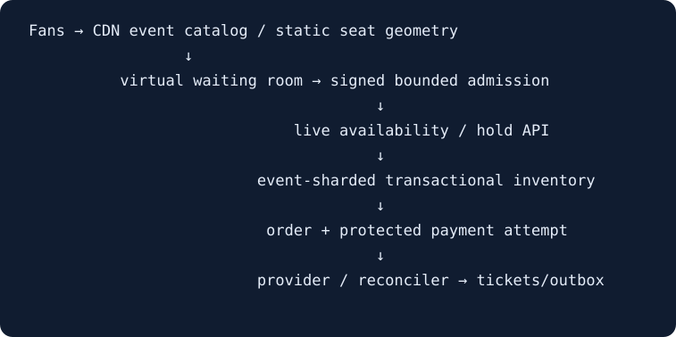

# W410. Design an Event Ticket Marketplace: Seat Holds and On-Sale Traffic

**Priority group:** Fifth 100 — specialized practice

**Category:** Inventory, reservations and marketplaces

**Study position:** 410 of 547

[Group list](../FIFTH_100.md) · [All categories](../ALL_CATEGORIES.md) · [Chapter guide](../README.md)

## Question

Design an online marketplace that sells tickets to live events (concerts, sports, theatre), in the style of Ticketmaster. Fans find an event, pick seats on a seat map, and pay for them.

Scale and assumptions
1. Catalog: tens of thousands of upcoming events across many venues. A large venue has about 50,000 assigned seats.
2. Orders: a typical order is 4 seats.
3. On-sale spikes: a popular event goes on sale at a published time. About 2 million users arrive within the first 10 minutes, far more than there are seats.
4. Normal traffic: outside on-sales, traffic is mostly browsing and search, with steady low purchase volume.
5. Payments: an external payment provider authorizes and captures card payments. Calls to it can time out.
Functional requirements
1. Browse and search events by name, performer, city and date.
2. View an event's seat map with live availability and prices.
3. Select seats and place a temporary hold on them. A hold expires after a fixed time (for example 10 minutes) if the purchase is not completed.
4. Complete the purchase: pay, confirm the order and issue tickets.
5. A seat is never sold to two buyers, and a buyer is never charged twice for one order.
Parts to address
1. API and data model for events, venues, seats, holds, orders and tickets.
2. Seat holds: how a hold is placed atomically for several seats, how expiry works, and what happens when two users try to take the same seat at the same moment.
3. Purchase flow: the steps from hold to issued ticket, including payment timeouts, retries and a hold that expires during payment.
4. On-sale traffic: how the system survives millions of users arriving at once, including a virtual waiting room (queue), how users are admitted, and how the seat map stays fast.
5. Scaling and storage: which data needs strong consistency and which can be cached or eventually consistent, and how the inventory store is partitioned.
Deliverables
1. The architecture, naming the services on the browse, hold and purchase paths.
2. Capacity estimates for a large on-sale: arrival rate, seat-map read rate, admission rate and hold write rate.
3. The failure behaviour for a payment timeout, a crashed service holding seats, a cache that shows a sold seat as free, and bots.

### Constraints

General system design; no machine-learning components are required.
State any assumption you add beyond the numbers above.

## Worked solution

### Separate the cheap browse path from scarce-seat writes

Two million users in ten minutes means about $2{,}000{,}000/600=3{,}333$ arrivals/s on average; opening-second peaks can be much higher. A 50,000-seat venue can support at most 12,500 four-seat orders. Most visitors must wait or receive a clear sold-out result, so admitting everyone to checkout is structurally wrong.

[Open the architecture diagram](../diagrams/W410_review_architecture.svg).

### API and records

Model Venue, SeatGeometry, Event, EventSeat `(event_id,seat_id,state,hold_id,version,price)`, Hold `(owner,expiry,state)`, Order with immutable amount/currency, PaymentAttempt, and Ticket with unique event-seat allocation. Geometry can be reused; a seat's sale status belongs to a particular event.

`GET /events?q=&city=&start=&end=` searches a cache/index. `GET /events/{id}/seats?after_version=` returns a snapshot/deltas. `POST /holds` accepts seats and a client key; `POST /orders` accepts hold, accepted quote and order key; `GET /orders/{id}` returns pending/confirmed state. The server owns price calculation. Require authenticated scope, rate limits and bounded group size.

### Atomic holds, expiry and payment

Within the event's transaction authority, lock all requested seats in deterministic order and require every seat available. Insert one hold/update every seat or roll back all. Return conflicting IDs/current states on failure. The expiry job conditionally releases only that hold/version while ordinary HELD; checks on the write path prevent scheduler lag from keeping an already expired hold logically valid.

Payment starts by atomically moving an unexpired hold to PAYMENT_PENDING before calling the provider. The expiry worker cannot release that state blindly. Store a stable provider operation key and reconcile timeouts. If the business insists inventory must release at a fixed wall deadline even during payment, the contract needs a provably terminal provider cancellation/void or a late-success refund path that does not promise a ticket; do not simultaneously promise unconditional payment success and a resold seat.

After verified success, one transaction confirms order, marks all seats SOLD, inserts unique tickets and writes an outbox event. A crash after payment but before that commit is recovered from durable provider evidence while the seats remain protected. Receipt/ticket delivery retries are independent of charging.

### Derive admission and read load

Assume each arriving user makes three seat-map reads: about 10,000 reads/s averaged over the ten-minute window, with the burst stated separately. If admitted shoppers instead poll every five seconds, 30,000 admitted users alone add 6,000 reads/s; use event deltas/coalescing and bounds. These are workload assumptions, not supplied measurements.

Suppose inventory can safely process 200 four-seat hold attempts/s. Admit at most that rate—and less if active-hold stock or payment capacity binds. At most 12,500 four-seat holds fit when all 50,000 seats are free. With ten-minute holds, a no-conversion fully held venue recycles only about 20.8 four-seat holds/s in steady state. Faster admission cannot manufacture available inventory. Each successful four-seat hold updates four seat rows plus hold/order metadata. If all 200 attempts/s succeed, that is 800 seat-row updates/s; at success fraction p it is 800p. Budget failed-attempt reads/locks and expiry/finalization writes separately.

### Failures and abuse

A crashed hold service loses no committed hold; timers/reconciliation resume from DB. A stale map can show a sold seat as free, but the authoritative hold fails and returns current states. A provider timeout shows pending and triggers status reconciliation under the same key. Bots face identity/account limits, signed queue tokens, bounded admission and abuse detection; front-door controls complement, rather than replace, seat constraints.

Keep one write authority per event with replicated durable storage and fenced failover. Use caches/replicas for discovery and maps, accepting bounded staleness. Monitor actual p99 browse/hold latency, queue age, inventory conflicts, active hold counts, provider uncertainty and seat-to-ticket reconciliation. Load-test the published on-sale instant, not just the 3,333/s average.
