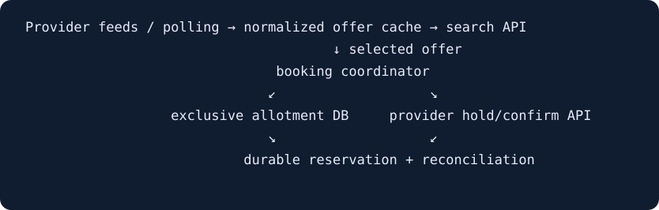

# W411. Design an Expedia-Style Hotel Reservation System

**Priority group:** Fifth 100 — specialized practice

**Category:** Inventory, reservations and marketplaces

**Study position:** 411 of 547

[Group list](../FIFTH_100.md) · [All categories](../ALL_CATEGORIES.md) · [Chapter guide](../README.md)

## Question

Design a hotel reservation system similar to Expedia — an aggregator that resells rooms sourced from many hotel groups' own systems/APIs (e.g. Marriott), rather than a single chain's first-party system.

Users search and book hotel rooms across many providers.
Hard requirement: room-availability latency must be very low.
Availability must stay correct: a room shown as available must (as much as possible) still be bookable when the user commits.
Notes

The central tension is cache vs consistency. Pre-fetching/caching each hotel group's availability gives low read latency, but a provider may sell a room out-of-band right after you cached it — so a confirm step against the provider can fail or be slow; calling the provider live on every read keeps inventory fresh but blows the latency budget. One workable direction: aggregators pre-negotiate and lock a block of rooms from each hotel group, so reads serve from your own cache/DB quickly; when the locked block is exhausted, fall back to the provider API. Distinguish a fast, possibly-stale availability read from an authoritative confirm-at-booking step. A single design round — reason about inventory caching, staleness windows (TTLs, write-through/invalidation), and graceful fallback when a cached room is gone at confirm time.

## Worked solution

### Choose an inventory contract before promising availability

An aggregator normally does not own the hotel's live inventory. A cached availability response can become stale immediately when another seller books a room. Calling every provider live on every search adds latency and still does not make a later independent booking atomic. Distinguish a fast search hint from an authoritative reservation.

[Open the architecture diagram](../diagrams/W411_review_architecture.svg).

### A practical two-path design

For contracted exclusive allotments, store room-type/night quantities that the provider has genuinely removed from other channels. Our transactional authority can hold/decrement those units quickly across every night/room in the stay. Merely caching a supplier quantity is **not** an exclusive allotment. Reconcile allocations, releases, cutoff dates and contract revisions with the provider.

For non-allotted inventory or exhausted allotments, use cached offers for discovery, then reprice and obtain an atomic provider hold/booking at commitment. Return changed terms or unavailable status clearly. A live availability check alone is insufficient if another client can reserve before our next call. If the provider has no atomic conditional booking operation, explain the resulting best-effort availability rather than promising elimination of external races.

### API, state and staleness

`GET /search` returns hotel/room offer IDs, stay dates, price/terms, provider version and freshness timestamp. `POST /booking-intents` takes an accepted offer and client idempotency key. Store intent, provider operation/hold reference, amount/currency and state. A stable provider client ID, status lookup and payment operation key make timeout recovery possible. Supplier and payment cannot be wrapped in one ordinary database transaction, so durable pending states and cancellation/void/refund compensation are required.

Set TTLs by provider volatility/contract and refresh popular offers proactively. Invalidation/webhooks reduce staleness but may arrive late. Do not serve an expired quote as a guaranteed rate. Bulkhead provider calls with deadlines and return partial search results; an unavailable hotel group should not stall all others. For a failed confirm, preserve search context, refresh alternatives and obtain consent before changing room or price.

Measure search p99, cache freshness, allotment utilization, confirm/sold-out/reprice rate, provider latency and unresolved bookings. The trade-off is economic as well as technical: exclusive blocks improve consistency/latency but create contract, allocation and possibly unsold-inventory risk. Test out-of-band sales, duplicate confirms, missing callbacks, partial multi-night failure and an allotment revision during checkout. No precise latency/QPS is supplied, so select budgets with measured provider response distributions rather than claiming a universal millisecond guarantee.
