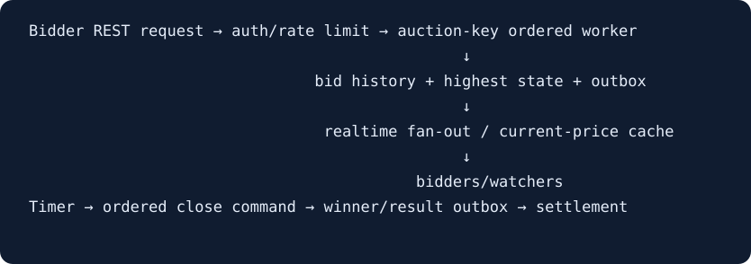

# W412. Design an Online Auction System with Concurrent Bidding

**Priority group:** Fifth 100 — specialized practice

**Category:** Inventory, reservations and marketplaces

**Study position:** 412 of 547

[Group list](../FIFTH_100.md) · [All categories](../ALL_CATEGORIES.md) · [Chapter guide](../README.md)

## Question

Design an online auction system (eBay-style) that supports concurrent bidding, real-time price updates, and correct close-out semantics.

Functional requirements:

List an item for auction.
Place bids; get real-time price updates.
End an auction and declare the winner.

Discuss bid ingestion and ordering, how you push real-time updates to clients, close-out handling, and anti-snipe (auto-extend) behavior. Provide a rough QPS estimate and defend your concurrency-control choice.

## Worked solution

### Serialize decisions per auction

Clarify an ascending-price auction with no proxy/max-bid feature initially. Each auction has seller/item, opening/closing time, minimum increment, current highest bid/version and status. Each bid records an immutable ID, bidder, amount, server acceptance order/time and outcome. Client clock timestamps do not decide who won.

[Open the architecture diagram](../diagrams/W412_review_architecture.svg).

`POST /auctions/{id}/bids` includes a client idempotency key and exact amount/currency. Route the auction to one fenced owner or use a row-locked SQL transaction. Check OPEN state, authoritative cutoff and minimum increment, then insert the bid and update highest state atomically. A repeated key returns the same result. A stale displayed price does not invalidate a sufficiently high bid automatically; choose whether the API requires an expected price/version and document it.

### Close and anti-sniping

A close job uses the same serialization boundary as bids. It closes only the current auction version after the authoritative deadline and records one winner/result event. Decide whether admission means durable receipt before cutoff or processing before cutoff; queue delay makes those different. If durable ingress before cutoff counts, close must drain/sequence all eligible admitted bids before finalization.

For anti-snipe behavior, an accepted qualifying bid in the last W seconds extends `ends_at` under the same transaction, subject to a maximum extension policy. Old timer jobs re-read the new version/deadline and become no-ops. A late worker must not close using a stale cached deadline. Every extension is broadcast with its event sequence.

### Capacity, reads and recovery

For an illustrative one million watchers refreshing every five seconds, polling would create 200,000 reads/s. A live stream with cached snapshots avoids repeated database reads, though fan-out bandwidth still matters. If ten thousand auctions average one bid per ten seconds, average bid QPS is one thousand, with final-second hot-auction bursts sized separately. These are assumptions, not supplied traffic figures.

Use SSE for server-to-client updates and REST bids, or WebSocket if bidirectional features justify it. Reconnect by event sequence and snapshot; slow clients have bounded buffers. Cache state after the transaction through an outbox, never as the winner authority. Partition by auction ID; a single hot auction still has an inherent ordered decision stream, so admission and efficient per-auction processing matter more than adding arbitrary workers.

A crashed worker is replaced under a new fenced lease and replays durable state. Acknowledgement must distinguish accepted-for-processing from a valid winning bid. Settlement failure does not rewrite bid history; use a separate winner-payment/default policy. Monitor queue delay, rejected duplicates, close lag, extension frequency, fan-out lag and ledger reconciliation. Test equal bids, close/bid races, retries, stale timers, owner loss and out-of-order notifications.
