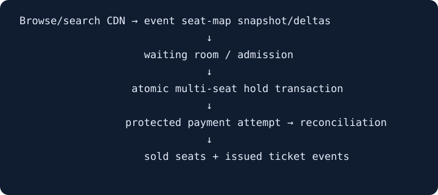

# W413. Design Ticket Booking (Ticketmaster)

**Priority group:** Fifth 100 — specialized practice

**Category:** Inventory, reservations and marketplaces

**Study position:** 413 of 547

[Group list](../FIFTH_100.md) · [All categories](../ALL_CATEGORIES.md) · [Chapter guide](../README.md)

## Question

Design a ticket-booking system (Ticketmaster-style). The core challenge is seat-locking under concurrency for high-traffic event drops.

Functional

Browse events; view venue seat map.
Reserve seat(s) — atomic across concurrent users.
Pay within a reservation window; on payment success the ticket becomes permanent.
On window expiry without payment, seat returns to the available pool.

Non-functional

Hot drops: 100K concurrent users hammering one event at sale open.
No double-booking under any concurrency scenario.
Browse and search stay low-latency during sale events.

## Worked solution

### Pick pessimistic checkout holds for a hot drop

A user selecting a seat locally has no ownership. A successful hold temporarily owns the seat for a bounded checkout window, reducing the frustration of discovering a conflict only after entering payment details. Optimistic conflict detection at final purchase is simpler for low contention but performs poorly when 100,000 buyers compete for a small seat set.

[Open the architecture diagram](../diagrams/W413_review_architecture.svg).

### Inventory and API

Use EventSeat keyed by `(event_id,seat_id)`, with state, hold ID, expiry/version and sold ticket ID. Hold references buyer and seat list; Order snapshots price/fees/currency and links payment; Ticket has a unique event-seat allocation. `POST /holds` takes desired seats and a retry key, locks seat rows in stable order and acquires **all** or none. A loser gets `409` with current conflicting seats. Seat maps are cached hints, not allocation authority.

During ordinary HELD, an indexed expiry job or write-path check releases the current hold only once. Start payment by conditionally claiming the unexpired hold as PAYMENT_PENDING. Once a provider could have charged, do not blindly release inventory on TTL: query/void/reconcile under a stable operation key, or define a late-success refund policy that does not promise those seats. Verified success confirms the order, marks seats SOLD and inserts tickets/outbox events atomically. Lost client responses return the existing result by order key.

### Isolate the sale from browsing

Serve static venue geometry and event pages at the edge, publish bounded availability deltas and rate-limit polling. Admit hold requests through signed short-lived queue tokens at a rate supported by measured inventory and payment capacity. Limit accounts/groups and reject reused/forged admission tokens. A hundred thousand concurrent users is not itself a QPS; for example, two polls/s creates 200,000 requests/s before hold attempts, so specify interaction rates explicitly.

Keep a hot event's atomic seat group within one transaction authority where possible. If sharding sections, a cross-section order needs a real multi-partition reservation protocol/transaction; independent locks do not give all-or-nothing groups. Replicate/fence the writer and keep browse/search on separate resources so hold contention cannot consume all discovery capacity.

Test last-seat races, partial group conflicts, crashed clients, expired holds, payment timeouts, duplicate callbacks and failover during confirmation. Monitor admission backlog, conflicts, seat-map freshness, pending-payment age and sold-seat/ticket uniqueness. Adding more web instances does not repair an overselling read-then-write inventory algorithm.
