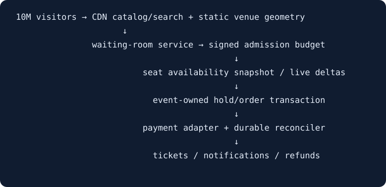

# W414. Design Ticketmaster - Event Booking and Seat Reservation

**Priority group:** Fifth 100 — specialized practice

**Category:** Inventory, reservations and marketplaces

**Study position:** 414 of 547

[Group list](../FIFTH_100.md) · [All categories](../ALL_CATEGORIES.md) · [Chapter guide](../README.md)

## Question

Design a ticket booking site supporting event browsing, search, and seat-level booking, with strong guarantees against double-booking and the ability to handle traffic spikes from high-demand on-sales.

### Requirements

Functional: browse and search events; view a venue seat map with live availability; reserve specific seats; complete payment; receive a confirmed ticket; cancellation and refund within policy.
Non-functional: no double-booking under concurrency (strong consistency on the booking write path); search latency p99 &lt; 500 ms; read-heavy workload (~100:1 read-to-write); handle 10M concurrent users on a marquee on-sale.
Core entities: Event, Venue, Seat (seat_id, event_id, section, row, number, status), Reservation (seat_id, user_id, expires_at), Booking (reservation_ids, payment_status), User, Performer.

## Worked solution

### Size the marquee event separately from ordinary browsing

Ten million concurrent users can overwhelm even a largely cached system if they poll too often. If each polls every ten seconds, that is one million read requests/s. At the stated 100:1 read/write ratio, one million reads/s would correspond to ten thousand writes/s—but the ratio is a workload description, not permission to admit ten thousand purchases/s when seats are scarce. Estimate actual event capacity and shopper behavior separately.

[Open the architecture diagram](../diagrams/W414_review_architecture.svg).

### Data and transaction boundary

Separate Venue/physical Seat from EventSeat sale status, linking Event to Performer. Reservation owns buyer, seat IDs, expiry/state and version; Booking holds accepted prices and payment state. Ticket issuance uniquely binds each event-seat. Partition authoritative writes by event so ordinary multi-seat orders remain one transaction.

`POST /holds` validates identity, admission token and selected seats, locks them in deterministic order and writes all reservations or none. The database's conditional update/constraints prevent two successful owners. Read replicas/Redis seat maps may lag; a conflict returns current seat states. A queue token grants permission to try, not a ticket.

### Payment, expiry and cancellation

Ordinary holds expire through indexed timer jobs plus on-write checks. Payment begins with a guarded transition before external execution. Keep uncertain payment holds protected until provider reconciliation or a provably safe void/refund; a wall-clock TTL is not proof that a delayed provider request cannot settle. Stable order/payment keys and deduplicated webhooks prevent repeated logical effects. After success, atomically finalize booking/seats/tickets and an outbox event.

Cancellation validates policy/current version, records an idempotent refund workflow and decides when inventory becomes resellable. Preserve the original payment and refund ledger rather than overwriting totals. Lost notifications cannot trigger another purchase or refund.

### Meet latency through admission and caching

Aim for p99 search below 500 ms with a search index, cached popular event pages, bounded result sizes and isolated browse resources. Venue geometry is static and highly cacheable; availability is timestamped/delta-driven. Ten million live update connections require dedicated sharded gateways/fan-out capacity, and waiting users can use slower queue-status refreshes rather than full seat maps.

Reserve capacity according to the event's available seats, hold turnover, inventory transaction benchmark and provider limits. Fair queueing, account/device limits and bot controls reduce abusive contention. Bound lock waits/retries and return clear sold-out/temporarily-busy states. Fenced database failover protects the no-double-sale invariant; checkout may pause while browse remains available.

Monitor actual hot-event read/write rates, search/hold tails, admission fairness, conflicts, expiry backlog, provider uncertainty and seat-to-ticket reconciliation. Test ten-million-user arrival modeling separately from real backend admitted load, including a cache outage or reconnect storm. Do not load-test only the average 100:1 ratio and infer marquee safety.
