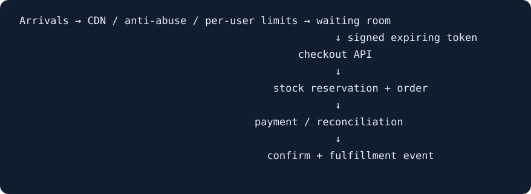

# W415. Million-User Flash Sale System

**Priority group:** Fifth 100 — specialized practice

**Category:** Inventory, reservations and marketplaces

**Study position:** 415 of 547

[Group list](../FIFTH_100.md) · [All categories](../ALL_CATEGORIES.md) · [Chapter guide](../README.md)

## Question

Design a system that handles a million-user flash-sale event. The expected discussion covers necessary components, happy and unhappy paths, and smoothing high-concurrency traffic.

### Requirements

Functional requirements:
Let users enter a high-demand purchase flow during a flash sale.
Track limited inventory accurately.
Complete purchase / reservation for successful users.
Show clear failure states when inventory is gone or payment fails.
Scale / constraints:
Millions of users can arrive around the same launch time.
Inventory is scarce relative to demand.
The system must degrade gracefully instead of overwhelming checkout, inventory, or payment dependencies.
Design decisions to discuss:
waiting room / queue vs direct checkout
token or reservation TTL before payment
rate limiting and backpressure at the edge
idempotent checkout and duplicate-click handling
happy path and unhappy path workflows
Notes
The prompt asks for both happy path and unhappy path. Do not stop at a component diagram; walk through success, sold-out, timeout, payment failure, and retry.
Smoothing traffic is central. A queue, admission token, or staged release is more relevant than simply adding more web servers.
Inventory correctness matters more than cart convenience; overselling is the failure mode to design against.

## Worked solution

### The queue protects a scarce resource

A million arriving users do not imply a million checkout workers are useful. Put the event at the edge, admit a bounded number of shoppers and allocate stock atomically at checkout. The waiting room smooths demand; the inventory authority enforces that confirmed sales never exceed supply.

[Open the architecture diagram](../diagrams/W415_review_architecture.svg).

Use explicit queue eligibility and a fair policy, such as randomized pre-opening order followed by arrival order. Signed admission tokens bind user/event/expiry and cannot be reused indefinitely. The token only grants a checkout attempt. Admission rate is the minimum of safe inventory throughput, payment capacity and currently available reservation slots; autoscaling web servers alone ignores those bottlenecks.

### Walk every required path

**Success:** validate token and accepted price, create one idempotent order, conditionally move requested units from available to held in a transaction, claim payment pending, execute one stable payment operation, then commit held units and order/outbox after verified success.

**Sold out:** the conditional allocation changes zero rows, so no payment is attempted. Return sold out and preserve a meaningful client state rather than retrying endlessly. If temporary holds may return stock, distinguish fully committed sold-out from temporarily held/unavailable.

**Checkout timeout:** retry the same order key and return its durable state. An API timeout does not justify a new order. Admission/hold expiry releases only ordinary uncommitted holds belonging to that version.

**Payment failure:** a verified terminal decline/void releases the hold once and records the result. A payment timeout is UNKNOWN; retain/reconcile the protected hold or use an explicitly safe compensation policy before resale. Never treat an exception as proof no charge occurred.

**Worker/dependency failure:** durable queues/outbox and leases resume accepted work. Bound retries and circuit-break an unhealthy provider; slow the admission rate and communicate waiting rather than letting queues grow without limit. Pending-payment recovery continues even if public intake is paused.

### Capacity and proof

For a stated assumption of one million arrivals in a minute, average arrival rate is 16,667/s. If checkout safely starts 200 attempts/s, at most 12,000 are admitted in that minute and the rest wait or leave. If there are ten thousand units and one unit/order, only ten thousand simultaneous valid holds can exist; admission must reflect that stock bound. These figures illustrate the arithmetic, not a supplied traffic duration or inventory count.

Cache browse/stock hints with freshness and publish status deltas, but make authoritative allocation transactional with nonnegative counters. Enforce per-account purchase limits in that same authority. Monitor queue age/abandonment, admitted rate, stock conflicts, hold turnover, uncertain payments and total allocations. Fault-test duplicate clicks, competing last-unit requests, provider downtime, cache loss and mass reconnects.
