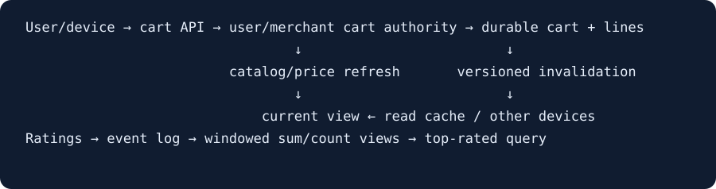

# W416. Online Shopping Cart System

**Priority group:** Fifth 100 — specialized practice

**Category:** Inventory, reservations and marketplaces

**Study position:** 416 of 547

[Group list](../FIFTH_100.md) · [All categories](../ALL_CATEGORIES.md) · [Chapter guide](../README.md)

## Question

Design an online shopping cart for a marketplace-style product, with the key constraint of one active cart per merchant per user. The difficulty is modeling per-merchant carts, handling concurrent updates from multiple devices, choosing the right database and indexes, and deciding whether to snapshot product price and metadata inside the cart.

A reported follow-up extends the problem with a streaming-analytics requirement: rank the highest average-rated products over arbitrary time windows.

## Worked solution

### The uniqueness rule belongs in storage

A user can have one active cart **per merchant**, so `(user_id,merchant_id)` is the lookup/partition key. Model Cart `(id,user,merchant,status,version)` and CartLine `(cart_id,sku,variant,quantity,display_snapshot,version)`. Enforce one active cart with a partial unique constraint/index on `(user_id,merchant_id) WHERE status='ACTIVE'`, or a conditional active-cart mapping in a key-value partition. Two concurrent devices must not both create separate active carts.

[Open the architecture diagram](../diagrams/W416_review_architecture.svg).

### Concurrent edits and snapshots

`GET /carts?merchant_id=...` returns current version. Add/increment operations take mutation IDs so retrying a lost response does not add twice. Quantity-setting/removal operations use expected cart/line versions and return conflicts rather than silently discarding another device's edit. One transaction/partition operation changes cart data and version. Checkout changes the active cart's status and creates the next active mapping under the same uniqueness rule.

Snapshot display title/image/price so the cart is readable if the catalog changes or is temporarily unavailable. Record snapshot time/version. The server refreshes hints on view and **revalidates price, promotion and availability at checkout**, obtaining consent for changes. A snapshot is not an indefinite price promise or inventory reservation. Cache by cart/version, invalidate through a durable outbox and support read-after-write from the authoritative store where necessary.

A relational store supports constraints, reporting and transactions naturally. A document/key-value store can keep a bounded cart together with conditional versions for predictable key access, but large carts and secondary queries need a deliberate model. Choose from measured size/access patterns, not “NoSQL scales” alone.

### Follow-up: top average ratings over arbitrary windows

Store rating events with product, rater, event time, unique ID and revision/retraction semantics. For a window, average is **sum of included ratings divided by their count**. Merge bucket sums/counts; averaging bucket averages equally is wrong when populations differ. Minimum-count/confidence criteria prevent a one-review product trivially outranking a well-established item.

For common aligned windows, stream versioned bucket aggregates and maintain ranked materialized views. Arbitrary start/end times need raw or finer-grained boundary data; fixed minute buckets cannot answer exact second boundaries without error. Scan the boundary fragments and combine interior buckets, or document an approximation. Late events, edits and deletions require compensating updates/recomputation with a watermark/freshness contract. Stable ties use product ID; a precomputed top-K for one window cannot answer every other window exactly.

Test duplicate cart creation/mutations, conflicting multi-device edits, catalog disappearance, uneven rating bucket populations and a late corrected rating. Monitor active-cart uniqueness, conflict rate, cache age, rating lag and top-list stability.
