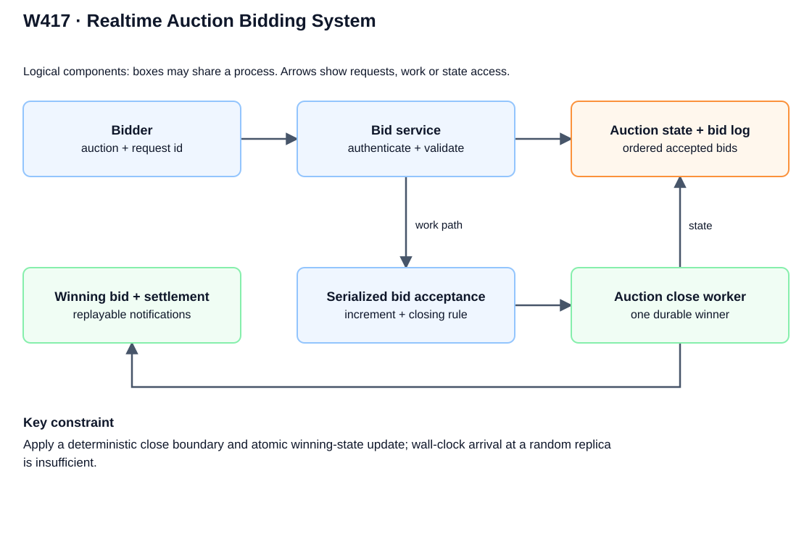

# W417. Realtime Auction Bidding System

**Priority group:** Fifth 100 — specialized practice

**Category:** Inventory, reservations and marketplaces

**Study position:** 417 of 547

[Group list](../FIFTH_100.md) · [All categories](../ALL_CATEGORIES.md) · [Chapter guide](../README.md)

## Question

Design a high-read, high-write auction service with REST bids, ordered bid processing, durable bid history, current-price state, and realtime client updates via SSE or WebSocket.

Architecture
Auction Service accepts REST bids, authenticates, validates, publishes to Kafka partitioned by auction_id.
Bid Worker consumes each auction's ordered stream, checks state and validity, updates MySQL transactionally, publishes state to Redis.
Redis holds current highest bid / state and powers pub/sub to the realtime layer.
SSE server pushes updates; switch hot final windows to WebSocket.
Notes

Partition Kafka by auction_id for per-auction ordering. Bid worker is the serialization point, or MySQL conditional updates enforce monotonic highest bid. Reject stale bids, dedup retries, close auction exactly once.

## Worked solution

<!-- architecture:W417:start -->
### Architecture and request flow

[Open the diagram at full size](../diagrams/W417_architecture.svg). This is a baseline component diagram for this question. The boxes describe responsibilities; they do not require a separate microservice for every box.

- **Request and state:** Bidder — auction + request id → Bid service — authenticate + validate. That component consults or updates **Auction state + bid log — ordered accepted bids** under the required access and consistency rules.
- **Work and result:** the work path passes through **Serialized bid acceptance — increment + closing rule** and **Auction close worker — one durable winner**, producing **Winning bid + settlement — replayable notifications**. Bound waiting and retries where a slow dependency can stall this path.
- **Correctness point:** Apply a deterministic close boundary and atomic winning-state update; wall-clock arrival at a random replica is insufficient.

When explaining the drawing, trace one normal request first, then a duplicate request, an unavailable dependency and recovery from saved state. If the question requires stricter guarantees or a different scope, state the change explicitly rather than treating this baseline as the only possible design.
<!-- architecture:W417:end -->

### Solution outline

1. Model auction id, lot, opening/closing policy, currency, bid id, bidder and authoritative acceptance sequence. Authenticate bidders and validate bid increments and eligibility.
2. Serialize bid acceptance per auction through a single owner or atomic conditional transaction. Compare against authoritative time and the current highest accepted bid; define tie and anti-sniping rules.
3. Publish updates asynchronously, but determine the winner from committed accepted bids after closure. Payment/fulfillment is a separate idempotent state machine with reconciliation.
4. Test simultaneous equal bids, delayed network packets, close-time boundaries, duplicate submissions and failed winner payment.

### Understand why the approach works

#### The browsing view is not the booking authority

Several clients may see the same resource as available. Correctness comes from an atomic hold or purchase transition against authoritative inventory, not from hiding the buy button or decrementing a local cache.

Represent resource id, owner, hold expiry, price/version and lifecycle state. A conditional update such as “available at version $v$ becomes held by request $r$” allows only one winner under the declared exclusivity rule. A hotel night, event seat and fungible stock quantity need different invariants, even when the surrounding API looks similar.

Separate hold, payment, confirmation, cancellation and refund. External systems do not join an ordinary local database transaction; keep pending/unknown states and reconcile. An expired hold racing with payment completion needs a deterministic policy, not two handlers that can independently claim success.

Use idempotency keys and stable order ids so retries do not reserve or charge twice. Queue/admit traffic during a flash sale rather than permitting unlimited contention. Test no inventory, simultaneous buyers, last-millisecond expiry, partial external-provider failure and an acknowledgment lost after a successful confirmation. The failure trace is the core of the design, not an appendix.

### Work a small example

Two clients may both display themselves as highest bidder temporarily, but only committed server acceptance order under the declared tie rule determines the winner.

### Edge cases and common mistakes

Using browser arrival/display time or eventual cache contents as the authoritative auction outcome.

### Check your reasoning on related cases

**Design idempotency for an order or booking API.** A timeout after successful booking should not create a second booking when the client retries the same key.

What if a downstream service is not transactional with your database? Use a durable state machine and reconciliation, not an unsupported exactly-once claim.

**Design a durable work queue with retries and leases.** If a worker completes a side effect and crashes before acknowledgment, the task can be delivered again.

How do fencing tokens help? They allow downstream systems to reject writes from an expired owner.

### Further study

- [F165: Design idempotency for an order or booking API.](../17_distributed_systems_depth.md#f165)
- [F162: Design a durable work queue with retries and leases.](../17_distributed_systems_depth.md#f162)

### Explain it back

Close the answer. State the main invariant or equation, work the example with changed inputs, and explain which assumption would make your solution fail. For a design, walk through a retry or partial failure; for a derivative, check a shape and a finite-difference case.
