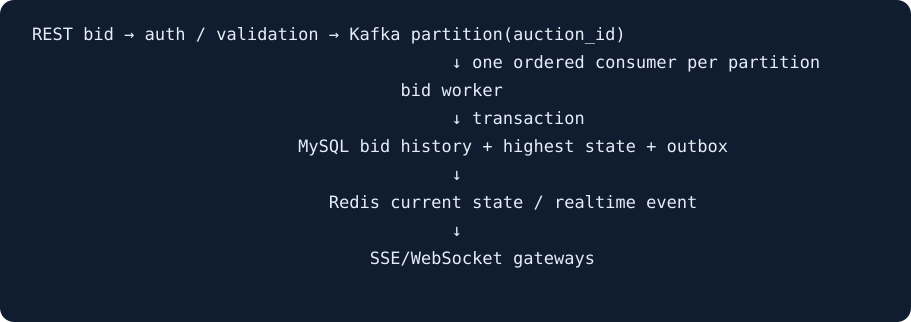

# W417. Realtime Auction Bidding System

**Priority group:** Fifth 100 — specialized practice

**Category:** Inventory, reservations and marketplaces

**Study position:** 417 of 547

[Group list](../FIFTH_100.md) · [All categories](../ALL_CATEGORIES.md) · [Chapter guide](../README.md)

## Question

Design a high-read, high-write auction service with REST bids, ordered bid processing, durable bid history, current-price state, and realtime client updates via SSE or WebSocket.

Architecture
Auction Service accepts REST bids, authenticates, validates, publishes to Kafka partitioned by auction_id.
Bid Worker consumes each auction's ordered stream, checks state and validity, updates MySQL transactionally, publishes state to Redis.
Redis holds current highest bid / state and powers pub/sub to the realtime layer.
SSE server pushes updates; switch hot final windows to WebSocket.
Notes

Partition Kafka by auction_id for per-auction ordering. Bid worker is the serialization point, or MySQL conditional updates enforce monotonic highest bid. Reject stale bids, dedup retries, close auction exactly once.

## Worked solution

### Make the asynchronous acceptance contract explicit

The prescribed path accepts bids over REST, publishes by auction ID to Kafka, and processes each auction in order. An HTTP 202 can mean **durably queued**, not that a bid is valid or currently winning. Return a bid ID/status endpoint and later outcome event so clients can distinguish those states.

[Open the architecture diagram](../diagrams/W417_review_architecture.svg).

### Order, persist and replay safely

Give each bid a client retry key, auction ID, bidder, exact amount and server ingress metadata. Kafka partition order serializes that auction's admitted messages, but a consumer can replay after a crash. In one MySQL transaction, insert the unique bid ID, validate auction OPEN/cutoff and increment rules, update highest bid/version and create an outbox outcome. Commit the broker offset afterward; a crash between DB commit and offset commit replays harmlessly through the unique ID.

Alternatively, a database conditional update can enforce monotonic highest bid, but it still needs durable history/idempotency and a defined ordering policy for ties. Do not let Redis determine the winner; it is derived from committed DB state. Publishing via an outbox avoids losing an update when the DB commit succeeds but Redis/pubsub fails.

### Closing and cutoff semantics

Sequence a close command with bids or define durable-ingress cutoff and drain all qualifying messages before closing. Processing time and arrival time differ during backlog. Close-out conditionally changes the current auction version to CLOSED and creates one result/winner event. If anti-sniping extends deadlines, old close commands recheck the new version/time. Consumer ownership/fencing prevents a revoked worker from committing stale writes during rebalance.

### Realtime and scaling

Clients receive versioned updates and reconnect from sequence or load a current snapshot; pubsub alone is not durable replay. SSE is sufficient for one-way updates while REST carries bids. Switching to WebSocket in a hot final window is a product/transport choice, not a correctness requirement; it adds connection/reconnect complexity and does not solve hot-auction ordering. Bound buffers and coalesce replaceable price snapshots while preserving bid-result/history access.

Scale partitions by auction ID and fan-out gateways separately. One celebrity auction remains one ordered hot stream, so apply admission/backpressure and benchmark that partition. Partition count changes require care to preserve ordering for active auctions. Monitor Kafka lag/age, queued-versus-final bid latency, DB conflicts, outbox lag and realtime gaps. Test duplicate delivery, consumer rebalance, Redis loss, close/bid races and accepted-before-cutoff bids delayed in the queue.
