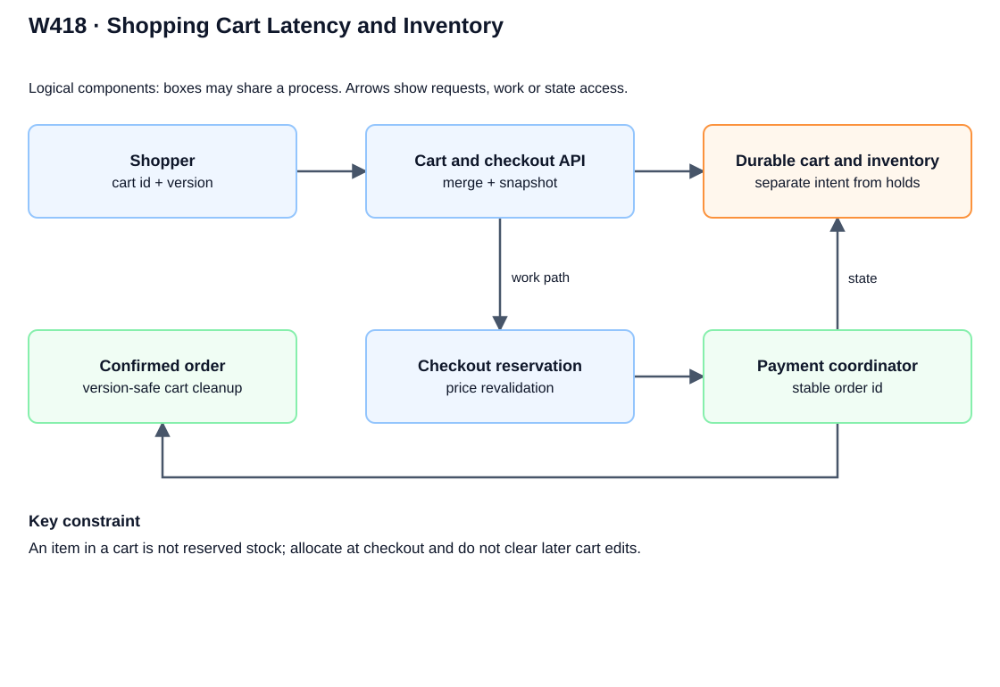

# W418. Shopping Cart Latency and Inventory

**Priority group:** Fifth 100 — specialized practice

**Category:** Inventory, reservations and marketplaces

**Study position:** 418 of 547

[Group list](../FIFTH_100.md) · [All categories](../ALL_CATEGORIES.md) · [Chapter guide](../README.md)

## Question

Design or improve an e-commerce shopping/cart system with fast user-facing operations, out-of-stock handling, duplicate-order prevention, and safe concurrent purchase of scarce inventory. Some versions frame it as improving an existing system; another asks for a shopping-website design with two focused deep dives.

### Requirements

Functional requirements:
Add items to a cart and read the current cart state.
Reflect product availability accurately enough that users are told when an item is out of stock.
Keep cart reads and writes fast under normal traffic.
Support checkout handoff without losing cart state.
Prevent duplicate orders when clients retry or double-submit.
Handle two users attempting to buy the last available item at the same time.
Scale / constraints:
Cart reads and writes are latency-sensitive user actions.
Inventory changes can happen outside the cart service.
Product unavailability should be surfaced quickly, but not every cart view needs a globally serializable inventory read.
Design decisions to discuss:
where cart state lives: cache, database, or hybrid
how inventory updates reach active carts
whether inventory is reserved at add-to-cart or checkout
cache invalidation and stale-product handling
idempotency key / order-state design for duplicate orders
reservation, locking, or conditional-write strategy for scarce inventory
Notes
One version explicitly says the interviewer did not require detailed APIs or data models; the conversation focused on improving an existing system and handling faster latency plus real-time out-of-stock notification.
Another version used a broader shopping-website prompt and then deep-dived on duplicate orders and simultaneous purchase of an out-of-stock / last-item product.
A practical answer separates cart state from inventory source of truth, then uses events or a read-through check to reconcile availability.
Clarify reservation semantics before designing: retail carts usually do not reserve inventory until checkout, while limited-sale systems may need reservations with TTL.

## Worked solution

<!-- architecture:W418:start -->
### Architecture and request flow

[Open the diagram at full size](../diagrams/W418_architecture.svg). This is a baseline component diagram for this question. The boxes describe responsibilities; they do not require a separate microservice for every box.

- **Request and state:** Shopper — cart id + version → Cart and checkout API — merge + snapshot. That component consults or updates **Durable cart and inventory — separate intent from holds** under the required access and consistency rules.
- **Work and result:** the work path passes through **Checkout reservation — price revalidation** and **Payment coordinator — stable order id**, producing **Confirmed order — version-safe cart cleanup**. Bound waiting and retries where a slow dependency can stall this path.
- **Correctness point:** An item in a cart is not reserved stock; allocate at checkout and do not clear later cart edits.

When explaining the drawing, trace one normal request first, then a duplicate request, an unavailable dependency and recovery from saved state. If the question requires stricter guarantees or a different scope, state the change explicitly rather than treating this baseline as the only possible design.
<!-- architecture:W418:end -->

### Solution outline

1. Separate browsing/search availability from authoritative inventory. A listing may be cached, but a hold or purchase must validate the resource and version on the write path.
2. Represent a hold with resource ids, owner, price version and expiry. Acquire it atomically through a conditional update or lock; enforce one active owner per exclusive seat or room-night.
3. Confirm with an idempotent order state machine and durable payment reconciliation. Expired/canceled holds release inventory; failed payment cannot leave an undocumented permanent hold.
4. Protect flash-sale traffic with admission control, short queues and bounded retries. Test simultaneous buyers, expiry/payment races, partial external inventory updates and replayed confirmations.

### Understand why the approach works

#### The browsing view is not the booking authority

Several clients may see the same resource as available. Correctness comes from an atomic hold or purchase transition against authoritative inventory, not from hiding the buy button or decrementing a local cache.

Represent resource id, owner, hold expiry, price/version and lifecycle state. A conditional update such as “available at version $v$ becomes held by request $r$” allows only one winner under the declared exclusivity rule. A hotel night, event seat and fungible stock quantity need different invariants, even when the surrounding API looks similar.

Separate hold, payment, confirmation, cancellation and refund. External systems do not join an ordinary local database transaction; keep pending/unknown states and reconcile. An expired hold racing with payment completion needs a deterministic policy, not two handlers that can independently claim success.

Use idempotency keys and stable order ids so retries do not reserve or charge twice. Queue/admit traffic during a flash sale rather than permitting unlimited contention. Test no inventory, simultaneous buyers, last-millisecond expiry, partial external-provider failure and an acknowledgment lost after a successful confirmation. The failure trace is the core of the design, not an appendix.

### Work a small example

Two clients can both see seat A1 as available, but only one conditional hold may succeed. A timed-out confirmation must be queried before a new payment is submitted.

### Edge cases and common mistakes

Treating a cache decrement as the final inventory authority or promising atomic transactions across an unrelated external hotel provider.

### Check your reasoning on related cases

**Design idempotency for an order or booking API.** A timeout after successful booking should not create a second booking when the client retries the same key.

What if a downstream service is not transactional with your database? Use a durable state machine and reconciliation, not an unsupported exactly-once claim.

**Explain backpressure in a multi-stage data pipeline.** A producer at 1000 items/s feeding a sustained 800 items/s consumer adds 200 queued items every second.

What should an overload response include? A clear retry policy or status, rather than silent loss or indefinite waiting.

### Further study

- [F165: Design idempotency for an order or booking API.](../17_distributed_systems_depth.md#f165)
- [F169: Explain backpressure in a multi-stage data pipeline.](../17_distributed_systems_depth.md#f169)

### Explain it back

Close the answer. State the main invariant or equation, work the example with changed inputs, and explain which assumption would make your solution fail. For a design, walk through a retry or partial failure; for a derivative, check a shape and a finite-difference case.
