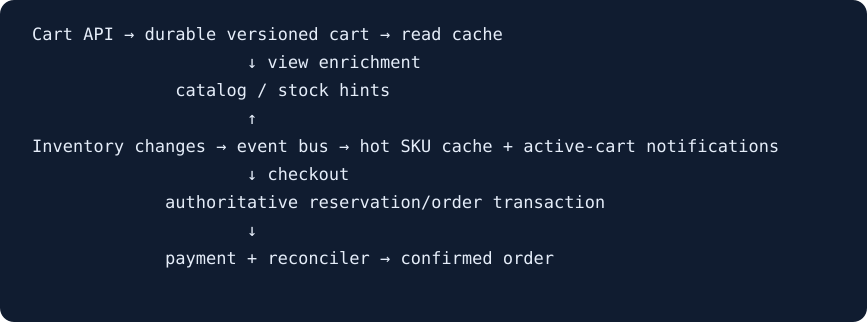

# W418. Shopping Cart Latency and Inventory

**Priority group:** Fifth 100 — specialized practice

**Category:** Inventory, reservations and marketplaces

**Study position:** 418 of 547

[Group list](../FIFTH_100.md) · [All categories](../ALL_CATEGORIES.md) · [Chapter guide](../README.md)

## Question

Design or improve an e-commerce shopping/cart system with fast user-facing operations, out-of-stock handling, duplicate-order prevention, and safe concurrent purchase of scarce inventory. Some versions frame it as improving an existing system; another asks for a shopping-website design with two focused deep dives.

### Requirements

Functional requirements:
Add items to a cart and read the current cart state.
Reflect product availability accurately enough that users are told when an item is out of stock.
Keep cart reads and writes fast under normal traffic.
Support checkout handoff without losing cart state.
Prevent duplicate orders when clients retry or double-submit.
Handle two users attempting to buy the last available item at the same time.
Scale / constraints:
Cart reads and writes are latency-sensitive user actions.
Inventory changes can happen outside the cart service.
Product unavailability should be surfaced quickly, but not every cart view needs a globally serializable inventory read.
Design decisions to discuss:
where cart state lives: cache, database, or hybrid
how inventory updates reach active carts
whether inventory is reserved at add-to-cart or checkout
cache invalidation and stale-product handling
idempotency key / order-state design for duplicate orders
reservation, locking, or conditional-write strategy for scarce inventory
Notes
One version explicitly says the interviewer did not require detailed APIs or data models; the conversation focused on improving an existing system and handling faster latency plus real-time out-of-stock notification.
Another version used a broader shopping-website prompt and then deep-dived on duplicate orders and simultaneous purchase of an out-of-stock / last-item product.
A practical answer separates cart state from inventory source of truth, then uses events or a read-through check to reconcile availability.
Clarify reservation semantics before designing: retail carts usually do not reserve inventory until checkout, while limited-sale systems may need reservations with TTL.

## Worked solution

### Improve the measured bottleneck, while separating intent from stock

The cart records desired items; inventory records what can actually be sold. Keep cart operations on a durable cart store with a cache/versioned read path, and keep stock allocation out of ordinary add/read requests. First trace current latency across network, cart lookup, catalog calls and inventory calls to identify why the existing system is slow.

[Open the architecture diagram](../diagrams/W418_review_architecture.svg).

### Fast cart path and fresh-enough availability

Use a cart ID/user ownership partition, line SKU/variant and positive quantity. Cache recent snapshots and bulk-load product metadata instead of one RPC per line. Persist changes before acknowledging durability; an evicted cache must not erase the shopper's cart. Mutation IDs protect add/increment retries and expected versions handle concurrent quantity edits.

Inventory events update SKU availability hints and notify active viewers of relevant carts through a SKU-to-active-subscription map. Do not rewrite every historical cart containing a popular SKU whenever stock changes. Version events, ignore stale updates and show freshness/unknown states. A periodic/read-through check repairs missed events. Out-of-stock notification is informative; a cached “in stock” badge is not a reservation guarantee.

### Checkout and the last unit

At checkout, freeze the requested cart version, reprice/revalidate rules and create one order using a unique checkout key/request hash. In the inventory authority, conditionally move requested units from available to held only if enough remain, creating the hold/order in the same transaction. With available=1 and two requests for one, only one update succeeds. For multi-item orders use a genuine shared transaction or explicit distributed reservation/compensation semantics.

Claim the valid hold as payment pending before contacting the provider, then use one stable payment operation. Ordinary holds expire, while uncertain payment outcomes require reconciliation or a verified safe void/refund before release. After success, confirm stock/order/outbox once. Duplicate checkout returns the durable order instead of another charge. Clear only the purchased cart snapshot/version so later shopper edits survive.

### Explain trade-offs and failures

Checkout-only holds avoid abandoned-cart hoarding for retail. A scarce sale may justify short holds after controlled admission, not unbounded reservation on every add. If stock service fails, keep viewing/editing carts where possible and show unavailable freshness; do not confirm a purchase from the cache. Lost events are repaired by read-through/replay; provider timeouts remain pending and visible.

Track cart p99, cache hit/age, enrichment fan-out, inventory event lag, out-of-stock notification delay, allocation conflicts, checkout duplicates and pending-payment age. Validate an optimization under real traffic, not only warm-cache microbenchmarks. Test restart/cache loss, old cart prices, concurrent last-unit checkout and retry after a lost order response. The broader [W408 answer](W408.md) supplies the full data model and checkout sequence; the key improvement here is removing unnecessary stock coupling from the latency-sensitive cart path while keeping authoritative checkout strict.
