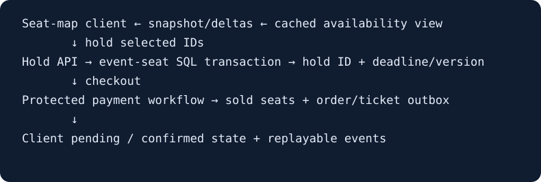

# W419. Ticketmaster-Style Seat Booking Design

**Priority group:** Fifth 100 — specialized practice

**Category:** Inventory, reservations and marketplaces

**Study position:** 419 of 547

[Group list](../FIFTH_100.md) · [All categories](../ALL_CATEGORIES.md) · [Chapter guide](../README.md)

<span class="practice-page"></span>

## Question

Design the backend and the seat-map client of an online ticketing product (like Ticketmaster) that sells reserved seats. Two buyers must never both succeed in buying the same seat, even when many of them compete for the same seats of a popular event at the same moment.

What to cover
1. Seat inventory: the storage model for the seats of an event and the transaction boundary that protects a seat.
2. Seat lifecycle: how a seat moves between available, held and sold, including expiry of holds from abandoned carts.
3. APIs: the calls for reading the seat map, holding seats and checking out, with their request and response shapes, including the response when a seat becomes unavailable during checkout.
4. Concurrency strategy: compare pessimistic holds with optimistic conflict detection at checkout, and justify your choice for a hot event.
5. Frontend seat map: the seat states the client distinguishes and how the map updates after a conflict.
6. Scale and failure modes: how the design copes with heavy contention, and what happens if a downstream step fails.

### Requirements

Users browse an event seat map that shows available, held and sold seats.
Users select seats, hold them and attempt checkout.
The system prevents two users from successfully booking the same seat.
API responses carry enough state for the frontend to update the displayed seat map.
Popular events can have many users competing for the same seats at the same time.

## Worked solution

### Choose pessimistic short holds and expose conflict state

For a hot reserved-seat event, acquire a short authoritative hold before payment. Optimistic final-checkout conflict detection uses fewer long-lived holds but can disappoint many users after they complete checkout forms. A browser selection is local UI state; only a successful hold response grants temporary ownership.



[Open the architecture diagram](../diagrams/W419_review_architecture.svg).

### Storage and lifecycle

EventSeat `(event_id,seat_id)` stores AVAILABLE/HELD/SOLD, hold ID, version and sold ticket reference. Hold stores owner, expiry and status; Order snapshots amount/currency and provider operation. Lock all requested seats in stable order, require all available, and insert one hold/update all or roll back. Unique seat allocation and guarded transitions protect the last-seat race.

Ordinary HELD expires through indexed jobs and current-state checks. Checkout atomically claims a valid hold as PAYMENT_PENDING before the provider call, protecting it from blind expiry while payment is uncertain. Reconcile by stable provider operation key. Only verified success finalizes seats/tickets/order once; failures release only the owning hold when payment cannot later settle, or follow an explicit refund compensation policy.

### API shapes and frontend states

`GET /events/E/seats` returns `{version,seats:[{id,status,price}]}` plus freshness. `POST /holds` takes `{seat_ids,client_key}` and returns `{hold_id,expires_at,version,seats}`. `POST /orders` takes `{hold_id,accepted_quote_id,client_key}` and returns `{order_id,status}`. `GET /orders/{id}` resolves pending outcomes.

A conflict uses HTTP 409, for example:

```json
{"error":"SEATS_UNAVAILABLE","conflicts":[{"id":"A12","status":"SOLD","version":19}],"event_version":87}
```

The client distinguishes available, locally selected, held-by-me, held-by-other, sold, payment-pending and temporarily unknown. On conflict it removes/marks conflicting selections, applies returned versions and lets the user choose alternatives; it must not silently buy a different seat. A local countdown is a display hint based on the server deadline, never the release authority. Reconnect fetches the user's hold/order and latest map versions. Avoid revealing another buyer's identity in availability data.

### Contention and failure

Cache static geometry/CDN assets and publish bounded seat deltas, while admission tokens and per-user limits bound hold traffic. A stale map can be wrong; the transaction still cannot sell twice. Cap lock waits/retries and keep one fenced write authority per event. Provider failure shows pending/error state without creating a new order. A crashed service leaves durable holds for expiry/reconciliation.

Test simultaneous grouped-seat requests, stale map conflicts, duplicate order submits, expiry/payment races, reconnect during payment and delayed/out-of-order deltas. Monitor conflict rate, UI recovery, hold utilization, pending-payment age and sold-seat/ticket reconciliation. A distributed lock without durable ownership/fencing is not sufficient for the stated guarantee.
