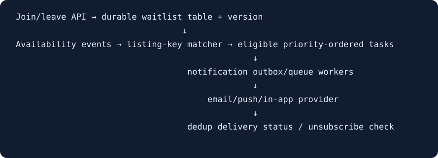

# W420. Waitlist System Design

**Priority group:** Fifth 100 — specialized practice

**Category:** Inventory, reservations and marketplaces

**Study position:** 420 of 547

[Group list](../FIFTH_100.md) · [All categories](../ALL_CATEGORIES.md) · [Chapter guide](../README.md)

## Question

Design a waitlist subsystem: users join a waitlist for a listing; when capacity opens, the system notifies subscribers in priority order. Booking integration is assumed to exist; the design focus is API + schema + notification fan-out.

### Requirements

Functional
join_waitlist(user_id, listing_id, criteria) — add a user with date/price criteria.
leave_waitlist(user_id, listing_id).
When matching availability appears, notify all subscribers whose criteria match.
Idempotent join (duplicate calls do not create multiple entries).
Non-functional
Tens of millions of waitlist rows across the catalog.
Notification fan-out latency under a minute when availability changes.
Cost-effective storage (these rows live for weeks, not seconds).
Scoped out
Actual booking flow (treated as an existing service).
Payment integration.

## Worked solution

### A notification is an opportunity, not a booking

Booking already exists, so this subsystem records interest and informs matching users. It must not promise reserved capacity or add an unnecessary payment flow. All matching subscribers may be notified in priority order; if the product instead wants exclusive first offers, that requires a different lease/offer contract with booking integration.

[Open the architecture diagram](../diagrams/W420_review_architecture.svg).

### API and indexes

`PUT /waitlists/{listing_id}` derives user from authentication and stores criteria such as date range, quantity and maximum price. Unique `(user_id,listing_id)` makes a repeated join idempotent; changed criteria update the row version. `DELETE` marks inactive, and `GET` returns current membership. Store created/priority time, criteria, active/version and notification preferences. Do not allocate a row per second of waiting.

Index active rows by listing plus priority/join time, with coarse date/price partitions where fan-out is large. Incoming availability events contain listing, offered dates/quantity/price and a stable availability version/ID. Deduplicate them, select coarse matching candidates and then apply exact criteria. Event time and current availability must be distinguished; an old event should not advertise inventory already withdrawn.

### Notify within the capacity budget

Create notification tasks with unique `(availability_event_id,waitlist_id,entry_version,channel)` keys and a priority sequence. Enqueue high-priority matches first and enforce fair worker/provider budgets across listings. Queue ordering cannot guarantee the same wall-clock delivery order across email/push providers; state that limitation. Retry transient failures with bounded jitter and expiration so a late notification is not sent days after the opportunity vanished.

Workers recheck active membership/version and consent before sending. A leave/rejoin creates a new version so old tasks cannot send on behalf of the new subscription accidentally. Provider timeouts can still make a delivered notification appear uncertain; use provider dedup keys where supported and avoid claiming exactly-once email.

### Storage and hot listings

At an illustrative thirty million rows of 250 bytes, raw membership is about 7.5 GB before indexes/replicas, making durable SQL/partitioned key-value storage more appropriate than weeks of exclusively in-memory queue state. Partition by listing/hash buckets for hot listings and retain an indexed listing lookup. If one event matches one million subscribers, delivery under sixty seconds needs over 16,667 sends/s plus retries and matching time; verify provider quotas or narrow the SLA to queued/in-app notification and communicate channel delay. Adding workers cannot exceed a provider's hard limit.

Monitor event-to-match/send lag, duplicate suppression, queue age by priority/listing, opt-out races and stale-availability clicks. Test idempotent joins, criteria updates, leave during fan-out, duplicate/out-of-order availability and an oversized hot-listing audience. The existing booking service remains the final authority when a notified user attempts to book.
