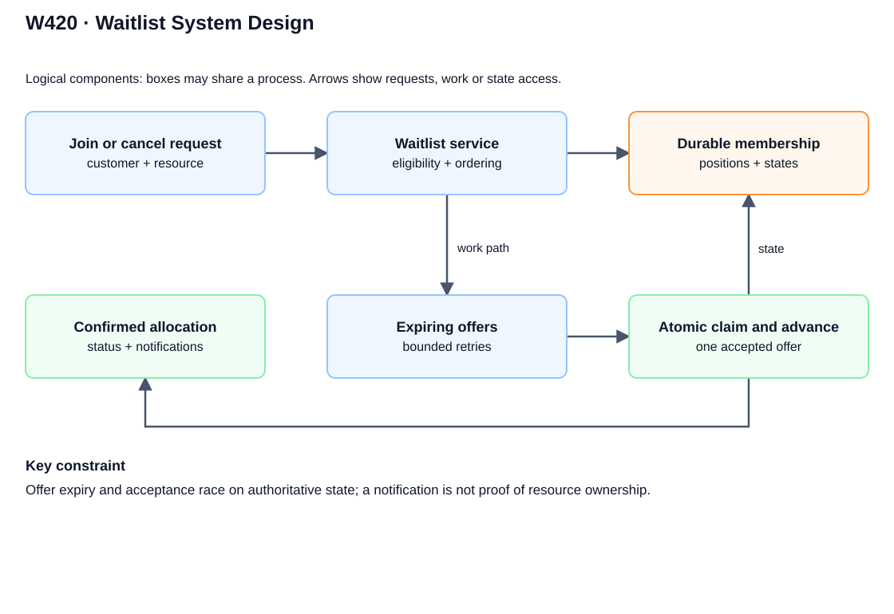

# W420. Waitlist System Design

**Priority group:** Fifth 100 — specialized practice

**Category:** Inventory, reservations and marketplaces

**Study position:** 420 of 547

[Group list](../FIFTH_100.md) · [All categories](../ALL_CATEGORIES.md) · [Chapter guide](../README.md)

## Question

Design a waitlist subsystem: users join a waitlist for a listing; when capacity opens, the system notifies subscribers in priority order. Booking integration is assumed to exist; the design focus is API + schema + notification fan-out.

### Requirements

Functional
join_waitlist(user_id, listing_id, criteria) — add a user with date/price criteria.
leave_waitlist(user_id, listing_id).
When matching availability appears, notify all subscribers whose criteria match.
Idempotent join (duplicate calls do not create multiple entries).
Non-functional
Tens of millions of waitlist rows across the catalog.
Notification fan-out latency under a minute when availability changes.
Cost-effective storage (these rows live for weeks, not seconds).
Scoped out
Actual booking flow (treated as an existing service).
Payment integration.

## Worked solution

<!-- architecture:W420:start -->
### Architecture and request flow

[Open the diagram at full size](../diagrams/W420_architecture.svg). This is a baseline component diagram for this question. The boxes describe responsibilities; they do not require a separate microservice for every box.

- **Request and state:** Join or cancel request — customer + resource → Waitlist service — eligibility + ordering. That component consults or updates **Durable membership — positions + states** under the required access and consistency rules.
- **Work and result:** the work path passes through **Expiring offers — bounded retries** and **Atomic claim and advance — one accepted offer**, producing **Confirmed allocation — status + notifications**. Bound waiting and retries where a slow dependency can stall this path.
- **Correctness point:** Offer expiry and acceptance race on authoritative state; a notification is not proof of resource ownership.

When explaining the drawing, trace one normal request first, then a duplicate request, an unavailable dependency and recovery from saved state. If the question requires stricter guarantees or a different scope, state the change explicitly rather than treating this baseline as the only possible design.
<!-- architecture:W420:end -->

### Solution outline

1. Store a unique membership record, eligibility, join sequence/priority and status. Define whether ordering is FIFO, weighted or policy-based and how cancellations/rejoins affect rank.
2. On capacity availability, atomically select and reserve offers for eligible waiting users; record offer expiry and claim state. Use a lease or transaction to prevent two dispatchers offering the same capacity.
3. Confirm acceptance idempotently, expire unclaimed offers and advance the queue. Notifications are retryable derived effects, not the source of queue position.
4. Expose position estimates honestly when priorities or capacity can change. Test duplicate joins, concurrent releases, expiry/accept races and eligibility changes.

### Understand why the approach works

#### The browsing view is not the booking authority

Several clients may see the same resource as available. Correctness comes from an atomic hold or purchase transition against authoritative inventory, not from hiding the buy button or decrementing a local cache.

Represent resource id, owner, hold expiry, price/version and lifecycle state. A conditional update such as “available at version $v$ becomes held by request $r$” allows only one winner under the declared exclusivity rule. A hotel night, event seat and fungible stock quantity need different invariants, even when the surrounding API looks similar.

Separate hold, payment, confirmation, cancellation and refund. External systems do not join an ordinary local database transaction; keep pending/unknown states and reconcile. An expired hold racing with payment completion needs a deterministic policy, not two handlers that can independently claim success.

Use idempotency keys and stable order ids so retries do not reserve or charge twice. Queue/admit traffic during a flash sale rather than permitting unlimited contention. Test no inventory, simultaneous buyers, last-millisecond expiry, partial external-provider failure and an acknowledgment lost after a successful confirmation. The failure trace is the core of the design, not an appendix.

### Work a small example

Replaying a “one spot opened” event must not issue two independently claimable offers for the same spot.

### Edge cases and common mistakes

Treating notification delivery as acceptance or promising an exact fixed wait time under uncertain capacity.

### Check your reasoning on related cases

**Design idempotency for an order or booking API.** A timeout after successful booking should not create a second booking when the client retries the same key.

What if a downstream service is not transactional with your database? Use a durable state machine and reconciliation, not an unsupported exactly-once claim.

**Design a durable work queue with retries and leases.** If a worker completes a side effect and crashes before acknowledgment, the task can be delivered again.

How do fencing tokens help? They allow downstream systems to reject writes from an expired owner.

### Further study

- [F165: Design idempotency for an order or booking API.](../17_distributed_systems_depth.md#f165)
- [F162: Design a durable work queue with retries and leases.](../17_distributed_systems_depth.md#f162)

### Explain it back

Close the answer. State the main invariant or equation, work the example with changed inputs, and explain which assumption would make your solution fail. For a design, walk through a retry or partial failure; for a derivative, check a shape and a finite-difference case.
