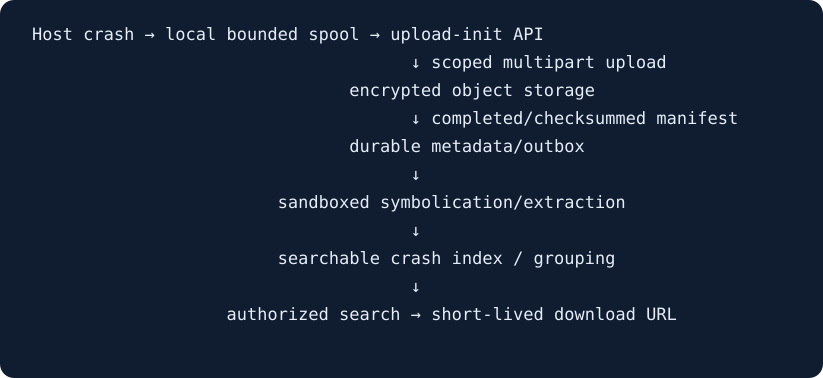

# W421. Core Dump Collection System Design

**Priority group:** Fifth 100 — specialized practice

**Category:** Logs, metrics and observability

**Study position:** 421 of 547

[Group list](../FIFTH_100.md) · [All categories](../ALL_CATEGORIES.md) · [Chapter guide](../README.md)

## Question

Design a core-dump collection system. Agents on many hosts upload crash artifacts; the backend stores large binaries durably and extracts searchable metadata; engineers query, group, and download dumps for debugging; and the platform enforces retention, access control, and scale limits.

Functional requirements:

Collect core dumps / crash artifacts from many hosts or services.
Store large binary dumps durably while extracting searchable metadata (service, host, version, timestamp, signal, stack signature).
Let engineers search, group, and download relevant dumps.
Enforce access control, retention, and deletion (dumps may contain sensitive memory).

Constraints to clarify: dumps are large; crash spikes after a bad deploy cause bursty ingestion; retention cost matters.

## Worked solution

### Keep large binaries out of the metadata database

An agent detects a crash, captures a bounded artifact and uploads it durably. The backend records service/build/host/time/signal, extracts stack signatures and lets authorized engineers search and download. Core dumps can contain credentials and user memory, so access, isolation and retention are part of the core design.

[Open the architecture diagram](../diagrams/W421_review_architecture.svg).

### Upload and processing contracts

`POST /dumps` accepts service/build, size/checksum and an idempotency key, validates tenant/quota and issues a short-lived upload token scoped to one object. Multipart/resumable uploads avoid restarting multi-GB artifacts after a network interruption. Finalization verifies size/checksum/object completion before marking the dump AVAILABLE and creating an extraction job. Incomplete multipart uploads have lifecycle cleanup; they must not appear as downloadable complete dumps.

The agent uses a disk quota, bandwidth limit and priority/sampling policy. A bad deployment causing thousands of crashes must not fill every host disk or saturate production networks. Record dropped/sampled counts and retain useful first examples plus representative build/signature samples. A backend acknowledgement follows durable object/manifest acceptance, not just receipt by one API process.

### Metadata, grouping and query

Store dump ID, tenant/service, build ID, host, event/ingest time, signal, object/version/checksum, size, extraction state, signature and retention deadline. Index service/build/time/signature; group by normalized stack frames/build rather than raw ASLR addresses. Preserve original extraction versions so re-symbolication with corrected symbols is reproducible. Match symbols to the exact trusted build, and run parsers in a resource-limited sandbox because malformed binaries can exploit or exhaust them.

Search uses bounded pagination and account/service authorization. Download requires a fresh authorization check and short-lived signed object access, with an access audit. Broad “all engineers” access is inappropriate when dumps contain sensitive memory. Redaction/minidumps reduce exposure but cannot guarantee every secret was removed; encryption, least privilege and retention remain necessary.

### Size bursts and enforce deletion

For an illustrative one thousand one-GB dumps in a bad-deploy hour, ingest is one TB/hour, about 278 MB/s payload before replication/retries. Thirty days at ten TB/day means 300 TB primary storage, so size caps, dedup/group-aware sampling, compression and lifecycle tiering have substantial impact. These are assumptions; obtain actual crash/dump size distributions.

Retention deletes the object, metadata/search references and derived symbolication artifacts under a recorded tombstone/workflow; retries cannot resurrect an expired dump. Keep legally/operationally required audit metadata separately from raw memory retention. Reconcile orphan objects and missing index records. Test partial uploads, duplicate finalization, checksum mismatch, symbol mismatch, extractor crash, unauthorized download and burst quota behavior. Monitor spool age, dropped captures, upload completion, extraction lag, storage growth, deletion completion and access anomalies.
