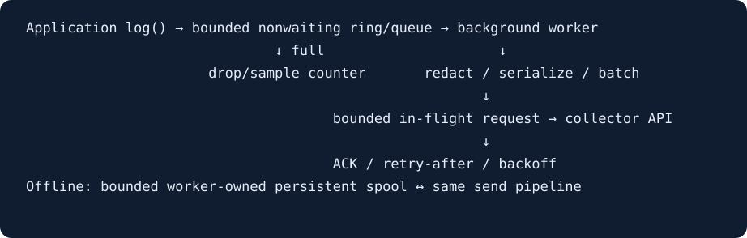

# W422. Cross-Platform Client Logging Library

**Priority group:** Fifth 100 — specialized practice

**Category:** Logs, metrics and observability

**Study position:** 422 of 547

[Group list](../FIFTH_100.md) · [All categories](../ALL_CATEGORIES.md) · [Chapter guide](../README.md)

## Question

Design a logging library that runs on both web (browser SPA) and mobile (iOS/Android) clients and ships logs to a backend collector without degrading client-side performance.

Logs are emitted by application code and must reach a backend collector.
Hard constraint: emitting a log must never block the calling thread or noticeably degrade UX.
The backend has a single ingest API; throughput from any client is variable and can spike.
Drive hard on backpressure: what happens when call volume grows and the in-flight batch gets too large to send.

## Worked solution

### Bound the work done by the logging call

The application thread should enqueue a small immutable event and return; it must not wait for disk, network, batching or retries. Set a maximum event size/field budget and avoid expensive recursive serialization/stack capture on every call. A literal zero-pause guarantee is impossible in ordinary browser/mobile runtimes because scheduling and GC can pause execution, so the implementable contract is bounded application work with no deliberate blocking, validated against UX/frame-time budgets.

[Open the architecture diagram](../diagrams/W422_review_architecture.svg).

### Queue and batch policy

Define event ID, session sequence, severity, event/monotonic time, schema and approved fields. Copy only bounded primitive data or require immutable event input; otherwise a caller can mutate the log after enqueue. In multithreaded mobile code, use an appropriate bounded concurrent queue or a try-lock/drop policy—waiting on a contested mutex violates the stated emission contract. Browser serialization can run in a Web Worker; native apps use a dedicated executor.

For example, cap queued encoded data at one MB, one event at eight KB, batches at64 KB or one second, and two in-flight requests. These are chosen limits to benchmark. A full queue drops/samples low-priority records with counters, reserves bounded space for higher severity and eventually drops even high severity rather than exhausting memory. A larger batch is not an unbounded escape hatch. Split oversized batches at event boundaries after a413; drop/quarantine a single over-limit event.

### One ingest API under variable throughput

The collector accepts a batch ID plus unique event IDs, enforces tenant/device quotas and returns per-batch/per-event acknowledgement as its contract requires. Retry transient failures with capped exponential jitter, honor429/Retry-After, and stop retrying permanent validation/auth errors until corrected. A timed-out request may already have arrived, so backend deduplication is necessary. Preserve queue ordering where useful but allow controlled sampling; do not let a poison record block every later event.

Offline buffering has byte/age quotas and backpressure too. Disk writes happen in the worker, and storage can be evicted or unavailable. On browser page hide, `sendBeacon`/keepalive may improve delivery but does not prove durable collector receipt. Mobile background execution is OS-limited. The combination of never-waiting emission, finite memory/storage and arbitrary outages cannot promise lossless delivery; state the bounded-loss policy and expose counters.

### Privacy, lifecycle and tests

Filter sensitive fields by an allowlisted schema before transmission, partition data by account, expire it and avoid placing secrets in logs. Configuration changes can adjust levels/sampling without application logic branches. Avoid sending logs about transport failure recursively through the same failing queue.

Test sudden producer spikes, queue overflow, slow collectors,413/429, duplicate ACK loss, offline/online transitions, app suspension and logout/account change. Measure log-call p99, frame drops, battery/CPU, memory, spool size and end-to-end loss. A transport worker that is reliable but drains the battery still fails the client-library requirement.
