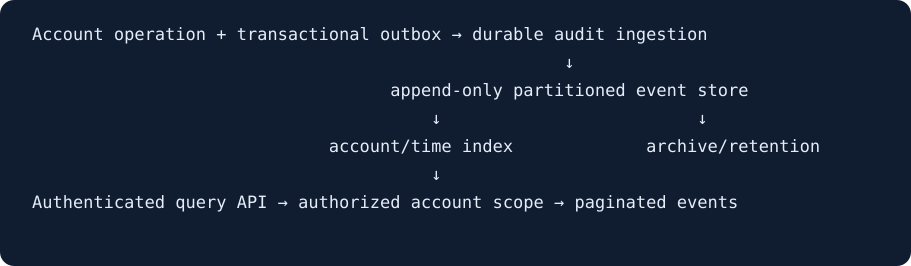

# W423. Design an Audit Logs Service

**Priority group:** Fifth 100 — specialized practice

**Category:** Logs, metrics and observability

**Study position:** 423 of 547

[Group list](../FIFTH_100.md) · [All categories](../ALL_CATEGORIES.md) · [Chapter guide](../README.md)

## Question

Design an audit-log service where users can query audit events belonging to their own account.

Audit events are generated from account activity and retained as an append-only transaction log.
The query path must support low-latency, account-scoped lookups.
Design the storage model for the transaction logs and the query indexes.
Discuss scaling as log volume and account count grow.
Authorization is part of the read path: a user must never query another account's audit log.

## Worked solution

### Enforce account scope before querying

Audit events describe actions and must remain append-only under the retention policy. Each event contains event ID, account, actor, action/resource, outcome, trusted event/ingest time, schema/version and correlation ID. Actor identity is not necessarily the owning account; an administrator's action may affect another account and needs explicit attribution.

[Open the architecture diagram](../diagrams/W423_review_architecture.svg).

### Capture without a lost-write window

When a business operation commits in its own database, write an audit outbox event in the same transaction. A relay may retry, so the audit sink has a unique event ID and idempotent insert. This avoids a successful account change followed by a lost best-effort logging RPC. It is not a distributed transaction across every business service; each producer must define its own capture boundary. Sensitive rejected attempts may need a separate durable security-event path.

Store immutable canonical events durably, then build query indexes by `(account_id,event_time,event_id)`, partitioning large histories by account hash and time. An analytical search index can add action/resource filters, but the original record remains the source of truth. Use stable pagination cursors including query scope and `(time,id)` tie-break; timestamps alone can collide. State ingestion freshness and handle late events/corrections with appended follow-up records rather than editing history invisibly.

### Authorization, scale and retention

Derive allowed accounts from the authenticated principal and account membership/role checks. Never trust a request's account ID merely because it appears in a filter. Apply the same account predicate to storage, cache keys, exports, cursor validation and object downloads; recheck permissions on each page. Service-to-service calls use scoped workload identity. Cross-account administrator access is separately authorized and audited.

Use immutable/WORM storage where the threat/compliance model requires it, integrity checks and separated write/read/admin privileges. Hash chains can help detect some changes but need trusted anchoring and do not replace access control. Redact/minimize sensitive payload fields before capture; append-only storage is a poor place to retain unnecessary secrets forever. Define retention/deletion/legal-hold policy and make it auditable rather than claiming immutable means no lifecycle management.

Partition/index by measured hot-account volume and archive old segments to cheaper object storage. Common recent-account reads can use a scoped cache with freshness; wide exports become bounded asynchronous jobs. Monitor producer/outbox lag, duplicate/missing events, query p99, per-account skew, retention completion and denied access. Test forged account IDs/cursors, stale membership, retries, late events, index outage and a cache key missing tenant scope.
