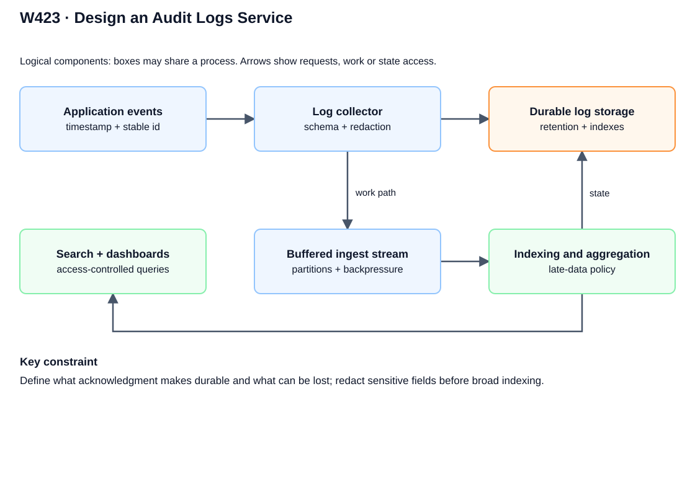

# W423. Design an Audit Logs Service

**Priority group:** Fifth 100 — specialized practice

**Category:** Logs, metrics and observability

**Study position:** 423 of 547

[Group list](../FIFTH_100.md) · [All categories](../ALL_CATEGORIES.md) · [Chapter guide](../README.md)

## Question

Design an audit-log service where users can query audit events belonging to their own account.

Audit events are generated from account activity and retained as an append-only transaction log.
The query path must support low-latency, account-scoped lookups.
Design the storage model for the transaction logs and the query indexes.
Discuss scaling as log volume and account count grow.
Authorization is part of the read path: a user must never query another account's audit log.

## Worked solution

<!-- architecture:W423:start -->
### Architecture and request flow

[Open the diagram at full size](../diagrams/W423_architecture.svg). This is a baseline component diagram for this question. The boxes describe responsibilities; they do not require a separate microservice for every box.

- **Request and state:** Application events — timestamp + stable id → Log collector — schema + redaction. That component consults or updates **Durable log storage — retention + indexes** under the required access and consistency rules.
- **Work and result:** the work path passes through **Buffered ingest stream — partitions + backpressure** and **Indexing and aggregation — late-data policy**, producing **Search + dashboards — access-controlled queries**. Bound waiting and retries where a slow dependency can stall this path.
- **Correctness point:** Define what acknowledgment makes durable and what can be lost; redact sensitive fields before broad indexing.

When explaining the drawing, trace one normal request first, then a duplicate request, an unavailable dependency and recovery from saved state. If the question requires stricter guarantees or a different scope, state the change explicitly rather than treating this baseline as the only possible design.
<!-- architecture:W423:end -->

### Solution outline

1. Collect immutable events/artifacts with stable ids, timestamps, actor or process identity, schema version and integrity metadata. Buffer and transport with bounded resource use so collection does not crash the primary workload.
2. For core dumps, encrypt and restrict access because memory can contain credentials and personal data; deduplicate by content/signature and separate metadata search from large-object storage.
3. For audit logs, use append-only authorized writes, ordered sequence/checkpoint verification and retention/legal-hold policies as applicable. Avoid claiming cryptographic immutability without defining the trust and key model.
4. Support retry/replay, ingestion lag monitoring and controlled deletion/expiry. Query by indexed metadata and provide evidence of missing/gapped records rather than silently presenting an incomplete audit as complete.

### Understand why the approach works

#### Preserve enough information to aggregate correctly

Logs describe events; counters, gauges and histograms summarize different measurements. A counter increment is not interchangeable with the current number of live objects, and a gauge may decrease for legitimate reasons.

For latency, percentiles are not mergeable by averaging them. Combine raw observations or compatible histogram/sketch state, then compute the requested quantile. An average is mergeable through sum and count, but carries different information from a tail measure.

Keep client queues bounded and state whether an emit call means accepted in RAM, written or durably flushed. Batch/fsync group commit can amortize I/O, but acknowledging before the required flush weakens durability. Backpressure/drop policy must protect the application rather than cause an outage while observing it.

Use event and ingest timestamps for late data, and avoid unbounded labels such as a unique request id in every metric series. Alert on sustained actionable conditions with deduplication and recovery state. Test collector failure, disk-full conditions, malformed records and counter resets. Security also matters: core dumps and diagnostic payloads may contain credentials, so indexing convenience must not imply broad access.

### Work a small example

A log line acknowledging a transfer is not a replacement for the ledger transaction; a core dump should never be placed in a public diagnostic bucket.

### Edge cases and common mistakes

Logging raw secrets or confusing ordinary writable application logs with an audited append-only trail.

### Check your reasoning on related cases

**Explain backpressure in a multi-stage data pipeline.** A producer at 1000 items/s feeding a sustained 800 items/s consumer adds 200 queued items every second.

What should an overload response include? A clear retry policy or status, rather than silent loss or indefinite waiting.

**Design a cache without serving incorrect data.** Two identical question strings from users with different document permissions must not automatically share a retrieved-answer cache entry.

Why can invalidation be preferable to TTL alone? Critical updates may need to take effect sooner than the ordinary expiry window.

### Further study

- [F169: Explain backpressure in a multi-stage data pipeline.](../17_distributed_systems_depth.md#f169)
- [F170: Design a cache without serving incorrect data.](../17_distributed_systems_depth.md#f170)

### Explain it back

Close the answer. State the main invariant or equation, work the example with changed inputs, and explain which assumption would make your solution fail. For a design, walk through a retry or partial failure; for a derivative, check a shape and a finite-difference case.
