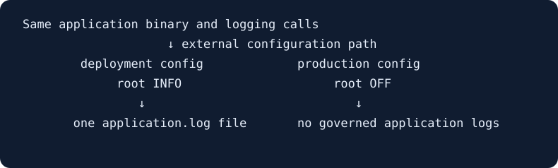

# W424. Environment-specific Logging Without Code Modifications

**Priority group:** Fifth 100 — specialized practice

**Category:** Logs, metrics and observability

**Study position:** 424 of 547

[Group list](../FIFTH_100.md) · [All categories](../ALL_CATEGORIES.md) · [Chapter guide](../README.md)

<span class="practice-page"></span>

## Question

Given two environments (prod and deployment) with identical codebases, accomplish the following: Record logs only in the deployment environment and not in the prod environment without changing the code logic. All logs should be written to the same file.

### Constraints

Do not add any environment-check logic in the code.
Do not use a load balancer.
Do not utilize multiple servers.
It is a monolithic environment setup.

How can this be achieved?

Example
Input
logging environment settings in the configuration file

## Worked solution

### Configure the logger externally

Use the same application binary and logging calls in both environments, but supply different logging configuration at the same external path. The deployment configuration routes the root logger to one file; the production configuration turns logging off. No load balancer, second server or application `if environment` branch is needed.

This assumes the monolith already uses a configurable logging framework. If it writes directly with `print`, raw file calls or a native library that ignores that framework, a logger configuration cannot magically suppress every output without changing its capture/runtime setup. State that limitation rather than claiming an arbitrary program obeys an unrelated config file.



[Open the architecture diagram](../diagrams/W424_review_architecture.svg).

### Concrete Logback example

For an application already using SLF4J/Logback, start the unchanged process with the standard external configuration property:

```sh
java -Dlogback.configurationFile=/etc/myapp/logback.xml -jar myapp.jar
```

In the deployment environment, `/etc/myapp/logback.xml` contains:

```xml
<configuration>
  <appender name="ONE_FILE" class="ch.qos.logback.core.FileAppender">
    <file>/var/log/myapp/application.log</file>
    <append>true</append>
    <encoder>
      <pattern>%date %-5level [%thread] %logger - %msg%n</pattern>
    </encoder>
  </appender>
  <root level="INFO">
    <appender-ref ref="ONE_FILE"/>
  </root>
</configuration>
```

In production, the file instead contains:

```xml
<configuration>
  <root level="OFF"/>
</configuration>
```

Only framework-managed application logs at configured deployment levels go to that single file; set DEBUG if lower-severity messages are required. Audit any package-specific logger/appender configuration so it does not bypass or duplicate the root route. Deployment creates/permissions the directory and chooses file ownership; the application does not infer its environment.

### Explain the operational boundary

“All logs in the same file” means one configured destination for the monolith's governed loggers, not multiple files per module. Add rotation/retention with a rolling appender if required, defining whether rotated segments still satisfy the intent. If two independent processes actually write one path, safe concurrent rotation needs a separate plan; the stated single-monolith setup avoids that complication.

Validate with the same startup binary in each environment: emit representative framework logs, confirm the deployment file receives them once, and confirm production emits none through the governed framework. Inspect stdout/access/native logs separately if “all logs” literally includes them. Disabling production logs also removes diagnostic evidence, so confirm that this is the intended operational requirement; the technical mechanism remains configuration, not environment checks added to business code.
